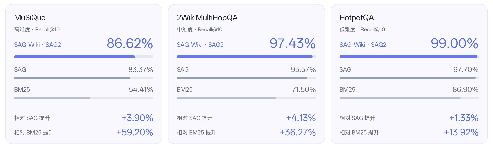
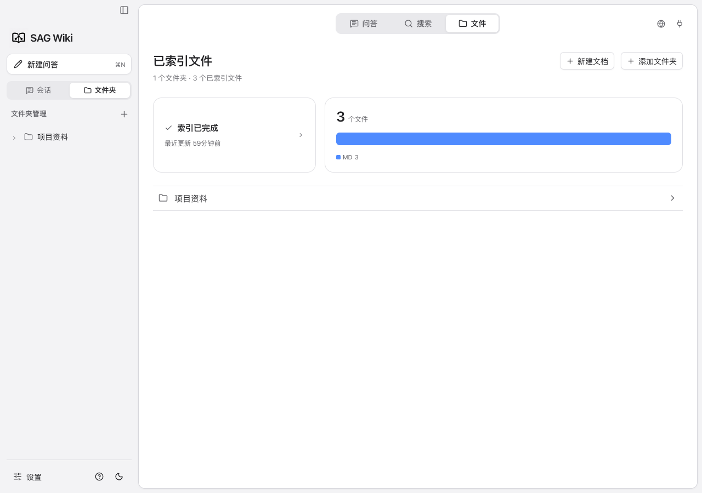
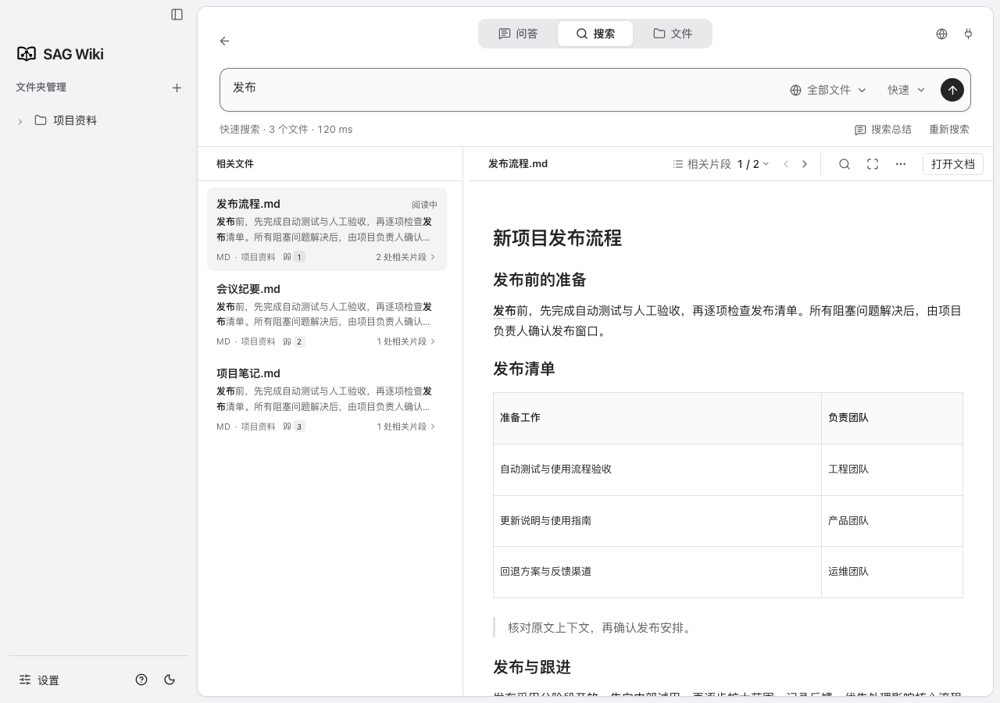
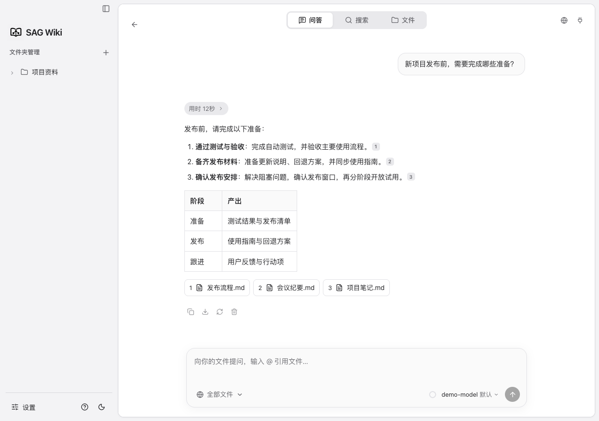
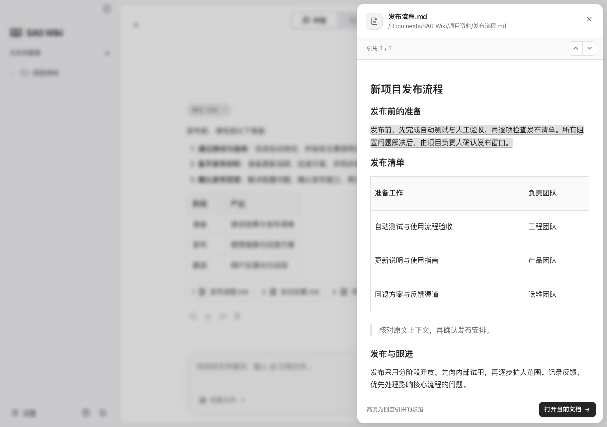
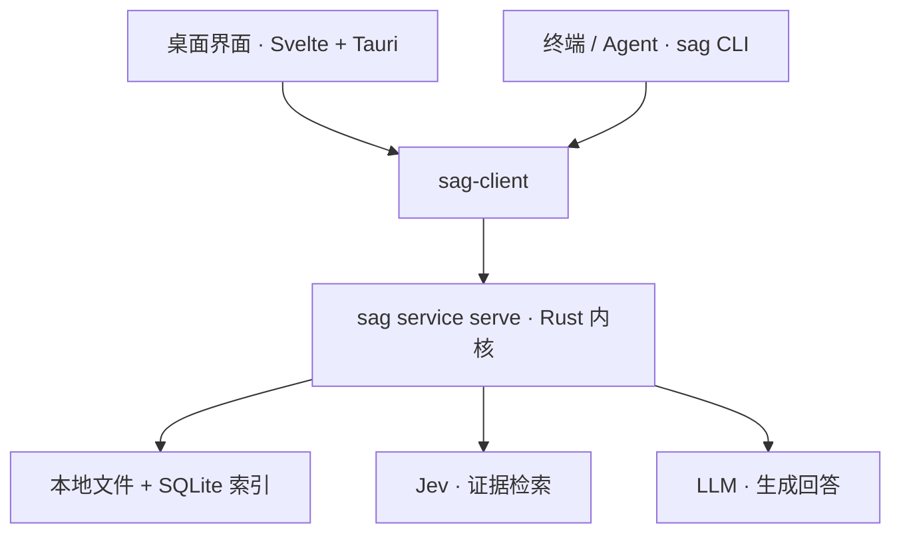

<p align="center">
  
</p>

<h1 align="center">SAG-Wiki</h1>

<p align="center">
  <a href="README.md">English</a> · <strong>简体中文</strong> · <a href="CHANGELOG.md">更新日志</a>
</p>

<p align="center">
  <a href="https://arxiv.org/abs/2610.22588"></a>
  <a href="https://github.com/Zleap-AI/SAG-Wiki/releases/tag/v0.1.5"></a>
  
  
  
  <a href="LICENSE"></a>
</p>

<p align="center"><strong>轻量易用，极速索引，精准检索。</strong></p>

<p align="center">
  面向个人与 Agent 的轻量知识库。索引与检索不调用 LLM，让本地文档、笔记和代码随时可查，问答有据可循。
</p>

https://github.com/user-attachments/assets/082b64d1-a9d1-4697-a0e4-3ba24397da94

## 目录

<p align="center">
  <a href="#project">项目介绍</a> ·
  <a href="#technology">技术原理</a> ·
  <a href="#user-guide">用户指南</a> ·
  <a href="#agent-guide">Agent 指南</a> ·
  <a href="#developer-guide">开发者指南</a> ·
  <a href="#community">社区交流</a>
</p>

---

<a id="project"></a>

## 一分钟了解 SAG-Wiki

| 系统 | 下载 | 大小 |
| --- | --- | --- |
| macOS | [v0.1.8](https://github.com/Zleap-AI/SAG-Wiki/releases/download/v0.1.8/SAG-Wiki-0.1.8-macOS-arm64.dmg) | 14.0MB |
| Windows | [v0.1.8](https://github.com/Zleap-AI/SAG-Wiki/releases/download/v0.1.8/SAG-Wiki-0.1.8-Windows-x64-setup.exe) | 10.7MB |

**给 Agent 安装**

```text
请安装 https://github.com/Zleap-AI/SAG-Wiki/blob/main/cli/skills/sag/SKILL.md 并按其中的 setup 流程配置当前项目。
```

安装包大小不含按需下载的文档转换组件和识别模型。

添加一个文件夹，就能搜索其中的文档、笔记和代码。查找原文、跨文件提问、核对答案出处，也可以让编程 Agent 使用同一份知识库。

- **轻**：安装包仅约 **14 MB**，无需额外安装数据库。
- **快**：百万字索引约 **200 ms**，索引和检索不调用 LLM。
- **准**：原创 **SAG2** 检索技术，检索效果超越 RAG、GraphRAG 等。

你还可以编辑 Markdown、阅读 HTML、探索文档关联，或直接在终端搜索。按需启用文档转换组件后，PDF、Office 等格式也能加入同一知识库。

### 与 LLM Wiki、RAG 的区别

| 功能 | **SAG-Wiki** | LLM Wiki | 典型向量 RAG |
| --- | --- | --- | --- |
| 开始使用 | **添加本地文件夹** | 让 Agent 阅读资料并维护 Wiki 页面 | 导入文档、切片并建立向量索引 |
| 建库依赖 | **不调用 LLM，无需 Embedding** | LLM 生成和维护摘要、页面与链接 | Embedding 模型生成文档向量 |
| 检索内容 | **原始文档，保留段落位置** | 模型整理后的 Wiki 页面 | 已建立索引的文档切片 |
| 文件更新 | **监听本地文件，增量更新索引** | 让 Agent 更新相关页面 | 更新受影响的切片和向量 |
| 查找信息 | **SAG2 跨文件精准检索** | 阅读和查询已整理的页面与链接 | 向量相似度召回，可配合重排 |
| 日常使用 | **桌面搜索、引用问答、文档编辑、关联探索** | Agent 工作流与 Markdown 编辑器 | 取决于具体应用 |
| Agent 接入 | **独立 CLI 与可安装的 Skill** | 通过指令维护和读取 Wiki | 通过应用提供的工具或 API |

对照采用 [Karpathy 的 LLM Wiki 模式](https://gist.github.com/karpathy/442a6bf555914893e9891c11519de94f)与[典型向量 RAG 流程](https://docs.langchain.com/oss/python/deepagents/retrieval)，具体功能随实现而异。

---

<a id="technology"></a>

## 技术原理

SAG-Wiki 基于我们原创的 **SAG2 检索方法**。本地建库无需向量模型或 LLM，检索时通过 Jev 判断证据价值，按需扩展查找范围，找出跨文档的相关原文。需要生成回答时，再调用用户配置的 LLM。

https://github.com/user-attachments/assets/439bbb1c-3fd8-41e1-a77b-865e8dce4d48

<p align="center">
  
</p>

<sub>图中 SAG-Wiki 展示其底层 SAG2 的基准结果，指标为前 10 条结果的证据召回率。SAG2 每项评测 1,000 题，MuSiQue 用于方法开发；SAG、BM25 为原 SAG 论文参考值。难度为展示分级，相对提升按图示分数计算。</sub>

**[阅读 SAG2 论文](https://arxiv.org/abs/2610.22588)** · 完整原理、实验结果和复现代码请查看 **[SAG-Benchmark](https://github.com/Zleap-AI/SAG-Benchmark)**。

---

<a id="user-guide"></a>

## 用户指南

| 功能 | 使用条件 |
| --- | --- |
| 文件索引、快速搜索 | 添加文件夹即可，无需 API Key |
| SAG2 精准检索 | 配置 Jev 服务；需要鉴权时填写 API Key |
| 引用问答 | 配置问答模型与 API Key；使用 SAG2 检索时还需 Jev 配置 |

SAG-Wiki 本身开源免费，外部服务是否收费及费用以所选服务商为准。原文件保留在本地；深入检索与问答会将所需问题、文档片段或上下文发送给你配置的服务。

### 1. 下载，添加文件夹

从上方表格下载 DMG，打开后将 SAG Wiki 拖入 Applications。当前 macOS 版本尚未通过 Apple 公证，首次打开可能出现系统安全提示。

安装并打开 SAG-Wiki，点击“文件夹管理”旁的 **+**，添加需要检索的文件夹。原文件保留在原处。

<p align="center">
  
</p>

### 2. 搜索，查看原文

索引完成后，在“搜索”中输入要查找的内容，点击结果即可查看原文。快速搜索可直接在本地使用；在“设置 → 模型设置”配置 Jev 后，可以使用深入语义检索。

接入本地 Jev 时，选择“自定义”，填写服务提供的模型名称及基础地址（如 `http://127.0.0.1:8000/v1`），或完整的 `/systemone`、`/decisions` 接口地址。服务不要求 API Key 时，将“Jev 鉴权方式”设为“无需鉴权”；此模式不发送鉴权头，并移除已保存的 Jev 密钥。服务需兼容 Jev 的 `state`、`questions` 与 `answers.*.noul` 协议。CLI 可运行 `sag config --url http://127.0.0.1:8000/v1 --model YOUR_MODEL --auth none`；切回需要密钥的服务时使用 `--auth bearer --key-stdin`，并输入该服务的密钥。

<p align="center">
  
</p>

### 3. 提问，核对出处

在“设置 → 模型设置”配置问答模型后，进入“问答”直接提问。输入 `@` 可以指定文件，点击答案中的引用即可查看对应原文。

<p align="center">
  
</p>

<p align="center">
  
</p>

---

<a id="agent-guide"></a>

## Agent 指南

把这句话发给 Agent：

```text
请安装 https://github.com/Zleap-AI/SAG-Wiki/blob/main/cli/skills/sag/SKILL.md 并按其中的 setup 流程配置当前项目。
```

支持 **Claude Code、Codex、OpenCode**。Skill 包含 CLI 安装、配置、项目索引和验证流程。**无需安装 SAG Wiki 桌面端，也能单独使用 CLI**；安装桌面端后，两者共用配置和知识库。已有配置会直接复用，使用 API Key 鉴权时，首次语义检索需要在终端中私密填写自己的 Jev API Key。统一以 GitHub 上的 Skill 链接为安装入口，Agent 会从同一目录获取配套文件。

安装 Node.js 18 或以上版本后，运行：

```sh
npm install -g @zleap-ai/sag
```

已发布的 **0.1.5** npm 包包含 **macOS Apple Silicon 和 Windows x64** 程序，无需 Rust 工具链或源码编译。安装 CLI 不会安装桌面端。

<details>
<summary>手动安装与使用</summary>

已有 `sag` 命令可直接复用；没有则运行上面的 npm 安装命令，然后在终端中检查版本并完成首次 Jev 配置：

```sh
sag --version
sag
```

将链接中的 [Skill 文件夹](https://github.com/Zleap-AI/SAG-Wiki/tree/main/cli/skills/sag)（包含 `SKILL.md` 和 `references/`）放到对应 Agent 的目录：

| Agent | Skill 文件夹 |
| --- | --- |
| Codex | `~/.agents/skills/sag/` |
| Claude Code | `~/.claude/skills/sag/` |
| OpenCode | `~/.config/opencode/skills/sag/` |

新开 Agent 会话。在需要检索的项目目录运行，确认索引就绪后开始搜索：

```sh
sag add
sag check
sag "权限在哪里检查？" . -m 5
```

完整的 Agent 安装流程见 Skill 的 [setup 指南](cli/skills/sag/references/setup.md#first-use-setup)，其他命令见 [CLI 使用说明](docs/zh-CN/CLI与Harness使用说明.md)。

</details>

---

<a id="developer-guide"></a>

## 开发者指南

**Rust CLI 提供底层运行能力。** `sag` 可执行文件启动统一的本机服务，命令行和 Tauri 桌面端通过同一个客户端连接服务。索引、检索和模型配置共用同一内核，退出桌面后 CLI 仍可使用。



| 目录 | 内容 |
| --- | --- |
| `src/` | 桌面界面 |
| `src-tauri/` | 桌面系统功能与服务连接 |
| `cli/` | 命令行入口与 Skill 安装 |
| `core/` | 索引、检索和问答 |
| `client/`、`protocol/` | 客户端通信与协议 |

按[环境说明](docs/zh-CN/开发指南.md#环境)准备 Node.js、Rust 和对应系统的 Tauri 开发依赖，然后运行：

```sh
git clone https://github.com/Zleap-AI/SAG-Wiki.git
cd SAG-Wiki
npm ci
npm run tauri dev
```

修改后运行 `npm run check` 和 `npm test`，完整检查命令见[代码检查](docs/zh-CN/开发指南.md#代码检查)。构建和实现细节见[开发指南](docs/zh-CN/开发指南.md)、[架构设计](docs/zh-CN/架构设计.md)与[文档目录](docs/zh-CN/README.md)。

---

## 参与贡献与许可

欢迎通过 [Issues](https://github.com/Zleap-AI/SAG-Wiki/issues) 反馈问题，通过 [Pull Requests](https://github.com/Zleap-AI/SAG-Wiki/pulls) 参与开发。应用修改请参照[开发指南](docs/zh-CN/开发指南.md)；检索研究与实验复现请前往 [SAG-Benchmark](https://github.com/Zleap-AI/SAG-Benchmark)。

SAG-Wiki 使用 [MIT 许可证](LICENSE)。第三方依赖许可保留在 [src-tauri/licenses](src-tauri/licenses/) 中。

---

<a id="community"></a>

## 社区交流

欢迎加入 SAG 的 Discord 或微信社区，与维护者和其他用户交流。

<table align="center">
  <tr>
    <th>Discord</th>
    <th>微信</th>
  </tr>
  <tr>
    <td align="center"></td>
    <td align="center"></td>
  </tr>
</table>
