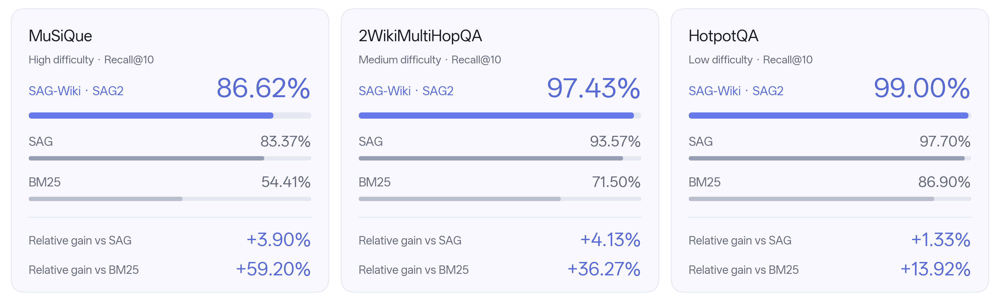
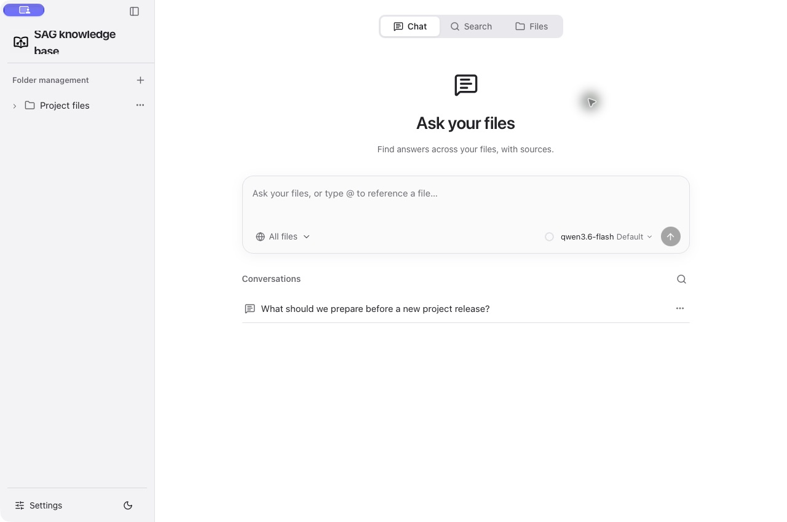
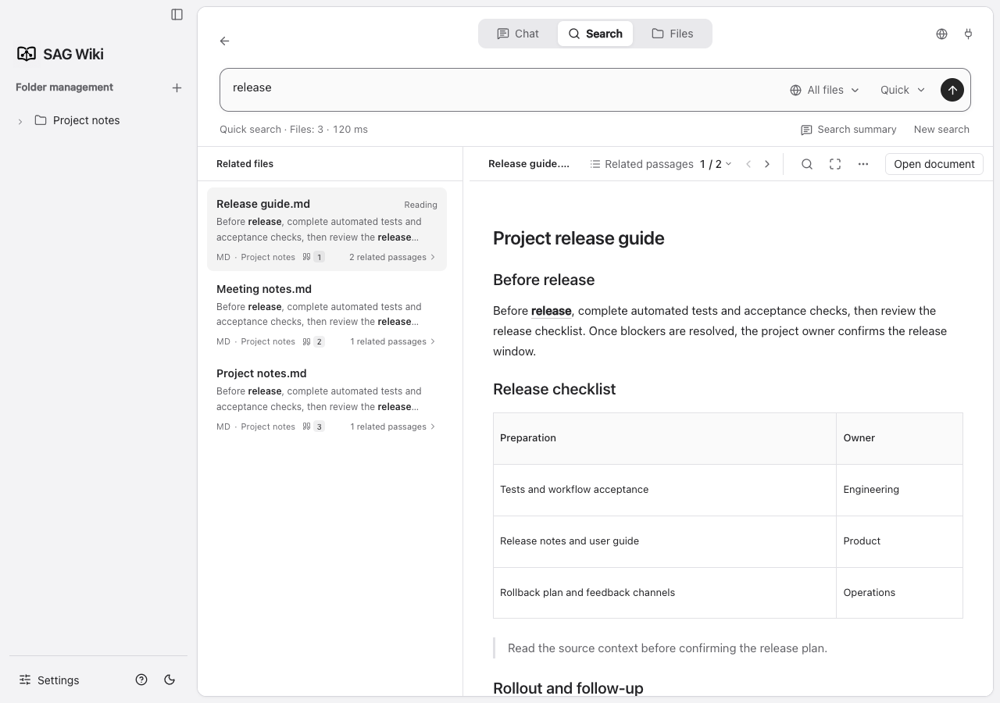
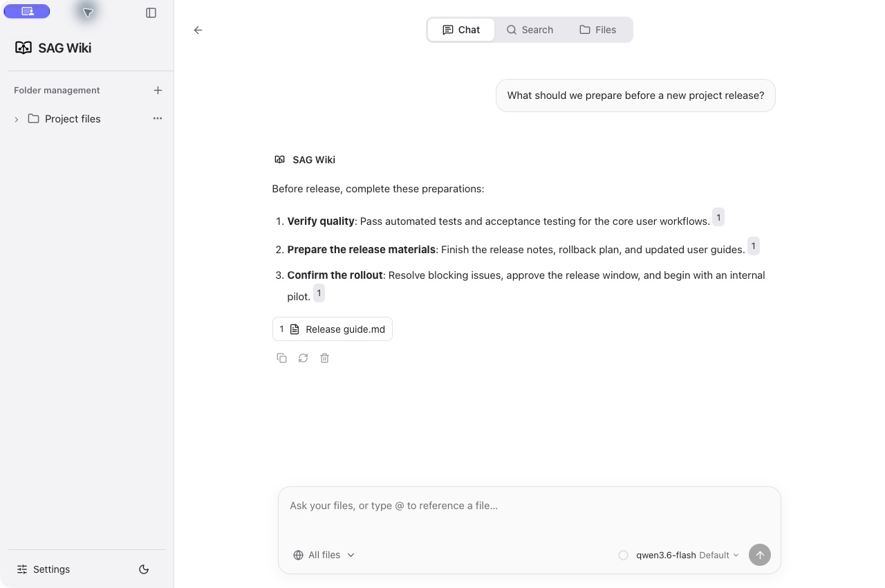
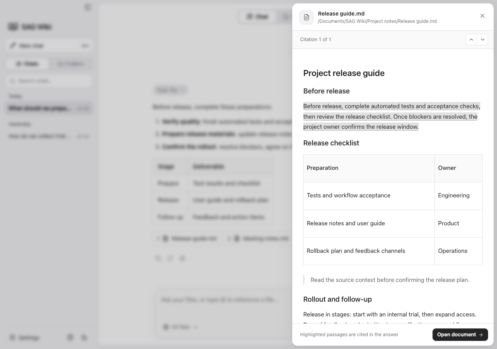
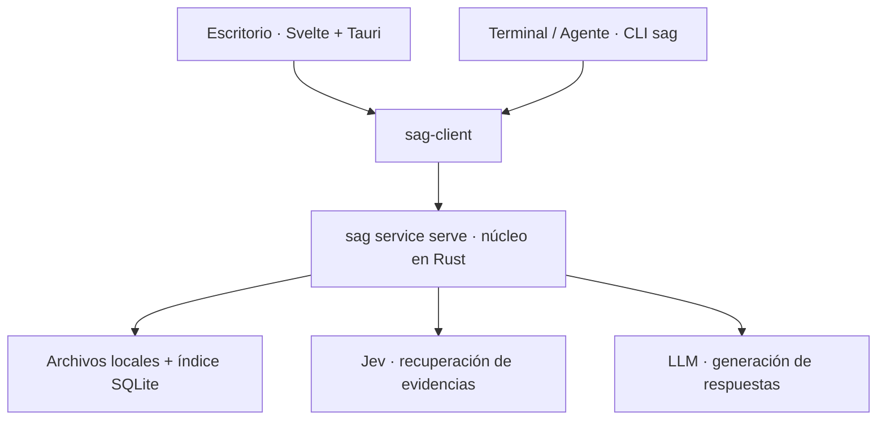

<p align="center">
  
</p>

<h1 align="center">SAG-Wiki</h1>

<p align="center">
  <a href="README.md">English</a> · <a href="README-CN.md">简体中文</a> · <a href="README-ZH-TW.md">繁體中文</a> · <a href="README-JA.md">日本語</a> · <a href="README-KO.md">한국어</a> · <strong>Español</strong> · <a href="CHANGELOG.md">Historial de cambios</a>
</p>

<p align="center">
  <a href="https://arxiv.org/abs/2610.22588"></a>
  <a href="https://github.com/Zleap-AI/SAG-Wiki/releases/latest"></a>
  
  
  
  <a href="LICENSE"></a>
</p>

<p align="center"><strong>Ligero y fácil de usar, con indexación rápida y recuperación precisa.</strong></p>

<p align="center">
  Una base de conocimiento ligera para personas y agentes. Indexa tus archivos locales y realiza búsquedas sin recurrir a un LLM. También puedes hacer preguntas y consultar las fuentes que respaldan las respuestas.
</p>

https://github.com/user-attachments/assets/e9c5499d-6057-4add-ac7e-f57eae381a2f

El texto básico de un PDF puede consultarse antes de que terminen el OCR y el reconocimiento avanzado de tablas en segundo plano. La indexación básica de los documentos locales compatibles de Office y RTF avanza de forma independiente. Los segmentos de un PDF reutilizan los modelos ya cargados. Consulta el [historial de cambios](CHANGELOG.md) para ver las novedades de cada versión y el [sitio de documentación](docs-site/README.md) para aprender a usar la aplicación. El enlace de descarga lleva a la última versión estable publicada.

## Índice

<p align="center">
  <a href="#project">Proyecto</a> ·
  <a href="#technology">Tecnología</a> ·
  <a href="#user-guide">Guía de uso</a> ·
  <a href="#agent-guide">Guía para agentes</a> ·
  <a href="#developer-guide">Guía de desarrollo</a> ·
  <a href="#community">Comunidad</a>
</p>

---

<a id="project"></a>

## SAG-Wiki en un minuto

[Descarga la última versión de escritorio para macOS y Windows](https://github.com/Zleap-AI/SAG-Wiki/releases/latest)

**Instalación para tu agente**

```text
Install https://github.com/Zleap-AI/SAG-Wiki/blob/main/cli/skills/sag/SKILL.md and follow its setup flow for my current project.
```

El tamaño del instalador no incluye los componentes opcionales de conversión de documentos ni los modelos de reconocimiento que se descargan bajo demanda.

Añade una carpeta para buscar en tus documentos, notas y código. Puedes localizar un fragmento, hacer preguntas sobre varios archivos, abrir la fuente de una respuesta o dar a tu agente de programación acceso a la misma base de conocimiento.

- **Ligero.** Funciona sin instalar una base de datos aparte. Los componentes opcionales de reconocimiento se descargan por separado.
- **Rápido.** Indexa un millón de caracteres en unos **200 ms**, sin llamadas a un LLM para indexar o recuperar documentos.
- **Preciso.** **SAG2**, nuestra tecnología de recuperación, supera a RAG, GraphRAG y otros enfoques en las comparaciones de recuperación.

La cifra corresponde a la indexación de texto. La conversión de documentos, el OCR y el reconocimiento de tablas tienen sus propios tiempos de procesamiento, por lo que el tiempo total de un PDF puede ser mayor.

Lee y edita Markdown, previsualiza HTML, explora documentos relacionados o busca desde la terminal. La conversión de documentos PDF, Office y EPUB viene integrada. El reconocimiento de imágenes y la transcripción de audio y vídeo son opcionales.

Si solo necesitas el texto de un archivo DOCX o PPTX con muchas imágenes, activa **Extraer solo el texto de Office** en **Configuración → Archivos**. Esta opción está desactivada de forma predeterminada y omite las imágenes y los objetos incrustados antes de cargarlos. El texto dentro de las imágenes queda fuera de la extracción. Consulta la [guía de carpetas](docs-site/content/docs/folders.en.mdx#office-text-only).

### Comparación

| Función | **SAG-Wiki** | LLM Wiki | RAG vectorial habitual |
| --- | --- | --- | --- |
| Primer paso | **Añadir una carpeta local** | Pedir a un agente que lea las fuentes y mantenga las páginas de la wiki | Importar documentos, dividirlos y crear un índice vectorial |
| Preparación del conocimiento | **Sin llamadas a LLM ni embeddings** | Un LLM redacta y actualiza resúmenes y enlaces | Un modelo de embeddings codifica los fragmentos |
| Contenido de búsqueda | **Documentos originales con la ubicación de los fragmentos** | Páginas de wiki generadas e interconectadas | Fragmentos de documentos indexados |
| Cambios en los archivos | **Detectar cambios locales y actualizar el índice** | Pedir al agente que revise las páginas afectadas | Actualizar los fragmentos y embeddings afectados |
| Búsqueda de información | **Recuperar evidencias de varios archivos con SAG2** | Navegar por la wiki y consultarla | Recuperar por similitud vectorial con una segunda ordenación opcional |
| Uso diario | **Búsqueda de escritorio, respuestas con citas, edición de documentos y exploración de relaciones** | Flujos de trabajo con agentes y un editor Markdown | Depende de la aplicación |
| Acceso para agentes | **CLI y Skill lista para instalar** | Instrucciones para mantener y leer la wiki | Herramientas o API específicas de la aplicación |

La comparación se basa en el [patrón LLM Wiki de Karpathy](https://gist.github.com/karpathy/442a6bf555914893e9891c11519de94f) y el [flujo de trabajo estándar de RAG vectorial](https://docs.langchain.com/oss/python/deepagents/retrieval). Las funciones concretas dependen de la implementación.

---

<a id="technology"></a>

## Tecnología

SAG-Wiki utiliza **SAG2, nuestro método de recuperación**. Crea un índice local sin embeddings ni llamadas a un LLM. Durante la consulta, Jev puntúa las evidencias y la búsqueda puede ampliarse para localizar fragmentos de apoyo en varios documentos. La generación de una respuesta usa el LLM que configures.

https://github.com/user-attachments/assets/bcdf9dbf-7535-41d6-bd22-bde0ea824525

<p align="center">
  
</p>

<sub>Los resultados de SAG2 representan el método de recuperación que utiliza SAG-Wiki. Recall@10 mide la proporción de evidencias recuperadas en los diez primeros resultados. SAG2 utiliza 1000 preguntas por conjunto de evaluación y MuSiQue se utilizó para desarrollar el método. Los resultados de SAG y BM25 proceden del artículo original de SAG. Las etiquetas de dificultad se usan para presentar la comparación. Las mejoras relativas se calculan a partir de las puntuaciones que aparecen en el gráfico.</sub>

**[Lee el artículo de SAG2](https://arxiv.org/abs/2610.22588)** · Consulta **[SAG-Benchmark](https://github.com/Zleap-AI/SAG-Benchmark)** para conocer el método, los resultados y el código con el que puedes reproducirlos.

---

<a id="user-guide"></a>

## Guía de uso

| Función | Requisitos |
| --- | --- |
| Indexación de archivos y búsqueda rápida | Añade una carpeta. Funciona sin clave de API |
| Recuperación semántica con SAG2 | Configura un modelo de decisión y proporciona una clave de API si el servicio la requiere |
| Preguntas y respuestas con citas | Configura un modelo de respuesta y su clave de API. La recuperación con SAG2 también requiere un modelo de decisión |

SAG-Wiki es gratuito y de código abierto. Los servicios externos pueden tener costes que dependen del proveedor elegido. Los archivos originales permanecen en tu equipo. La búsqueda profunda y la generación de respuestas envían las preguntas, los fragmentos o el contexto necesarios a los servicios que configures.

### 1. Descarga la aplicación y añade una carpeta

En macOS, descarga el DMG desde el enlace de la última versión, ábrelo y arrastra SAG Wiki a Aplicaciones. La aplicación, la CLI incluida y el DMG están firmados con Developer ID y notarizados por Apple. Para Windows, consulta la [guía de instalación](docs-site/content/docs/installation.es.mdx).

Instala y abre SAG-Wiki. En la barra lateral, selecciona **Carpetas** y pulsa **+** junto a la gestión de carpetas para añadir la que quieras buscar. Los archivos conservan su ubicación original.

<p align="center">
  
</p>

### 2. Busca en tus archivos

Puedes usar **Búsqueda** en cuanto se indexe el texto básico. En PDF mixtos o escaneados, el OCR y el reconocimiento avanzado de tablas continúan en segundo plano. La lista de archivos indica si el texto básico ya está disponible para búsquedas y si el procesamiento adicional está pendiente, en curso o ha fallado. Si ese procesamiento falla, todavía puedes buscar en el texto que ya se indexó. En escaneos que solo contienen imágenes, la búsqueda está disponible una vez indexado el texto reconocido. Espera a que termine el procesamiento y consulta el original para comprobar la cobertura. La búsqueda rápida funciona localmente. Para la búsqueda semántica profunda, configura un modelo de decisión en **Configuración → Modelos**.

Si utilizas un modelo de decisión local compatible con Jev, selecciona **Personalizado** e introduce el nombre del modelo y su URL base, por ejemplo `http://127.0.0.1:8000/v1`, o el endpoint completo de `/systemone` o `/decisions`. Si el servicio funciona sin clave de API, elige **No autenticación** en la configuración de autenticación del modelo de decisión. Esta opción omite la cabecera de autorización y elimina la clave guardada del modelo de decisión. El servicio debe implementar el protocolo de Jev con `state`, `questions` y `answers.*.noul`. En la CLI, ejecuta `sag config --url http://127.0.0.1:8000/v1 --model YOUR_MODEL --auth none`. Para volver a un servicio con clave, usa `--auth bearer --key-stdin` e introduce la clave de ese servicio.

<p align="center">
  
</p>

### 3. Haz preguntas y consulta las fuentes

Configura el modelo de respuestas en **Configuración → Modelos** y haz tu pregunta en **Preguntas y respuestas**. Escribe `@` para seleccionar archivos y pulsa una cita para abrir el fragmento que respalda la respuesta.

<p align="center">
  
</p>

<p align="center">
  
</p>

---

<a id="agent-guide"></a>

## Guía para agentes

Envía esta instrucción a tu agente:

```text
Install https://github.com/Zleap-AI/SAG-Wiki/blob/main/cli/skills/sag/SKILL.md and follow its setup flow for my current project.
```

SAG es compatible con **Claude Code, Codex y OpenCode**. La Skill incluye la instalación de la CLI, la configuración, la indexación del proyecto y la verificación. **La CLI funciona de forma independiente**. Si instalas la aplicación de escritorio de SAG Wiki, ambas comparten la configuración y la base de conocimiento. Se reutiliza la configuración existente. Si tu servicio de búsqueda semántica requiere una clave de API, introduce tu clave del modelo de decisión de forma privada en la terminal. Usa el enlace de GitHub de la Skill para la instalación. El agente obtiene los archivos auxiliares del mismo directorio.

Con Node.js 18 o posterior instalado, ejecuta:

```sh
npm install -g @zleap-ai/sag
```

El [paquete publicado en npm](https://www.npmjs.com/package/@zleap-ai/sag) incluye binarios para **macOS Apple Silicon e Intel (Intel desde la versión `0.3.11`), Windows x64 y Linux ARM64 / x86_64**. Los binarios de Linux se verificaron en Ubuntu 24.04 y Debian 12. Los binarios ya están compilados y se pueden usar sin instalar Rust. La CLI se instala por separado de la aplicación de escritorio.

<details>
<summary>Instalación y uso manual</summary>

Si ya tienes `sag`, puedes usar esa instalación. Si aún no lo tienes, ejecuta el comando npm indicado arriba. Después, comprueba la versión y configura el modelo de decisión por primera vez en una terminal:

```sh
sag --version
sag
```

Instala la [carpeta de la Skill](https://github.com/Zleap-AI/SAG-Wiki/tree/main/cli/skills/sag), incluidos `SKILL.md` y `references/`, en la ubicación que corresponda a tu agente:

| Agente | Carpeta de la Skill |
| --- | --- |
| Codex | `~/.agents/skills/sag/` |
| Claude Code | `~/.claude/skills/sag/` |
| OpenCode | `~/.config/opencode/skills/sag/` |

Inicia una nueva sesión del agente. En el proyecto que quieras consultar, añade la carpeta y confirma que el índice esté listo antes de buscar:

```sh
sag add
sag check
sag "Where is permission checked?" . -m 5
```

En una carpeta grande, puedes ampliar el tiempo de espera con `sag add --timeout 3600`. Cuando se agota el tiempo, la carpeta sigue añadida y la indexación continúa en segundo plano. Usa `sag list --json` para consultar el progreso.

Consulta la [guía de configuración](cli/skills/sag/references/setup.md#first-use-setup) de la Skill para ver el flujo completo y la [guía de la CLI](docs/en/cli-and-harness.md) para conocer los demás comandos.

</details>

---

<a id="developer-guide"></a>

## Guía de desarrollo

La **CLI en Rust es la base de ejecución**. El ejecutable `sag` inicia un servicio local compartido. Los comandos de terminal y la aplicación de escritorio de Tauri se conectan al servicio mediante el mismo cliente. La indexación, la recuperación y la configuración de modelos se gestionan en un núcleo común y siguen disponibles tras cerrar la aplicación de escritorio.



| Directorio | Contenido |
| --- | --- |
| `src/` | Interfaz de escritorio |
| `src-tauri/` | Funciones del sistema y conexión con el servicio |
| `cli/` | Punto de entrada de la línea de comandos e instalación de la Skill |
| `core/` | Indexación, recuperación y respuesta a preguntas |
| `client/`, `protocol/` | Comunicación del cliente y protocolo |

Sigue la [guía del entorno de desarrollo](docs/en/development.md#environment) para preparar Node.js, Rust y las dependencias de Tauri de tu plataforma. Después, ejecuta:

```sh
git clone https://github.com/Zleap-AI/SAG-Wiki.git
cd SAG-Wiki
npm ci
npm run tauri dev
```

Después de realizar cambios, ejecuta `npm run check` y `npm test`. La [sección de comprobaciones](docs/en/development.md#code-checks) enumera todos los comandos de validación. Para más detalles sobre la compilación y la implementación, consulta la [guía de desarrollo](docs/en/development.md), la [arquitectura](docs/en/architecture.md) y el [índice de documentación](docs/en/README.md).

---

## Contribuciones y licencia

Puedes colaborar a través de [Issues](https://github.com/Zleap-AI/SAG-Wiki/issues) y [Pull Requests](https://github.com/Zleap-AI/SAG-Wiki/pulls). Para modificar la aplicación, sigue la [guía de desarrollo](docs/en/development.md). La investigación sobre recuperación y el código para reproducir los experimentos se encuentran en [SAG-Benchmark](https://github.com/Zleap-AI/SAG-Benchmark).

SAG-Wiki se distribuye bajo la [licencia MIT](LICENSE). Los avisos de terceros se encuentran en [src-tauri/licenses](src-tauri/licenses/).

---

<a id="community"></a>

## Comunidad

Únete a la comunidad de SAG en Discord o WeChat para conversar con quienes mantienen y usan el proyecto.

<table align="center">
  <tr>
    <th>Discord</th>
    <th>WeChat</th>
  </tr>
  <tr>
    <td align="center"></td>
    <td align="center"></td>
  </tr>
</table>
