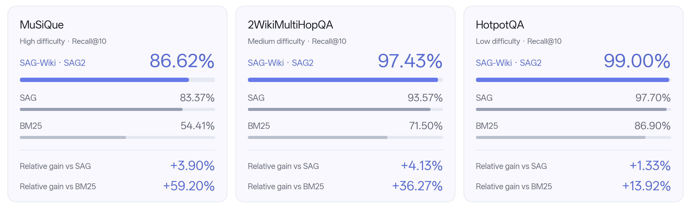
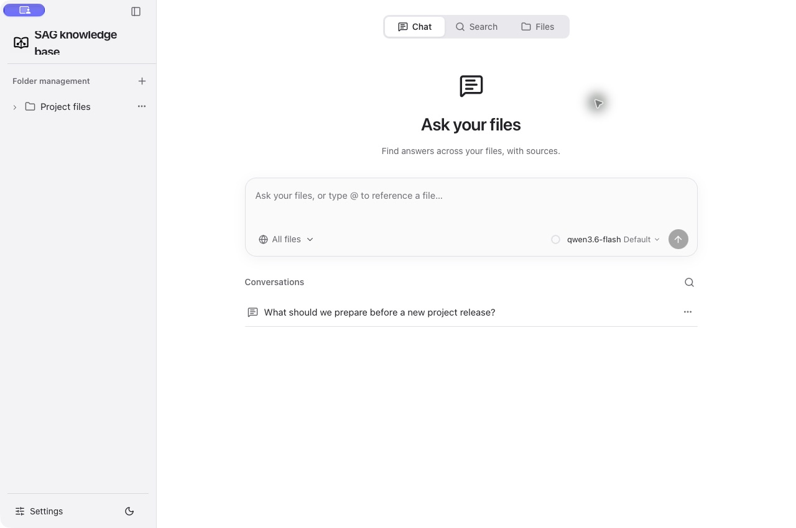
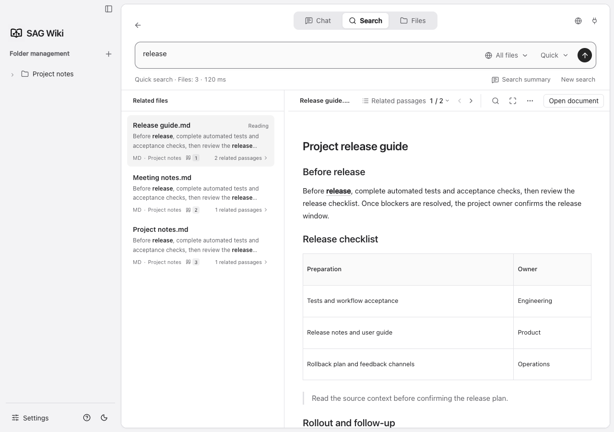
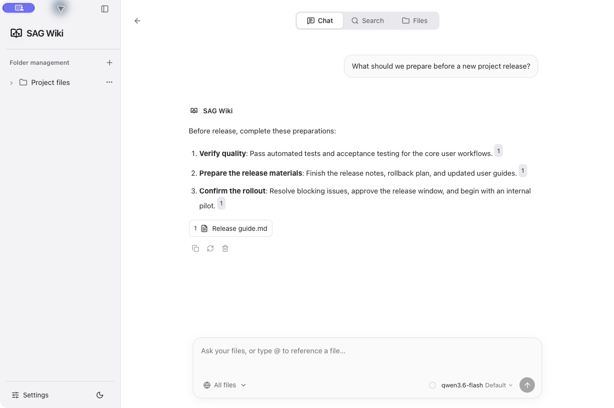
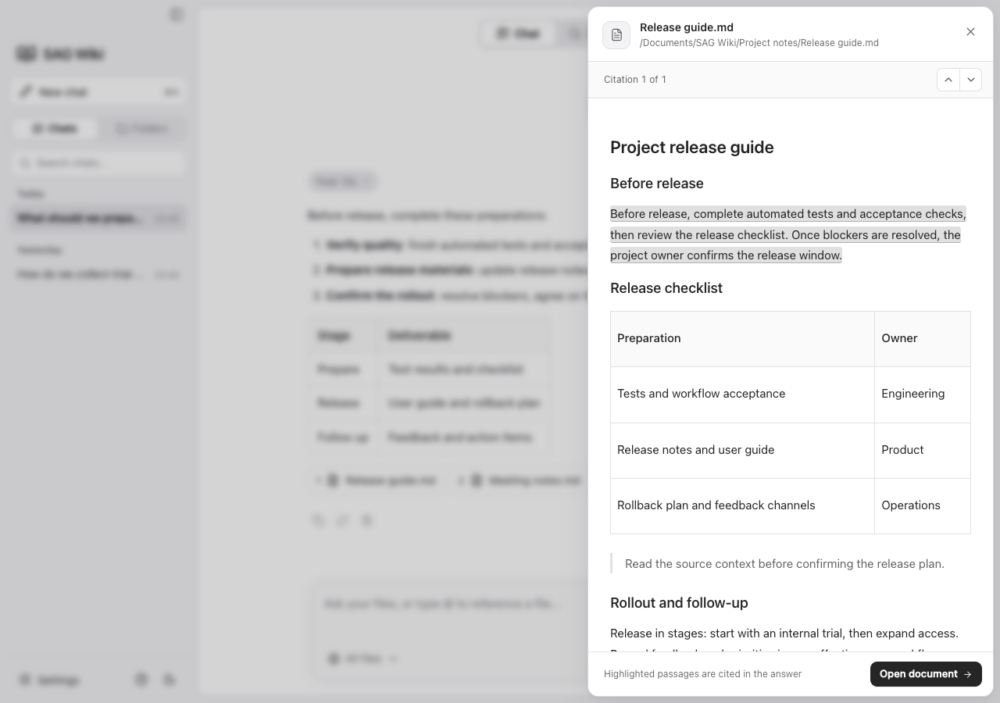
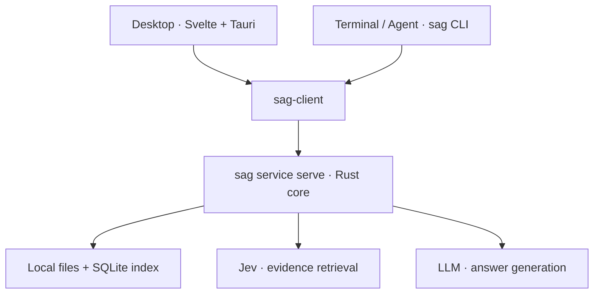

<p align="center">
  
</p>

<h1 align="center">SAG-Wiki</h1>

<p align="center">
  <a href="README.md">English</a> · <a href="README-CN.md">简体中文</a> · <a href="README-ZH-TW.md">繁體中文</a> · <strong>日本語</strong> · <a href="README-KO.md">한국어</a> · <a href="README-ES.md">Español</a> · <a href="CHANGELOG.md">変更履歴</a>
</p>

<p align="center">
  <a href="https://arxiv.org/abs/2610.22588"></a>
  <a href="https://github.com/Zleap-AI/SAG-Wiki/releases/latest"></a>
  
  
  
  <a href="LICENSE"></a>
</p>

<p align="center"><strong>軽量で簡単。高速なインデックス作成。精密な検索。</strong></p>

<p align="center">
  人とエージェントのための軽量なナレッジベースです。LLM を呼び出さずにローカルファイルをインデックス化して検索し、ソースまでたどれる回答付きで質問できます。
</p>

https://github.com/user-attachments/assets/e9c5499d-6057-4add-ac7e-f57eae381a2f

PDF の基本テキストは、バックグラウンドでの OCR と表の強化処理が終わる前に検索可能になります。独立した基本インデックス作成により、対応するローカルの Office/RTF ドキュメントの処理が滞らず、PDF のセグメントは読み込み済みのモデルを再利用します。リリースごとの変更点は[変更履歴](CHANGELOG.md)を、使い方は[ドキュメントサイト](docs-site/README.md)を参照してください。下のダウンロードリンクは、公開済みの最新の安定版 Release を指しています。

## 目次

<p align="center">
  <a href="#project">プロジェクト</a> ·
  <a href="#technology">テクノロジー</a> ·
  <a href="#user-guide">ユーザーガイド</a> ·
  <a href="#agent-guide">エージェントガイド</a> ·
  <a href="#developer-guide">開発者ガイド</a> ·
  <a href="#community">コミュニティ</a>
</p>

---

<a id="project"></a>

## 1 分でわかる SAG-Wiki

[macOS と Windows 向けの最新デスクトップ版をダウンロード](https://github.com/Zleap-AI/SAG-Wiki/releases/latest)

**エージェントにインストールする**

```text
Install https://github.com/Zleap-AI/SAG-Wiki/blob/main/cli/skills/sag/SKILL.md and follow its setup flow for my current project.
```

インストーラーのサイズには、オンデマンドでダウンロードされるオプションのドキュメント変換コンポーネントと認識モデルは含まれていません。

フォルダーを追加すると、ドキュメント、メモ、コードを検索できるようになります。文章を見つける、複数のファイルにまたがって質問する、回答の根拠となるソースを開く、あるいはコーディングエージェントに同じナレッジベースへのアクセスを与えることができます。

- **軽量：** 別途データベースをインストールする必要はありません。オプションの認識コンポーネントは個別にダウンロードされます。
- **高速：** 100 万文字を約 **200 ms** でインデックス化し、インデックス作成にも検索にも LLM を呼び出しません。
- **精密：** 独自の **SAG2** 検索技術は、RAG や GraphRAG などの手法を上回ります。

上記のインデックス作成の数値はテキストのインデックス作成に関するもので、ドキュメント変換、OCR、表認識は含まれていません。PDF 全体の完了時間の見積もりではありません。

Markdown の閲覧と編集、HTML のプレビュー、関連ドキュメントの探索、ターミナルからの検索ができます。PDF、Office、EPUB のドキュメントは追加設定なしで変換でき、画像認識と音声/動画の文字起こしはオプションのコンポーネントです。

テキストだけが必要な画像の多い DOCX/PPTX ファイルでは、**Settings → File settings** で **Office text only** を有効にしてください（デフォルトはオフ）。画像と埋め込みオブジェクトは読み込み前にスキップされ、画像内のテキストは認識されません。[フォルダーガイド](docs-site/content/docs/folders.en.mdx#office-text-only)を参照してください。

### 比較

| 機能 | **SAG-Wiki** | LLM Wiki | 一般的なベクトル RAG |
| --- | --- | --- | --- |
| 始め方 | **ローカルフォルダーを追加する** | エージェントにソースを読ませ、Wiki ページを管理させる | ドキュメントをインポートして分割し、ベクトルインデックスを構築する |
| ナレッジの準備 | **LLM の呼び出しも埋め込みも不要** | LLM が要約とリンクを作成・更新する | 埋め込みモデルがドキュメントのチャンクをエンコードする |
| 検索対象のナレッジ | **元のドキュメントと、その文章の位置** | 生成され、相互にリンクされた Wiki ページ | インデックス化されたドキュメントのチャンク |
| ファイルの変更 | **ローカルファイルを監視してインデックスを更新する** | エージェントに影響を受けるページを修正させる | 影響を受けるチャンクと埋め込みを更新する |
| 情報の検索 | **ファイルをまたいだ SAG2 による根拠の検索** | 管理されている Wiki をたどって問い合わせる | ベクトルの類似度で検索し、必要に応じてリランキングする |
| 日常の利用 | **デスクトップでの検索、引用付きの Q&A、ドキュメントの編集、関連性の探索** | エージェントのワークフローと Markdown エディター | アプリケーションによって異なる |
| エージェントからのアクセス | **CLI と、すぐにインストールできる Skill** | Wiki の管理と閲覧のための指示 | アプリケーション固有のツールや API |

この比較は、[Karpathy の LLM Wiki パターン](https://gist.github.com/karpathy/442a6bf555914893e9891c11519de94f)と[標準的なベクトル RAG のワークフロー](https://docs.langchain.com/oss/python/deepagents/retrieval)に基づいています。機能は実装によって異なります。

---

<a id="technology"></a>

## テクノロジー

SAG-Wiki は、**独自の検索手法である SAG2** の上で動作します。埋め込みや LLM の呼び出しなしでローカルインデックスを構築し、Jev による根拠のスコアリングとクエリ時の拡張を使って、ドキュメントをまたいで裏付けとなる文章を見つけます。LLM は、回答の生成を選んだ場合に使われます。

https://github.com/user-attachments/assets/bcdf9dbf-7535-41d6-bd22-bde0ea824525

<p align="center">
  
</p>

<sub>SAG-Wiki は、その基盤となる SAG2 のベンチマーク結果で示しています。Recall@10 は、上位 10 件の結果における根拠の再現率を測定します。SAG2 はベンチマークごとに 1,000 問を使用しています。MuSiQue は手法の開発に使用しました。SAG と BM25 は、元の SAG 論文の参照値です。難易度のラベルは表示上の分類であり、相対的な向上率は表示されているスコアを用いています。</sub>

**[SAG2 の論文を読む](https://arxiv.org/abs/2610.22588)** · 手法、ベンチマーク結果、再現用コードについては **[SAG-Benchmark](https://github.com/Zleap-AI/SAG-Benchmark)** を参照してください。

---

<a id="user-guide"></a>

## ユーザーガイド

| 機能 | 必要なもの |
| --- | --- |
| ファイルのインデックス作成とクイック検索 | フォルダーを追加するだけで、API キーは不要です |
| SAG2 によるセマンティック検索 | 判定モデルを設定し、必要に応じて API キーを指定します |
| 引用付きの Q&A | 回答モデルと API キーを設定します。SAG2 による検索には判定モデルも必要です |

SAG-Wiki 自体は無料のオープンソースです。外部サービスの料金は、選択したプロバイダーによって異なります。元のファイルはお使いのマシン上に留まります。詳細な検索と Q&A では、必要な質問、ドキュメントの文章、またはコンテキストが、設定したサービスへ送信されます。

### 1. ダウンロードしてフォルダーを追加する

上記の最新リリースのリンクから macOS 用の DMG をダウンロードして開き、SAG Wiki をアプリケーションフォルダーにドラッグします。macOS アプリ、同梱の CLI、DMG は Developer ID で署名され、Apple による公証を受けています。

SAG-Wiki をインストールして開き、サイドバーを **Folders** に切り替えてから、フォルダー管理の横にある **+** をクリックして、検索したいフォルダーを追加します。ファイルは元の場所に置かれたままです。

<p align="center">
  
</p>

### 2. ファイルを検索する

基本テキストがインデックス化されると、すぐに **Search** を使えます。混在型またはスキャンされた PDF では、OCR と表の強化処理がバックグラウンドで続きます。ファイル一覧の状態表示で、基本テキストが検索可能か、強化処理が保留中/実行中か、強化処理が失敗したかを確認できます。強化処理が失敗しても既存のテキストは検索可能なままです。画像のみのスキャンは、認識されたテキストがインデックス化された後にのみ検索可能になります。全体を確実に対象にするには、完了を待ち、元のファイルを確認してください。クイック検索はローカルで動作します。詳細なセマンティック検索を行うには、**Settings → Models** で判定モデルを設定してください。

Jev 互換のローカル判定モデルを使う場合は、**Custom** を選択し、そのモデル名とベース URL（例：`http://127.0.0.1:8000/v1`）、またはその完全な `/systemone` もしくは `/decisions` エンドポイントを入力します。サービスが API キーを必要としない場合は、**Decision model authentication** で **No authentication** を選択します。これにより認証ヘッダーが省略され、保存されている判定モデルのキーが削除されます。サービスは Jev の `state`、`questions`、`answers.*.noul` プロトコルを実装している必要があります。CLI の場合は、`sag config --url http://127.0.0.1:8000/v1 --model YOUR_MODEL --auth none` を実行します。キーが必要なサービスに戻すには、`--auth bearer --key-stdin` を使い、そのサービスのキーを入力します。

<p align="center">
  
</p>

### 3. 質問してソースを確認する

**Settings → Models** で回答モデルを設定し、**Chat** で質問します。`@` を使ってファイルを選択し、引用をクリックすると、回答を裏付ける文章を確認できます。

<p align="center">
  
</p>

<p align="center">
  
</p>

---

<a id="agent-guide"></a>

## エージェントガイド

エージェントに次の一文を伝えてください：

```text
Install https://github.com/Zleap-AI/SAG-Wiki/blob/main/cli/skills/sag/SKILL.md and follow its setup flow for my current project.
```

SAG は **Claude Code、Codex、OpenCode** に対応しています。Skill には、CLI のインストール、設定、プロジェクトのインデックス作成、検証が含まれています。**CLI は SAG Wiki デスクトップなしでも動作し**、デスクトップがインストールされている場合は、その設定とナレッジベースを共有します。既存の設定は再利用されます。API キー認証を使うセマンティック検索には、ご自身の判定モデルのキーが必要で、ターミナルで非公開に入力します。GitHub の Skill へのリンクが正式なインストールの入り口であり、エージェントはサポートファイルを同じディレクトリから取得します。

Node.js 18 以降がインストールされている場合：

```sh
npm install -g @zleap-ai/sag
```

[公開されている npm パッケージ](https://www.npmjs.com/package/@zleap-ai/sag)には、**macOS Apple Silicon と Intel（Intel は `0.3.11` 以降）、Windows x64、Linux ARM64 / x86_64** のバイナリが含まれています（Linux は Ubuntu 24.04 と Debian 12 で検証済み）。Rust ツールチェーンやソースからのコンパイルは不要です。CLI をインストールしても、デスクトップアプリはインストールされません。

<details>
<summary>手動でのインストールと使い方</summary>

`sag` がすでにインストールされている場合は、それを再利用します。そうでない場合は上記の npm コマンドを実行し、ターミナルでコマンドを確認して、初回の判定モデルの設定を完了します：

```sh
sag --version
sag
```

リンク先の [Skill フォルダー](https://github.com/Zleap-AI/SAG-Wiki/tree/main/cli/skills/sag)を、`SKILL.md` と `references/` を含めて、お使いのエージェント用の場所にインストールします：

| エージェント | Skill フォルダー |
| --- | --- |
| Codex | `~/.agents/skills/sag/` |
| Claude Code | `~/.claude/skills/sag/` |
| OpenCode | `~/.config/opencode/skills/sag/` |

新しいエージェントセッションを開始します。検索したいプロジェクトでフォルダーを追加し、検索する前にインデックス作成の準備ができていることを確認します：

```sh
sag add
sag check
sag "Where is permission checked?" . -m 5
```

大きなフォルダーの場合は、`sag add --timeout 3600` を使って待機時間の上限を延ばします。待機時間が切れてもフォルダーが削除されたりバックグラウンドのインデックス作成が止まったりすることはありません。進捗の確認には `sag list --json` を使います。

エージェントのワークフロー全体については Skill の[セットアップガイド](cli/skills/sag/references/setup.md#first-use-setup)を、その他のコマンドについては [CLI ガイド](docs/en/cli-and-harness.md)を参照してください。

</details>

---

<a id="developer-guide"></a>

## 開発者ガイド

**Rust CLI がランタイムの基盤** です。`sag` 実行ファイルが共有のローカルサービスを起動し、ターミナルのコマンドと Tauri デスクトップの両方が、同じクライアントを通じてそれに接続します。インデックス作成、検索、モデルの設定は 1 つのコアにまとまっており、デスクトップを終了した後も利用できます。



| ディレクトリ | 内容 |
| --- | --- |
| `src/` | デスクトップのインターフェース |
| `src-tauri/` | デスクトップのシステム機能とサービスへの接続 |
| `cli/` | コマンドラインのエントリーポイントと Skill のインストール |
| `core/` | インデックス作成、検索、Q&A |
| `client/`、`protocol/` | クライアントの通信とプロトコル |

[環境ガイド](docs/en/development.md#environment)に従って、Node.js、Rust、お使いのプラットフォームの Tauri 開発用の依存関係を準備してから、次を実行します：

```sh
git clone https://github.com/Zleap-AI/SAG-Wiki.git
cd SAG-Wiki
npm ci
npm run tauri dev
```

変更後は `npm run check` と `npm test` を実行してください。すべての検証コマンドは[チェックのセクション](docs/en/development.md#code-checks)に記載されています。ビルドと実装の詳細については、[開発ガイド](docs/en/development.md)、[アーキテクチャ](docs/en/architecture.md)、[ドキュメントの索引](docs/en/README.md)を参照してください。

---

## コントリビュートとライセンス

コントリビュートは [Issues](https://github.com/Zleap-AI/SAG-Wiki/issues) と [Pull Requests](https://github.com/Zleap-AI/SAG-Wiki/pulls) で歓迎しています。アプリケーションの変更については[開発ガイド](docs/en/development.md)に従ってください。検索の研究と再現用コードは [SAG-Benchmark](https://github.com/Zleap-AI/SAG-Benchmark) にあります。

SAG-Wiki は [MIT License](LICENSE) の下で公開されています。サードパーティの通知は [src-tauri/licenses](src-tauri/licenses/) にあります。

---

<a id="community"></a>

## コミュニティ

Discord または WeChat の SAG コミュニティに参加して、メンテナーや他のユーザーとつながりましょう。

<table align="center">
  <tr>
    <th>Discord</th>
    <th>WeChat</th>
  </tr>
  <tr>
    <td align="center"></td>
    <td align="center"></td>
  </tr>
</table>
