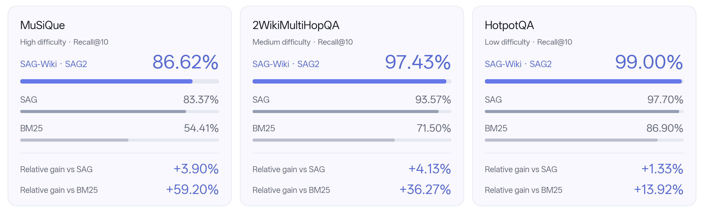
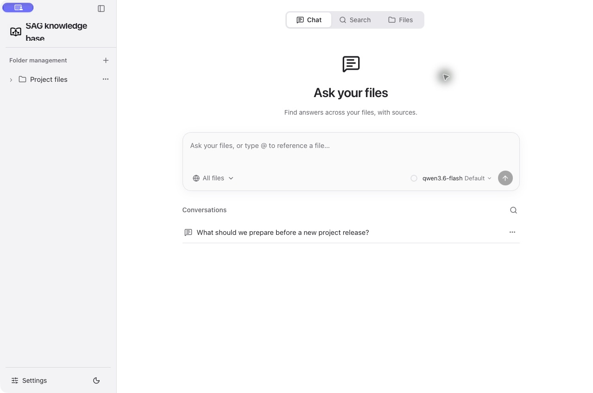
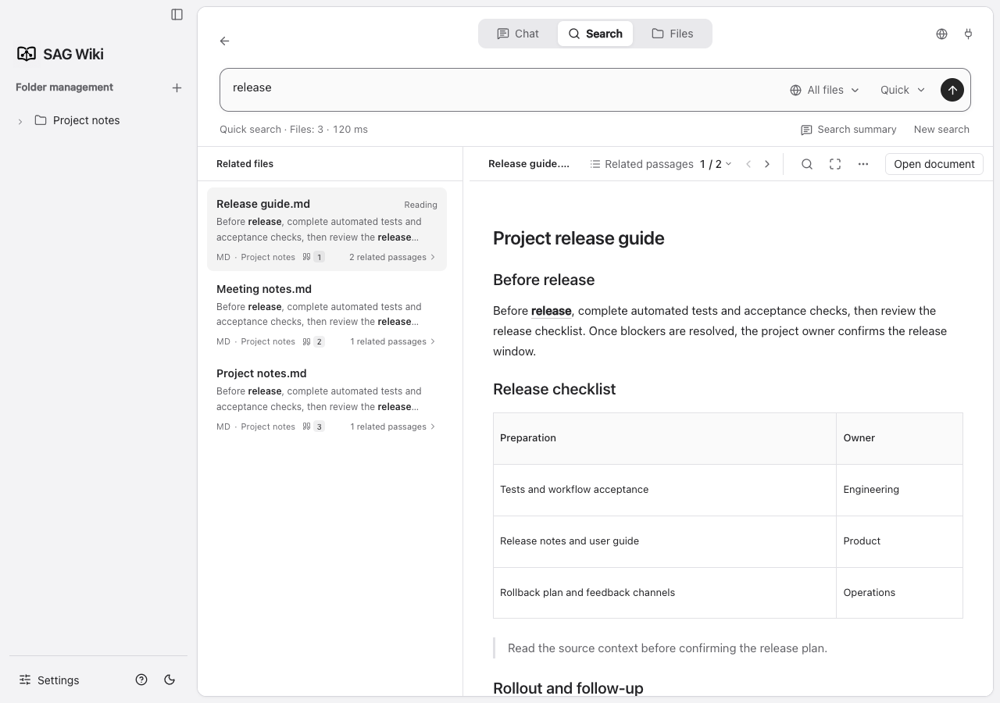
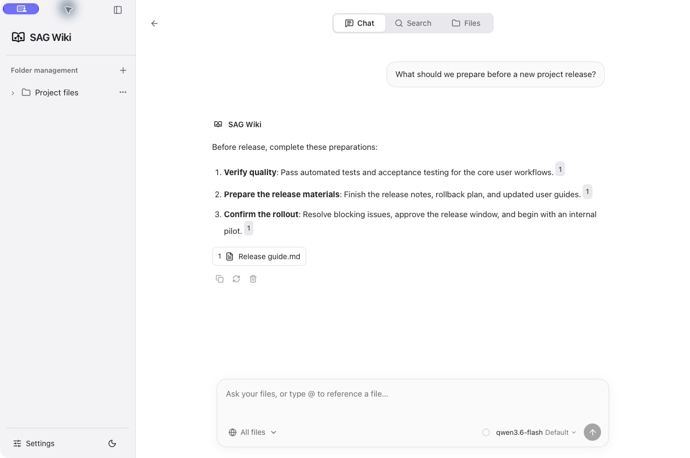
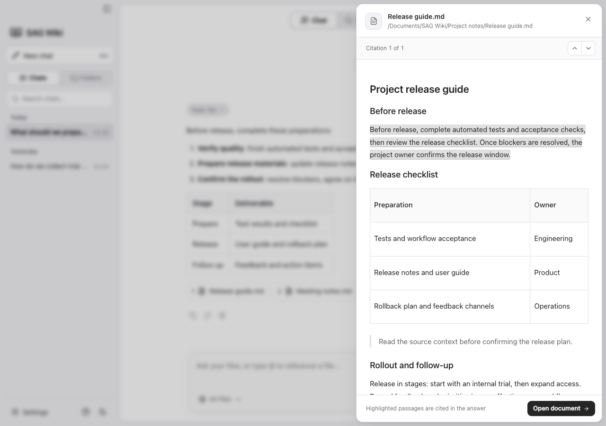
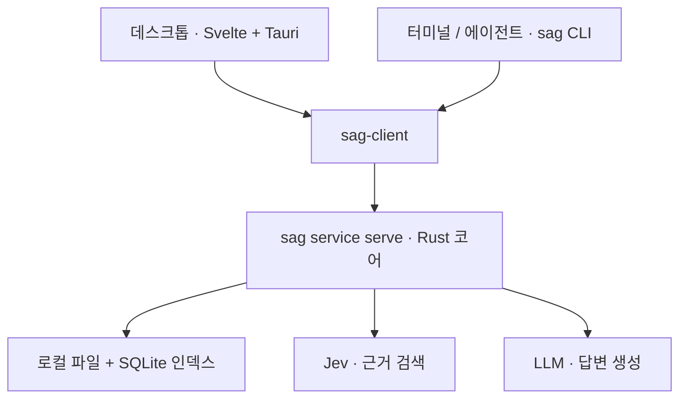

<p align="center">
  
</p>

<h1 align="center">SAG-Wiki</h1>

<p align="center">
  <a href="README.md">English</a> · <a href="README-CN.md">简体中文</a> · <a href="README-ZH-TW.md">繁體中文</a> · <a href="README-JA.md">日本語</a> · <strong>한국어</strong> · <a href="README-ES.md">Español</a> · <a href="CHANGELOG.md">변경 기록</a>
</p>

<p align="center">
  <a href="https://arxiv.org/abs/2610.22588"></a>
  <a href="https://github.com/Zleap-AI/SAG-Wiki/releases/latest"></a>
  
  
  
  <a href="LICENSE"></a>
</p>

<p align="center"><strong>가볍고 간편한 지식 베이스. 빠른 인덱싱과 정확한 검색.</strong></p>

<p align="center">
  사람과 에이전트를 위한 가벼운 지식 베이스입니다. LLM을 호출하지 않고 로컬 파일을 인덱싱하고 빠르게 검색할 수 있습니다. 질문에 대한 답변은 근거가 되는 원문에서 확인할 수 있습니다.
</p>

https://github.com/user-attachments/assets/e9c5499d-6057-4add-ac7e-f57eae381a2f

PDF에서 추출한 기본 텍스트는 백그라운드 OCR과 표 보강 작업이 끝나기 전부터 검색할 수 있습니다. 지원되는 로컬 Office 및 RTF 문서는 기본 인덱싱이 독립적으로 진행됩니다. PDF를 나누어 처리할 때는 이미 로드된 모델을 재사용합니다. 버전별 변경 사항은 [변경 이력](CHANGELOG.md), 사용 방법은 [문서 사이트](docs-site/README.md)를 참고하세요. 아래 다운로드 링크는 이미 공개된 최신 정식 릴리스로 연결됩니다.

## 목차

<p align="center">
  <a href="#project">프로젝트 소개</a> ·
  <a href="#technology">기술</a> ·
  <a href="#user-guide">사용자 가이드</a> ·
  <a href="#agent-guide">에이전트 가이드</a> ·
  <a href="#developer-guide">개발자 가이드</a> ·
  <a href="#community">커뮤니티</a>
</p>

---

<a id="project"></a>

## 1분 만에 살펴보는 SAG-Wiki

[macOS 및 Windows용 최신 데스크톱 릴리스 다운로드](https://github.com/Zleap-AI/SAG-Wiki/releases/latest)

**에이전트에 설치하기**

```text
https://github.com/Zleap-AI/SAG-Wiki/blob/main/cli/skills/sag/SKILL.md 의 Skill을 설치하고, 이 프로젝트에서 사용할 수 있도록 설정 절차를 진행해 주세요.
```

설치 파일 크기에는 필요할 때 다운로드하는 선택형 문서 변환 구성 요소와 인식 모델이 포함되지 않습니다.

폴더 하나를 추가하면 그 안의 문서, 메모, 코드를 검색할 수 있습니다. 필요한 구절을 찾거나 여러 파일에 걸쳐 질문할 수 있습니다. 답변의 출처를 열어 보거나 코딩 에이전트에 같은 지식 베이스를 연결할 수도 있습니다.

- **가벼운 구성** · 데이터베이스를 별도로 설치할 필요가 없습니다. 선택형 인식 구성 요소는 필요할 때 내려받습니다.
- **빠른 인덱싱** · 약 **200ms**에 100만 자의 텍스트를 인덱싱합니다. 인덱싱과 빠른 검색에는 LLM 호출이 필요하지 않습니다.
- **정확한 검색** · 자체 개발한 **SAG2** 검색 기술은 아래에 소개된 벤치마크에서 다른 검색 방식보다 높은 근거 재현율을 보였습니다.

위 수치는 텍스트 인덱싱에 한정되며 문서 변환, OCR, 표 인식 시간은 제외됩니다. PDF 전체를 처리하는 데 걸리는 시간은 문서에 따라 달라집니다.

Markdown을 읽고 편집하거나 HTML을 미리 볼 수 있습니다. 관련 문서를 탐색하거나 터미널에서 검색할 수도 있습니다. PDF, Office, EPUB 문서는 기본으로 변환할 수 있으며 이미지 인식과 오디오·동영상 전사는 선택형 구성 요소로 제공됩니다.

이미지가 많은 DOCX/PPTX에서 텍스트만 필요한 경우 **설정 → 파일 설정**에서 **Office 문서에서 텍스트만 추출**을 켜세요. 기본값은 꺼짐입니다. 이 기능을 켜면 이미지와 삽입 개체를 불러오기 전에 건너뛰므로 이미지 안의 텍스트는 인식되지 않습니다. [폴더와 인덱싱 가이드](docs-site/content/docs/folders.ko.mdx) · [Office 텍스트 전용 설정 상세 설명 (영어)](docs-site/content/docs/folders.en.mdx#office-text-only)

### 다른 방식과 비교

| 기능 | **SAG-Wiki** | LLM Wiki | 일반적인 벡터 RAG |
| --- | --- | --- | --- |
| 시작하기 | **로컬 폴더 추가** | 에이전트가 자료를 읽고 위키 페이지 관리 | 문서를 가져와 분할하고 벡터 인덱스 생성 |
| 지식 준비 | **LLM 호출이나 임베딩 없이 인덱싱** | LLM이 요약과 링크를 작성하고 갱신 | 임베딩 모델이 문서 조각을 벡터로 변환 |
| 검색 대상 | **구절 위치가 유지된 원본 문서** | 생성 후 링크로 연결한 위키 페이지 | 인덱싱된 문서 조각 |
| 파일 변경 | **로컬 파일을 감시하고 인덱스 갱신** | 에이전트가 관련 페이지 수정 | 변경된 문서 조각과 임베딩 갱신 |
| 정보 찾기 | **SAG2로 여러 파일에서 근거 검색** | 관리 중인 위키를 탐색하고 질의 | 벡터 유사도를 기준으로 검색하고 필요시 재정렬 |
| 일상적인 사용 | **데스크톱 검색, 출처가 있는 질의응답, 문서 편집, 관련 문서 탐색** | 에이전트 작업 흐름과 Markdown 편집기 | 애플리케이션에 따라 다름 |
| 에이전트 연동 | **CLI와 바로 설치할 수 있는 Skill** | 위키 관리 및 열람 지침 | 애플리케이션별 도구 또는 API |

비교 기준은 [Karpathy의 LLM Wiki 패턴](https://gist.github.com/karpathy/442a6bf555914893e9891c11519de94f)과 [일반적인 벡터 RAG 작업 흐름](https://docs.langchain.com/oss/python/deepagents/retrieval)입니다. 세부 기능은 구현에 따라 다릅니다.

---

<a id="technology"></a>

## 기술

SAG-Wiki는 자체 개발한 검색 방식인 **SAG2**를 사용합니다. 임베딩과 LLM 호출 없이 로컬 인덱스를 만들고, 검색할 때 Jev로 근거 점수를 매기고 필요에 따라 질의를 확장해 여러 문서에서 관련 구절을 찾습니다. 답변 생성을 선택하면 설정한 LLM을 호출합니다.

https://github.com/user-attachments/assets/bcdf9dbf-7535-41d6-bd22-bde0ea824525

<p align="center">
  
</p>

<sub>SAG-Wiki 수치는 내부 검색 기술인 SAG2의 벤치마크 결과입니다. Recall@10은 상위 10개 결과에 근거가 얼마나 포함됐는지를 나타냅니다. 벤치마크별로 질문 1,000개를 사용했으며 MuSiQue는 검색 방식 개발에 활용했습니다. SAG와 BM25 수치는 기존 SAG 논문의 참조값입니다. 난이도는 결과를 설명하기 위한 분류이며 상대 향상률은 표시된 점수를 기준으로 계산합니다.</sub>

**[SAG2 논문 읽기](https://arxiv.org/abs/2610.22588)** · 검색 방식, 벤치마크 결과, 재현 코드는 **[SAG-Benchmark](https://github.com/Zleap-AI/SAG-Benchmark)**를 참고하세요.

---

<a id="user-guide"></a>

## 사용자 가이드

| 기능 | 필요한 설정 |
| --- | --- |
| 파일 인덱싱 및 빠른 검색 | 폴더 추가. API 키 불필요 |
| SAG2 의미 검색 | 판단 모델 설정. 서비스에서 요구하는 경우 API 키 입력 |
| 출처가 있는 질의응답 | 답변 모델과 API 키 설정. SAG2 검색을 함께 사용하려면 판단 모델도 설정 |

SAG-Wiki 자체는 무료 오픈 소스입니다. 외부 서비스 비용은 선택한 제공업체에 따라 다릅니다. 원본 파일은 기기에 그대로 남습니다. 심층 검색과 질의응답에서는 필요한 질문, 문서의 일부 구절 또는 문맥을 설정한 서비스로 보냅니다.

### 1. 다운로드하고 폴더 추가하기

위의 최신 릴리스 링크에서 macOS용 DMG를 내려받아 열고 SAG Wiki를 **응용 프로그램** 폴더로 드래그합니다. macOS 앱, 함께 제공되는 CLI, DMG는 Developer ID로 서명되어 있으며 Apple의 공증을 받았습니다. Windows에서는 x64 설치 프로그램을 실행하고 안내에 따릅니다. [설치 가이드](docs-site/content/docs/installation.ko.mdx)

SAG-Wiki를 실행하고 사이드바에서 **폴더**로 전환한 뒤 폴더 관리 옆의 **+**를 누릅니다. 검색할 자료가 담긴 폴더를 선택하세요. 원본 파일은 이동하지 않습니다.

<p align="center">
  
</p>

### 2. 파일 검색하기

기본 텍스트의 인덱싱이 끝나면 **검색**에서 찾을 수 있습니다. 텍스트와 이미지가 섞인 PDF나 스캔 PDF의 OCR과 표 보강 작업은 백그라운드에서 계속 진행됩니다. 파일 목록에서 기본 텍스트의 검색 가능 여부와 보강 작업의 대기, 진행, 실패 상태를 확인할 수 있습니다. 보강에 실패해도 기존 텍스트는 검색됩니다. 이미지로만 된 스캔 문서는 인식한 텍스트를 인덱싱한 뒤 검색할 수 있습니다. 누락 여부를 확인하려면 모든 처리가 끝난 뒤 원문과 비교하세요. 빠른 검색은 기기에서 실행됩니다. 의미를 바탕으로 심층 검색하려면 **모델 설정**에서 판단 모델을 설정하세요.

로컬 Jev 호환 판단 모델을 사용하려면 **사용자 지정**을 선택하고 모델 이름과 기본 URL(예: `http://127.0.0.1:8000/v1`) 또는 전체 `/systemone`, `/decisions` 엔드포인트를 입력합니다. 서비스에 API 키가 필요 없다면 **판단 모델 인증**에서 **인증 없음**을 선택하세요. 인증 헤더가 전송되지 않으며 저장된 판단 모델 키는 지워집니다. 서비스는 Jev의 `state`, `questions`, `answers.*.noul` 프로토콜을 구현해야 합니다. CLI에서는 `sag config --url http://127.0.0.1:8000/v1 --model YOUR_MODEL --auth none`을 실행하세요. 키가 필요한 서비스로 다시 전환하려면 `--auth bearer --key-stdin`으로 해당 서비스의 키를 입력합니다.

<p align="center">
  
</p>

### 3. 질문하고 출처 확인하기

**모델 설정**에서 답변 모델을 설정한 뒤 **질의응답**을 엽니다. `@`를 입력해 질문에 포함할 파일을 선택할 수 있습니다. 답변의 인용을 클릭하면 근거가 된 원문 구절이 열립니다.

<p align="center">
  
</p>

<p align="center">
  
</p>

---

<a id="agent-guide"></a>

## 에이전트 가이드

에이전트에 다음 문장을 전달하세요.

```text
https://github.com/Zleap-AI/SAG-Wiki/blob/main/cli/skills/sag/SKILL.md 의 Skill을 설치하고, 이 프로젝트에서 사용할 수 있도록 설정 절차를 진행해 주세요.
```

SAG는 **Claude Code, Codex, OpenCode**를 지원합니다. Skill에는 CLI 설치, 설정, 프로젝트 인덱싱, 동작 확인 절차가 들어 있습니다. **CLI는 SAG Wiki 데스크톱 앱 없이도 사용할 수 있습니다.** 데스크톱 앱이 설치되어 있으면 같은 설정과 지식 베이스를 사용합니다. 기존 설정을 재사용하며 API 키 인증을 사용하는 의미 검색에는 본인의 판단 모델 키가 필요합니다. 키는 터미널에 직접 입력하세요. 위 GitHub의 Skill 링크가 공식 설치 경로이며, 에이전트는 같은 디렉터리에서 필요한 파일을 가져옵니다.

Node.js 18 이상이 설치되어 있다면 다음 명령을 실행하세요.

```sh
npm install -g @zleap-ai/sag
```

[공개된 npm 패키지](https://www.npmjs.com/package/@zleap-ai/sag)는 **macOS Apple Silicon 및 Intel(Intel은 `0.3.11`부터), Windows x64, Linux ARM64 및 x86_64**용 바이너리를 포함합니다. Linux에서는 Ubuntu 24.04와 Debian 12에서 확인했습니다. Rust 도구 모음이나 소스 빌드는 필요하지 않습니다. CLI를 설치해도 데스크톱 앱은 설치되지 않습니다.

<details>
<summary>수동 설치 및 사용</summary>

`sag`가 이미 설치되어 있으면 그대로 사용하세요. 설치되어 있지 않다면 위의 npm 명령을 실행한 뒤 터미널에서 버전을 확인하고 최초 판단 모델 설정을 완료합니다.

```sh
sag --version
sag
```

연결된 [Skill 폴더](https://github.com/Zleap-AI/SAG-Wiki/tree/main/cli/skills/sag)의 `SKILL.md`와 `references/`를 에이전트별 위치에 설치하세요.

| 에이전트 | Skill 폴더 |
| --- | --- |
| Codex | `~/.agents/skills/sag/` |
| Claude Code | `~/.claude/skills/sag/` |
| OpenCode | `~/.config/opencode/skills/sag/` |

새 에이전트 세션을 시작하세요. 검색할 프로젝트에서 폴더를 추가하고 인덱싱이 준비되었는지 확인한 뒤 검색합니다.

```sh
sag add
sag check
sag "Where is permission checked?" . -m 5
```

폴더가 큰 경우 `sag add --timeout 3600`으로 대기 시간을 늘릴 수 있습니다. 대기 시간이 지나도 폴더는 제거되지 않으며 백그라운드 인덱싱은 계속됩니다. 진행 상황은 `sag list --json`으로 확인할 수 있습니다.

에이전트 연동 절차는 [Skill 설정 가이드 (영어)](cli/skills/sag/references/setup.md#first-use-setup), 다른 명령은 [CLI 가이드 (영어)](docs/en/cli-and-harness.md)를 참고하세요.

</details>

---

<a id="developer-guide"></a>

## 개발자 가이드

**Rust CLI가 실행 환경의 기반입니다.** `sag` 실행 파일은 공유 로컬 서비스를 시작하며 터미널 명령과 Tauri 데스크톱 앱은 같은 클라이언트를 통해 서비스에 연결됩니다. 인덱싱, 검색, 모델 설정은 하나의 코어에서 처리하므로 데스크톱 앱을 종료한 뒤에도 로컬 서비스가 실행 중이면 계속 사용할 수 있습니다.



| 디렉터리 | 내용 |
| --- | --- |
| `src/` | 데스크톱 인터페이스 |
| `src-tauri/` | 데스크톱 시스템 연동 기능 및 서비스 연결 |
| `cli/` | 명령줄 진입점 및 Skill 설치 |
| `core/` | 인덱싱, 검색, 질의응답 |
| `client/`, `protocol/` | 클라이언트 통신 및 프로토콜 |

[환경 가이드 (영어)](docs/en/development.md#environment)에 따라 Node.js, Rust, 운영체제에 필요한 Tauri 개발 의존성을 준비한 뒤 다음 명령을 실행하세요.

```sh
git clone https://github.com/Zleap-AI/SAG-Wiki.git
cd SAG-Wiki
npm ci
npm run tauri dev
```

수정 후에는 `npm run check`와 `npm test`를 실행하세요. 전체 검증 명령은 [코드 검증 (영어)](docs/en/development.md#code-checks)에 있습니다. 빌드와 구현에 대한 자세한 내용은 [개발 가이드 (영어)](docs/en/development.md), [아키텍처 (영어)](docs/en/architecture.md), [문서 목록 (영어)](docs/en/README.md)를 참고하세요.

---

## 기여 및 라이선스

[Issues](https://github.com/Zleap-AI/SAG-Wiki/issues)와 [Pull Requests](https://github.com/Zleap-AI/SAG-Wiki/pulls)를 통한 기여를 환영합니다. 애플리케이션을 수정하려면 [개발 가이드 (영어)](docs/en/development.md)를 참고하세요. 검색 연구와 벤치마크 재현 코드는 [SAG-Benchmark](https://github.com/Zleap-AI/SAG-Benchmark)에 있습니다.

SAG-Wiki는 [MIT 라이선스](LICENSE)로 배포됩니다. 외부 구성 요소의 라이선스 고지는 [src-tauri/licenses](src-tauri/licenses/)에 있습니다.

---

<a id="community"></a>

## 커뮤니티

Discord 또는 WeChat의 SAG 커뮤니티에서 프로젝트 관리 담당자와 다른 사용자들을 만나보세요.

<table align="center">
  <tr>
    <th>Discord</th>
    <th>WeChat</th>
  </tr>
  <tr>
    <td align="center"></td>
    <td align="center"></td>
  </tr>
</table>
