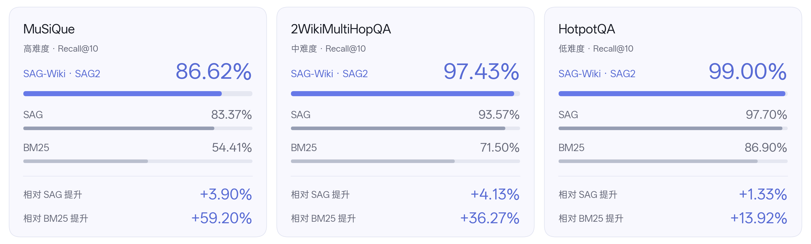
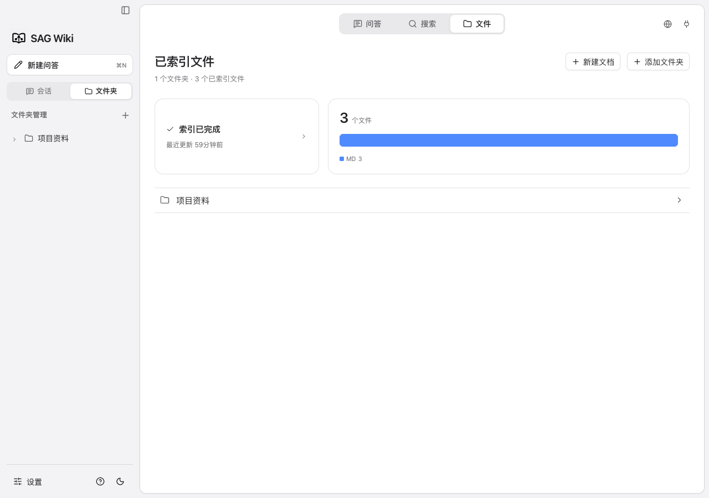
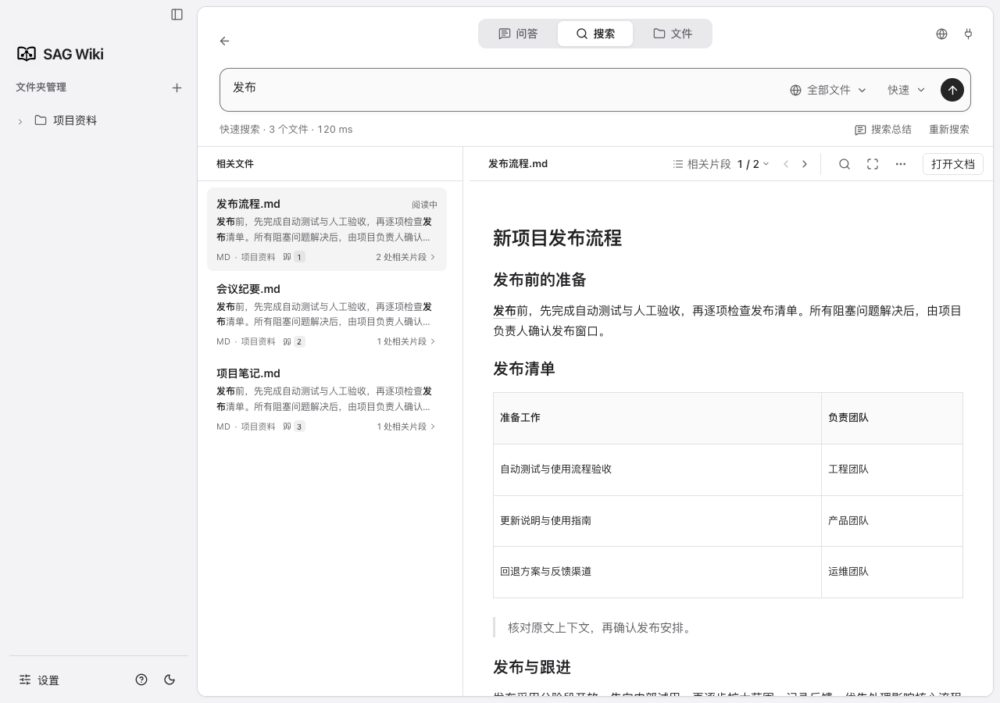
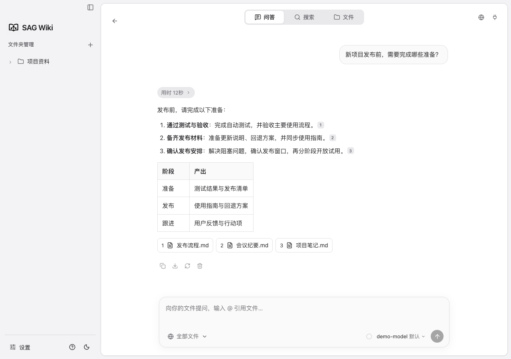
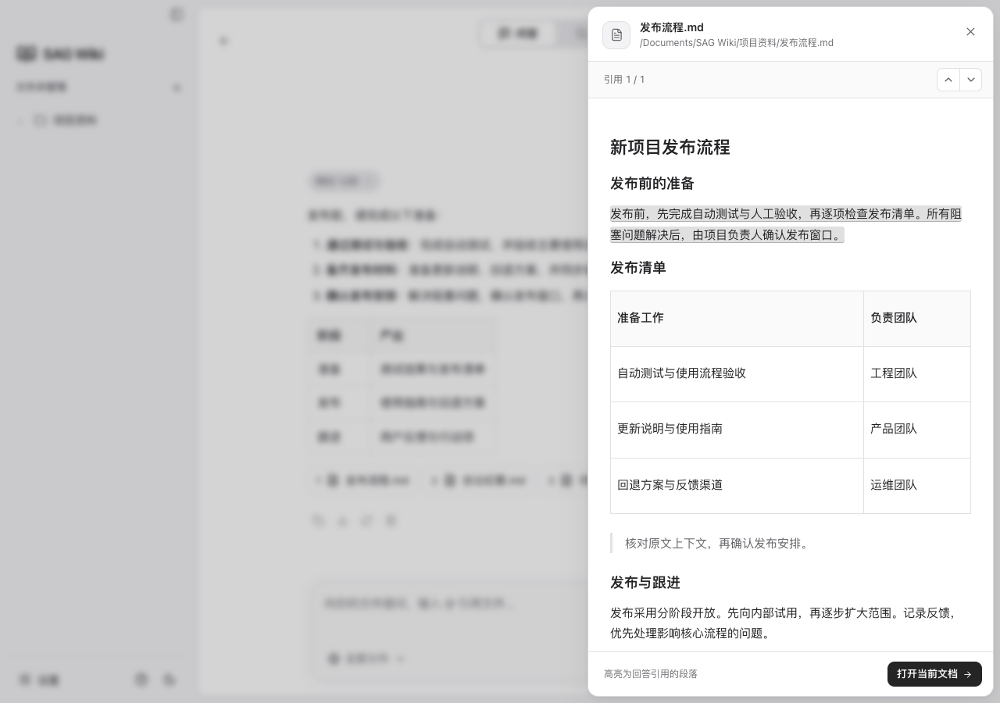
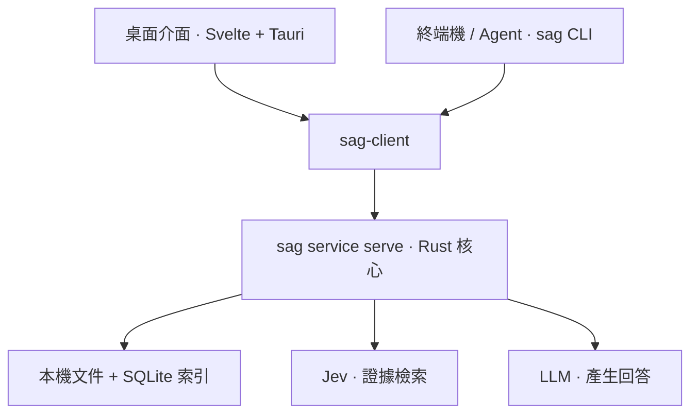
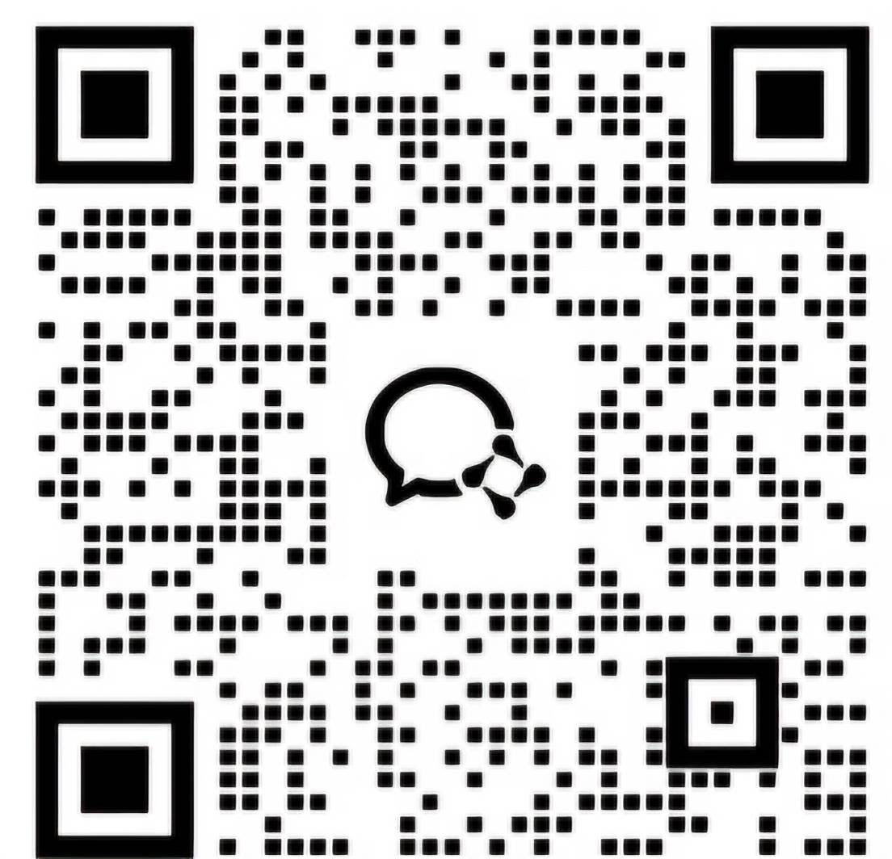

<p align="center">
  
</p>

<h1 align="center">SAG-Wiki</h1>

<p align="center">
  <a href="README.md">English</a> · <a href="README-CN.md">简体中文</a> · <strong>繁體中文</strong> · <a href="README-JA.md">日本語</a> · <a href="README-KO.md">한국어</a> · <a href="README-ES.md">Español</a> · <a href="CHANGELOG.md">更新記錄</a>
</p>

<p align="center">
  <a href="https://arxiv.org/abs/2610.22588"></a>
  <a href="https://github.com/Zleap-AI/SAG-Wiki/releases/latest"></a>
  
  
  
  <a href="LICENSE"></a>
</p>

<p align="center"><strong>輕量易用，快速索引，精準檢索。</strong></p>

<p align="center">
  為個人與 Agent 提供的輕量知識庫。索引與檢索不呼叫 LLM，讓本機文件、筆記和程式碼隨時可查，問答時可核對原文。
</p>

https://github.com/user-attachments/assets/082b64d1-a9d1-4697-a0e4-3ba24397da94

PDF 基礎文字建立索引後即可搜尋，OCR 與表格辨識仍會在背景執行。本機 Office、RTF 等文件可獨立建立基礎索引，PDF 分段沿用已載入的模型。各版本變更見[更新記錄](CHANGELOG.md)，使用方法見[文件網站](docs-site/README.md)。下方下載入口指向已發布的最新正式版。

## 目錄

<p align="center">
  <a href="#project">專案介紹</a> ·
  <a href="#technology">技術原理</a> ·
  <a href="#user-guide">使用者指南</a> ·
  <a href="#agent-guide">Agent 指南</a> ·
  <a href="#developer-guide">開發者指南</a> ·
  <a href="#community">社群交流</a>
</p>

---

<a id="project"></a>

## 一分鐘了解 SAG-Wiki

[下載 macOS / Windows 最新桌面版](https://github.com/Zleap-AI/SAG-Wiki/releases/latest)

**給 Agent 安裝**

```text
請安裝 https://github.com/Zleap-AI/SAG-Wiki/blob/main/cli/skills/sag/SKILL.md 並依照其中的 setup 流程設定目前專案。
```

安裝檔大小不含視需求下載的圖片辨識與影音元件。

新增一個資料夾，就能搜尋其中的文件、筆記和程式碼。查找原文、跨文件提問、核對答案出處，也可以讓程式開發 Agent 使用同一份知識庫。

- **輕**：不需額外安裝資料庫，可選辨識元件按需單獨下載。
- **快**：百萬字索引約 **200 ms**，索引和檢索不呼叫 LLM。
- **準**：原創 **SAG2** 檢索技術，檢索效果超越 RAG、GraphRAG 等。

上面的索引指標指文字索引，不包含文件轉換、OCR 和表格辨識，與整份 PDF 的處理時間不同。

你還可以編輯 Markdown、閱讀 HTML、探索文件關聯，或直接在終端機搜尋。PDF、Office、EPUB 等文件內建轉換，直接加入同一知識庫。圖片辨識與影音轉錄視需求安裝元件。

若 DOCX 或 PPTX 含有大量圖片，但你只需要搜尋文字，可在「設定 → 檔案設定」開啟「Office 僅提取文字」（預設關閉）。程式會在載入前略過圖片和內嵌物件，且不會辨識圖片中的文字。詳見[檔案格式與進階設定](docs-site/content/docs/folders.en.mdx#office-text-only)（英文）。

### 與 LLM Wiki、RAG 的比較

| 功能 | **SAG-Wiki** | LLM Wiki | 典型向量 RAG |
| --- | --- | --- | --- |
| 開始使用 | **新增本機資料夾** | 讓 Agent 閱讀資料並維護 Wiki 頁面 | 匯入文件、切分並建立向量索引 |
| 建立知識庫所需條件 | **不呼叫 LLM，不需 Embedding** | LLM 產生和維護摘要、頁面與連結 | Embedding 模型產生文件向量 |
| 檢索內容 | **原始文件，保留段落位置** | 模型整理後的 Wiki 頁面 | 已建立索引的文件片段 |
| 文件更新 | **監聽本機文件，只更新有變動的部分索引** | 讓 Agent 更新相關頁面 | 更新受影響的片段和向量 |
| 查找資訊 | **SAG2 跨文件精準檢索** | 閱讀和查詢已整理的頁面與連結 | 依向量相似度找出候選，可配合重排 |
| 日常使用 | **桌面搜尋、引用問答、文件編輯、關聯探索** | Agent 工作流程與 Markdown 編輯器 | 依應用程式而異 |
| Agent 使用方式 | **獨立 CLI 與可安裝的 Skill** | 透過指令維護和讀取 Wiki | 透過應用提供的工具或 API |

對照採用 [Karpathy 的 LLM Wiki 模式](https://gist.github.com/karpathy/442a6bf555914893e9891c11519de94f)與[典型向量 RAG 流程](https://docs.langchain.com/oss/python/deepagents/retrieval)，實際功能視實作而定。

---

<a id="technology"></a>

## 技術原理

SAG-Wiki 基於我們原創的 **SAG2 檢索方法**。本機建立知識庫不需向量模型或 LLM，檢索時透過 Jev 判斷候選片段能否作為證據，視需要擴充查詢，找出不同文件中的相關原文。需要產生回答時，再呼叫使用者設定的 LLM。

https://github.com/user-attachments/assets/439bbb1c-3fd8-41e1-a77b-865e8dce4d48

<p align="center">
  
</p>

<sub>圖中 SAG-Wiki 展示其底層 SAG2 的基準測試結果，指標為前 10 條結果的證據召回率。SAG2 每項評估 1,000 題，MuSiQue 用於方法開發。SAG、BM25 為原 SAG 論文參考值。難度為展示分級，相對提升依圖示分數計算。</sub>

**[閱讀 SAG2 論文](https://arxiv.org/abs/2610.22588)** · 完整原理、實驗結果與重現程式碼請檢視 **[SAG-Benchmark](https://github.com/Zleap-AI/SAG-Benchmark)**。

---

<a id="user-guide"></a>

## 使用者指南

| 功能 | 使用條件 |
| --- | --- |
| 文件索引、快速搜尋 | 新增資料夾即可，不需 API Key |
| SAG2 精準檢索 | 設定決策模型；需要鑑權時填寫 API Key |
| 引用問答 | 設定問答模型與 API Key。使用 SAG2 檢索時還需設定決策模型 |

SAG-Wiki 本身免費且開放原始碼，外部服務是否收費及費用以所選服務商為準。原始檔案保留在本機。深入檢索與問答會將所需問題、文件片段或前後文傳送給你設定的服務。

### 1. 下載，新增資料夾

從上方最新版本連結下載 macOS DMG，開啟後將 SAG Wiki 拖曳至「應用程式」。macOS 應用程式、隨附的 CLI 與 DMG 已使用 Developer ID 簽署並通過 Apple 公證。

安裝並開啟 SAG-Wiki，先切換到側邊欄「資料夾」，再點選「資料夾管理」旁的 **+**，新增需要檢索的資料夾。原始檔案保留在原處。

<p align="center">
  
</p>

### 2. 搜尋，檢視原文

基礎文字建立索引後即可搜尋。混合內容或掃描版 PDF 會在背景繼續進行 OCR 和表格辨識。檔案清單會顯示基礎文字是否可搜尋，以及後續處理是等待中、進行中或失敗。即使後續處理失敗，已建立索引的文字仍可搜尋。純掃描件須等文字辨識和索引完成後才能搜尋。若需要查遍整份文件，請等待處理完成並核對原文。快速搜尋可直接在本機使用。在「設定 → 模型設定」設定決策模型後，即可使用深入語意搜尋。

使用相容 Jev 協定的本機決策模型時，選擇「自訂」，填寫服務提供的模型名稱及基礎網址（如 `http://127.0.0.1:8000/v1`），或完整的 `/systemone`、`/decisions` 端點網址。服務不要求 API Key 時，將「決策模型鑑權方式」設為「不必鑑權」。此模式不傳送驗證標頭，並移除已儲存的決策模型金鑰。服務必須支援 Jev 的 `state`、`questions` 與 `answers.*.noul` 協定。CLI 可執行 `sag config --url http://127.0.0.1:8000/v1 --model YOUR_MODEL --auth none`。切回需要金鑰的服務時使用 `--auth bearer --key-stdin`，並輸入該服務的金鑰。

<p align="center">
  
</p>

### 3. 提問，核對出處

在「設定 → 模型設定」設定問答模型後，進入「問答」直接提問。輸入 `@` 可以指定文件，點選答案中的引用即可檢視對應原文。

<p align="center">
  
</p>

<p align="center">
  
</p>

---

<a id="agent-guide"></a>

## Agent 指南

將下列指示交給 Agent。

```text
請安裝 https://github.com/Zleap-AI/SAG-Wiki/blob/main/cli/skills/sag/SKILL.md 並依照其中的 setup 流程設定目前專案。
```

支援 **Claude Code、Codex、OpenCode**。Skill 包含 CLI 安裝、設定、專案索引和驗證流程。**不需安裝 SAG Wiki 桌面應用程式，也能單獨使用 CLI**。安裝桌面應用程式後，兩者共用設定和知識庫。既有設定會直接沿用，使用 API Key 鑑權時，首次語意檢索需要在終端機中私下輸入自己的決策模型 API Key。請透過 GitHub 上的 Skill 連結安裝，Agent 會從同一目錄取得相關檔案。

安裝 Node.js 18 或更新版本後，執行下列指令。

```sh
npm install -g @zleap-ai/sag
```

[已發布的 npm 套件](https://www.npmjs.com/package/@zleap-ai/sag)包含 **macOS Apple Silicon 和 Intel（Intel 自 `0.3.11` 起支援）、Windows x64 和 Linux ARM64 / x86_64** 執行檔（Linux 已在 Ubuntu 24.04、Debian 12 驗證），不需 Rust 工具鏈或原始碼編譯。安裝 CLI 不會安裝桌面應用程式。

<details>
<summary>手動安裝與使用</summary>

已有 `sag` 指令可直接沿用。若尚未安裝，請執行上面的 npm 安裝指令，然後在終端機檢查版本並完成首次決策模型設定。

```sh
sag --version
sag
```

將連結中的 [Skill 資料夾](https://github.com/Zleap-AI/SAG-Wiki/tree/main/cli/skills/sag)（包含 `SKILL.md` 和 `references/`）放到對應 Agent 的目錄：

| Agent | Skill 資料夾 |
| --- | --- |
| Codex | `~/.agents/skills/sag/` |
| Claude Code | `~/.claude/skills/sag/` |
| OpenCode | `~/.config/opencode/skills/sag/` |

開啟新的 Agent 工作階段。在需要檢索的專案目錄執行，確認索引就緒後開始搜尋。

```sh
sag add
sag check
sag "權限在哪裡檢查？" . -m 5
```

對於大型資料夾，可使用 `sag add --timeout 3600` 延長等待。等待逾時不會移除目錄或停止背景索引，可用 `sag list --json` 檢視進度。

完整的 Agent 安裝流程見 Skill 的 [setup 指南](cli/skills/sag/references/setup.md#first-use-setup)，其他指令見 [CLI 使用說明](docs/zh-CN/CLI与Harness使用说明.md)。

</details>

---

<a id="developer-guide"></a>

## 開發者指南

**Rust CLI 提供底層執行環境。** `sag` 執行檔啟動共用的本機服務，命令列和 Tauri 桌面應用程式透過同一個用戶端連線到服務。索引、檢索和模型設定共用同一核心，關閉桌面應用程式後 CLI 仍可使用。



| 目錄 | 內容 |
| --- | --- |
| `src/` | 桌面介面 |
| `src-tauri/` | 桌面系統功能與服務連線 |
| `cli/` | 命令列入口與 Skill 安裝 |
| `core/` | 索引、檢索和問答 |
| `client/`、`protocol/` | 用戶端通訊與協定 |

按[環境說明](docs/zh-CN/开发指南.md#环境)準備 Node.js、Rust 和對應系統的 Tauri 開發相依項目，再執行下列指令。

```sh
git clone https://github.com/Zleap-AI/SAG-Wiki.git
cd SAG-Wiki
npm ci
npm run tauri dev
```

修改後執行 `npm run check` 和 `npm test`，完整檢查指令見[程式碼檢查](docs/zh-CN/开发指南.md#代码检查)。建置和實作細節見[開發指南](docs/zh-CN/开发指南.md)、[架構設計](docs/zh-CN/架构设计.md)與[文件目錄](docs/zh-CN/README.md)。

---

## 參與貢獻與授權

歡迎透過 [Issues](https://github.com/Zleap-AI/SAG-Wiki/issues) 回報問題，透過 [Pull Requests](https://github.com/Zleap-AI/SAG-Wiki/pulls) 參與開發。修改應用程式時請參照[開發指南](docs/zh-CN/开发指南.md)。檢索研究與實驗重現請前往 [SAG-Benchmark](https://github.com/Zleap-AI/SAG-Benchmark)。

SAG-Wiki 使用 [MIT 授權條款](LICENSE)。第三方相依套件的授權保留在 [src-tauri/licenses](src-tauri/licenses/) 中。

---

<a id="community"></a>

## 社群交流

歡迎加入 SAG 的 Discord 或微信社群，與維護者及其他使用者交流。

<table align="center">
  <tr>
    <th>Discord</th>
    <th>微信</th>
  </tr>
  <tr>
    <td align="center"></td>
    <td align="center"></td>
  </tr>
</table>
