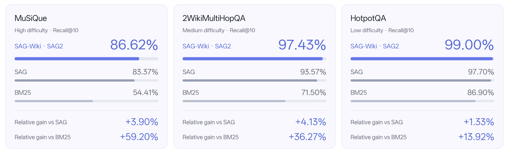
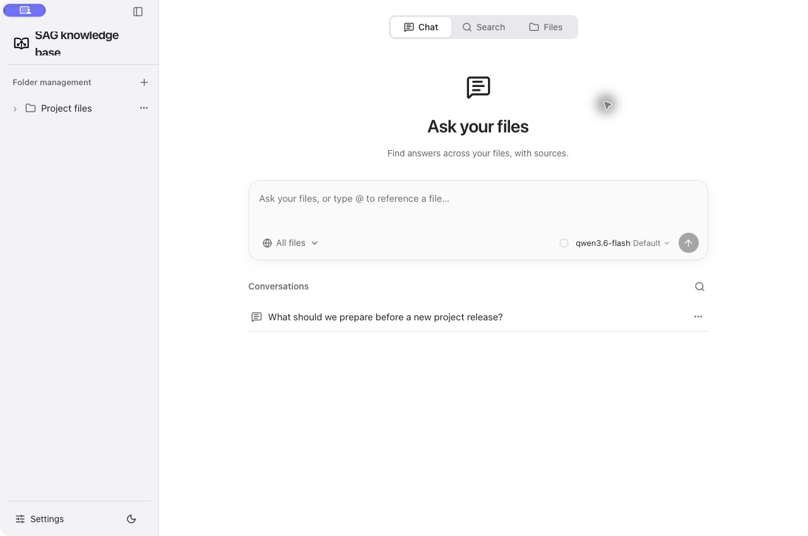
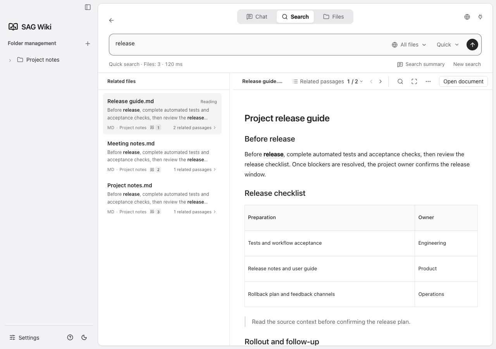
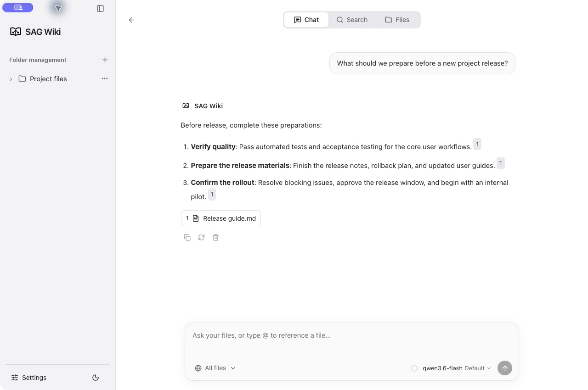
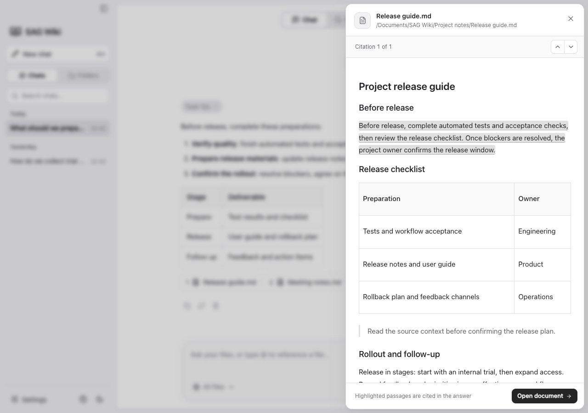
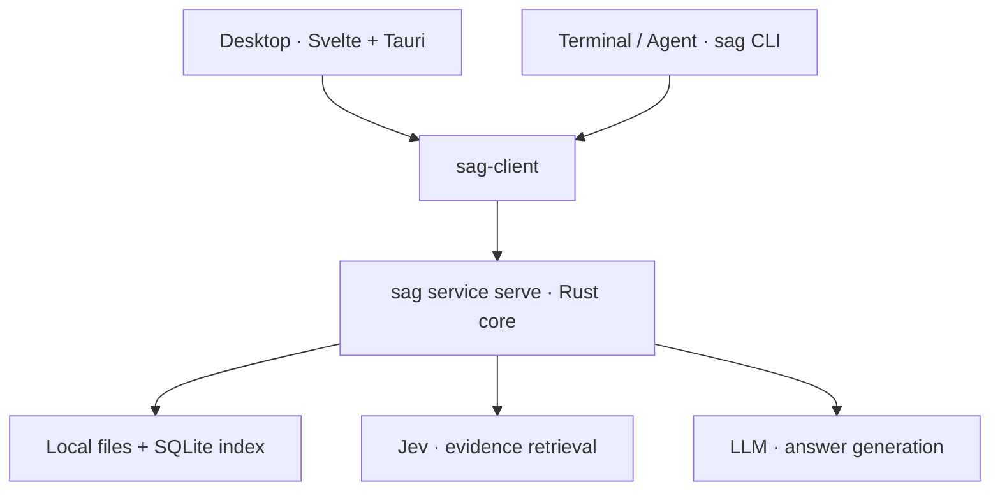

<p align="center">
  
</p>

<h1 align="center">SAG-Wiki</h1>

<p align="center">
  <strong>English</strong> · <a href="README-CN.md">简体中文</a> · <a href="CHANGELOG.md">Changelog</a>
</p>

<p align="center">
  <a href="https://arxiv.org/abs/2610.22588"></a>
  <a href="https://github.com/Zleap-AI/SAG-Wiki/releases/latest"></a>
  
  
  
  <a href="LICENSE"></a>
</p>

<p align="center"><strong>Lightweight and easy. Fast indexing. Precise retrieval.</strong></p>

<p align="center">
  A lightweight knowledge base for people and agents. Index and search your local files without LLM calls, then ask questions with answers you can trace to the source.
</p>

https://github.com/user-attachments/assets/e9c5499d-6057-4add-ac7e-f57eae381a2f

## Contents

<p align="center">
  <a href="#project">Project</a> ·
  <a href="#technology">Technology</a> ·
  <a href="#user-guide">User Guide</a> ·
  <a href="#agent-guide">Agent Guide</a> ·
  <a href="#developer-guide">Developer Guide</a> ·
  <a href="#community">Community</a>
</p>

---

<a id="project"></a>

## SAG-Wiki in one minute

| System | Download | Size |
| --- | --- | --- |
| macOS | [v0.1.9](https://github.com/Zleap-AI/SAG-Wiki/releases/download/v0.1.9/SAG-Wiki-0.1.9-macOS-arm64.dmg) | 14.4MB |
| Windows | [v0.1.9](https://github.com/Zleap-AI/SAG-Wiki/releases/download/v0.1.9/SAG-Wiki-0.1.9-Windows-x64-setup.exe) | 10.9MB |

**Upgrading from 0.1.8 or earlier:** manually install 0.1.9 once to switch to the new update signing key. Future versions can use in-app updates. [Migration details](docs/en/app-update-publishing.md).

**Install for your agent**

```text
Install https://github.com/Zleap-AI/SAG-Wiki/blob/main/cli/skills/sag/SKILL.md and follow its setup flow for my current project.
```

The installer size excludes optional document conversion components and recognition models downloaded on demand.

Add a folder to make your documents, notes, and code searchable. Find a passage, ask a question across files, open the source behind an answer, or give your coding agent access to the same knowledge base.

- **Light:** just **14 MB** to download, with no separate database to install.
- **Fast:** index a million characters in approximately **200 ms**, with no LLM calls for indexing or retrieval.
- **Precise:** our original **SAG2** retrieval technology outperforms RAG, GraphRAG, and other approaches.

Read and edit Markdown, preview HTML, explore related documents, or search from the terminal. PDF, Office, and EPUB documents convert out of the box; image recognition and audio/video transcription are optional components.

### How it compares

| Capability | **SAG-Wiki** | LLM Wiki | Typical vector RAG |
| --- | --- | --- | --- |
| Getting started | **Add a local folder** | Have an agent read sources and maintain wiki pages | Import documents, split them, and build a vector index |
| Preparing knowledge | **No LLM calls or embeddings** | An LLM writes and updates summaries and links | An embedding model encodes document chunks |
| Knowledge you search | **Original documents, with passage locations** | Generated, interlinked wiki pages | Indexed document chunks |
| File changes | **Watch local files and update the index** | Have the agent revise affected pages | Update affected chunks and embeddings |
| Finding information | **SAG2 evidence retrieval across files** | Navigate and query the maintained wiki | Retrieve by vector similarity, optionally with reranking |
| Everyday use | **Desktop search, cited Q&A, document editing, and relationship exploration** | Agent workflows and a Markdown editor | Depends on the application |
| Agent access | **CLI and a ready-to-install Skill** | Instructions for maintaining and reading the wiki | Application-specific tools or APIs |

The comparison uses [Karpathy's LLM Wiki pattern](https://gist.github.com/karpathy/442a6bf555914893e9891c11519de94f) and the [standard vector RAG workflow](https://docs.langchain.com/oss/python/deepagents/retrieval). Features vary by implementation.

---

<a id="technology"></a>

## Technology

SAG-Wiki runs on **SAG2, our original retrieval method**. It builds a local index without embeddings or LLM calls, then uses Jev evidence scoring and query-time expansion to find supporting passages across documents. LLMs are used when you choose to generate an answer.

https://github.com/user-attachments/assets/bcdf9dbf-7535-41d6-bd22-bde0ea824525

<p align="center">
  
</p>

<sub>SAG-Wiki is represented by its underlying SAG2 benchmark results. Recall@10 measures evidence recall in the first ten results. SAG2 uses 1,000 questions per benchmark; MuSiQue was used for method development. SAG and BM25 are reference values from the original SAG paper. Difficulty labels are presentation categories; relative gains use the displayed scores.</sub>

**[Read the SAG2 paper](https://arxiv.org/abs/2610.22588)** · For the method, benchmark results, and reproduction code, see **[SAG-Benchmark](https://github.com/Zleap-AI/SAG-Benchmark)**.

---

<a id="user-guide"></a>

## User Guide

| Feature | What you need |
| --- | --- |
| File indexing and quick search | Add a folder; no API key needed |
| SAG2 semantic retrieval | Configure a Jev service; supply an API key when required |
| Cited Q&A | Configure an answer model and API key; SAG2 retrieval also requires Jev configuration |

SAG-Wiki itself is free and open source. External service charges depend on your chosen provider. Original files stay on your machine; in-depth retrieval and Q&A send the required questions, document passages, or context to the services you configure.

### 1. Download and add a folder

Download the DMG from the table above, open it, and drag SAG Wiki into Applications. The current macOS build is not Apple-notarized, so macOS may display a security prompt on first launch.

Install and open SAG-Wiki, then click **+** beside folder management to add the folder you want to search. Your files stay in their original locations.

<p align="center">
  
</p>

### 2. Search your files

Once indexing finishes, use **Search** to find passages and preview the source. Quick search works locally; configure Jev in **Settings → Models** for in-depth semantic retrieval.

For a local Jev service, select **Custom** and enter its model name and base URL (for example, `http://127.0.0.1:8000/v1`), or its complete `/systemone` or `/decisions` endpoint. Choose **No authentication** under **Jev authentication** if the service does not require an API key; this omits the authorization header and removes the saved Jev key. The service must implement Jev’s `state`, `questions`, and `answers.*.noul` protocol. For the CLI, run `sag config --url http://127.0.0.1:8000/v1 --model YOUR_MODEL --auth none`. To switch back to a keyed service, use `--auth bearer --key-stdin` and enter that service’s key.

<p align="center">
  
</p>

### 3. Ask questions and check the source

Configure your answer model in **Settings → Models**, then ask in **Chat**. Use `@` to select files, and click a citation to see the passage supporting the answer.

<p align="center">
  
</p>

<p align="center">
  
</p>

---

<a id="agent-guide"></a>

## Agent Guide

Give your agent this one sentence:

```text
Install https://github.com/Zleap-AI/SAG-Wiki/blob/main/cli/skills/sag/SKILL.md and follow its setup flow for my current project.
```

SAG supports **Claude Code, Codex, and OpenCode**. The Skill includes CLI installation, configuration, project indexing and verification. **The CLI works without SAG Wiki desktop** and shares its settings and knowledge base when the desktop is installed. Existing settings are reused; API-key-authenticated semantic search needs your own Jev key, entered privately in a terminal. The GitHub Skill link is the canonical installation entry; the agent retrieves its supporting files from the same directory.

With Node.js 18 or later installed:

```sh
npm install -g @zleap-ai/sag
```

The published **0.1.5** npm package includes **macOS Apple Silicon and Windows x64** binaries. It requires no Rust toolchain or source compilation. Installing the CLI does not install the desktop app.

<details>
<summary>Manual installation and usage</summary>

If `sag` is already installed, reuse it. Otherwise run the npm command above, then verify the command and complete first-time Jev setup in a terminal:

```sh
sag --version
sag
```

Install the linked [Skill folder](https://github.com/Zleap-AI/SAG-Wiki/tree/main/cli/skills/sag), including `SKILL.md` and `references/`, at the location for your agent:

| Agent | Skill folder |
| --- | --- |
| Codex | `~/.agents/skills/sag/` |
| Claude Code | `~/.claude/skills/sag/` |
| OpenCode | `~/.config/opencode/skills/sag/` |

Start a new agent session. In the project you want to search, add the folder and confirm indexing is ready before searching:

```sh
sag add
sag check
sag "Where is permission checked?" . -m 5
```

See the Skill's [setup guide](cli/skills/sag/references/setup.md#first-use-setup) for the complete agent workflow and the [CLI guide](docs/en/cli-and-harness.md) for other commands.

</details>

---

<a id="developer-guide"></a>

## Developer Guide

The **Rust CLI is the runtime foundation**. The `sag` executable starts a shared local service; both terminal commands and the Tauri desktop connect to it through the same client. Indexing, retrieval, and model configuration live in one core, and remain available after the desktop exits.



| Directory | Contents |
| --- | --- |
| `src/` | Desktop interface |
| `src-tauri/` | Desktop system features and service connection |
| `cli/` | Command-line entry point and Skill installation |
| `core/` | Indexing, retrieval, and Q&A |
| `client/`, `protocol/` | Client communication and protocol |

Follow the [environment guide](docs/en/development.md#environment) to prepare Node.js, Rust, and your platform's Tauri development dependencies, then run:

```sh
git clone https://github.com/Zleap-AI/SAG-Wiki.git
cd SAG-Wiki
npm ci
npm run tauri dev
```

After changes, run `npm run check` and `npm test`; the [checks section](docs/en/development.md#code-checks) lists all validation commands. See the [development guide](docs/en/development.md), [architecture](docs/en/architecture.md), and [documentation index](docs/en/README.md) for builds and implementation details.

---

## Contributing and License

Contributions are welcome through [Issues](https://github.com/Zleap-AI/SAG-Wiki/issues) and [Pull Requests](https://github.com/Zleap-AI/SAG-Wiki/pulls). For changes to the application, follow the [development guide](docs/en/development.md); retrieval research and reproduction code live in [SAG-Benchmark](https://github.com/Zleap-AI/SAG-Benchmark).

SAG-Wiki is released under the [MIT License](LICENSE). Third-party notices are in [src-tauri/licenses](src-tauri/licenses/).

---

<a id="community"></a>

## Community

Join the SAG community on Discord or WeChat to connect with maintainers and other users.

<table align="center">
  <tr>
    <th>Discord</th>
    <th>WeChat</th>
  </tr>
  <tr>
    <td align="center"></td>
    <td align="center"></td>
  </tr>
</table>
