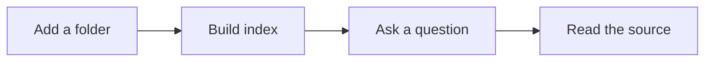

These screenshots use example folders and copies of 34 Markdown documents from HowToLiveBetter. The example source text is Chinese; document counts, connections and shared terms depend on your own files. Click a screenshot to enlarge it.

## Browse files

Open **Files** in the top navigation and choose an added folder. The list shows the files and subfolders at the current level. Click an indexed file to read its contents, or **Back to parent folder** to go up one level.


Documents opened from Q&A or search retain their source page. Use Back after reading to continue that conversation or search.

### Filter by index status

Inside a folder, select the filter beside the file count to cycle through **All**, **Indexed** and **Not indexed**. The filter applies to files at the current level; subfolders remain visible so you can continue browsing.

The folder title, file count and filter stay fixed at the top of the list while you scroll, so they remain visible and usable.


Files that are not indexed appear gray. Selecting one prompts you to check file formats and conversion settings. Use **Open settings** to review enabled file types. For indexing failures, check the cause in [indexing details](/en/docs/folders#reindex-and-history). Filtering does not change the indexing scope or delete files.

## Create a document

Click **New document** on the **Files** page to open a blank Markdown editor and start writing. If the document is still untitled when you first click **Save**, a filename field opens with the default name selected for replacement. The `.md` extension is added automatically if omitted. If you have already changed the name in the editor, saving does not ask for it again. When creating from the **Indexed files** overview, also choose a destination folder; the first added folder is selected by default. The destination picker shows a folder tree with folder names only. Expand folders to select a subfolder. You can also start writing before any folders are added, then add a folder when saving.


Confirm the name and destination to write the file and update its index. Canceling keeps the filename and content so you can continue editing. Documents created inside a folder save to that folder: untitled documents ask for a name first, while named documents save directly. Later saves update the existing file directly.

## Read and edit Markdown

Open a Markdown file to read and edit it in the same window. The toolbar supports headings, bold text, lists, quotes and code blocks. Click **Save**, or press `⌘ S` / `Ctrl S`, after making changes.

Click the folder name to the left of the filename to view and select the full folder path for copying. Click outside or press `Esc` to close the path popup.


Saving modifies the local source file. If the app reports an external editing conflict, follow the prompt to avoid overwriting changes from another program. HTML documents open in a reading view; search and citations can locate matching content.

### Ask about the current document

Click **Chat** in the bottom-right corner of a document, enter a question in the single-line field, and select Send on the far right or press `Enter`. The app starts a new conversation, switches to Chat, and automatically references the current file, with the scope limited to that file.


The current model reads content as needed through the SAG file tools; referencing a file does not automatically add its full text to the context. Unsaved changes in an existing document prompt you to save first. New documents must be saved before their file can be referenced. Canceling keeps the question you entered.

### Document outline

The Markdown editor shows a heading outline on the left, with indentation for heading levels one through six. Click a heading to jump to its section. The current section is highlighted as you scroll, and editing a heading updates the outline. Documents without headings do not show an outline.


When there is enough room, the outline opens in the margin to the left of the document and widens with the available space to show more of longer headings. Expanding or collapsing it keeps the document centered at the same width. Narrower layouts show an expand button; opening the outline reduces the text area only when space is limited, so it does not cover the content. Your choice is kept for the current document. Navigating the outline does not change the document or mark it as unsaved.

### Mermaid diagrams

Markdown code blocks marked `mermaid` are rendered locally as SVG with [Pele](https://github.com/obsidianmd/pele). Supported diagrams include flowcharts, sequence diagrams, class diagrams, state diagrams, entity relationships and pie charts. The document editor shows the diagram by default. Search previews, citation documents and Q&A content also display diagrams.

````markdown

````


Hover over the diagram and click **Edit** to show the source. After making changes, click **Preview** to return to the diagram. You can also reach the edit button with Tab. Saving writes the original Markdown code block. Invalid syntax or content exceeding rendering limits displays an error and keeps the source available for editing. External images and navigation links inside diagrams are disabled.

## Read converted documents

After an Office document, PDF or ebook has been parsed and indexed, select its original file in the list to open the corresponding Markdown conversion. The original file also appears under **Indexed**, so you do not need to find the conversion directory manually.

Conversions are stored in `.sag-converted/` under the added root folder, preserving the original subfolder structure. Editing and saving a conversion changes only that Markdown file; the original Office document, PDF or other source remains unchanged. See [Document formats and conversion](/en/docs/folders#other-formats-and-conversion) for supported types and component requirements.

## Enter Explore mode

Click **Explore mode** in a folder to see its document relationships. Each node represents a document; a connection indicates similar content. Counts above the graph show the documents and connections in the current view.


- **Find a document**: enter part of a filename above the graph, such as `时间`, then choose a result.
- **Preview content**: select a node to show its source preview, related files and shared terms. Select a related file to continue exploring.
- **Adjust the view**: drag the background to pan, use the scroll wheel or lower-right buttons to zoom, and click **Fit** to fit the graph to the window. Hover over a node to see its filename.
- **Connection strength**: use the upper-right slider to filter connections. Higher thresholds retain stronger relationships.

The graph uses local term statistics and does not call Jev or the answer model. Connections help you discover related content; they do not establish citations or causality.

## Explore a local graph

Select a document and click **Local graph** in the preview, or double-click its node, to focus on its local relationships.


1. Select a document in the overview, such as `04-不要浪费时间.md`.
2. Enter its local graph and continue through related files in the preview. **Evidence** shows content and terms supporting the connection.
3. Click **Back** to undo one exploration step, or **Overview** to return to the whole folder.
4. Click **Open document** for full reading, or **Back to file tree** to return to the file list.

A document's visible neighbors can change with the selected scope and connection-strength threshold.
