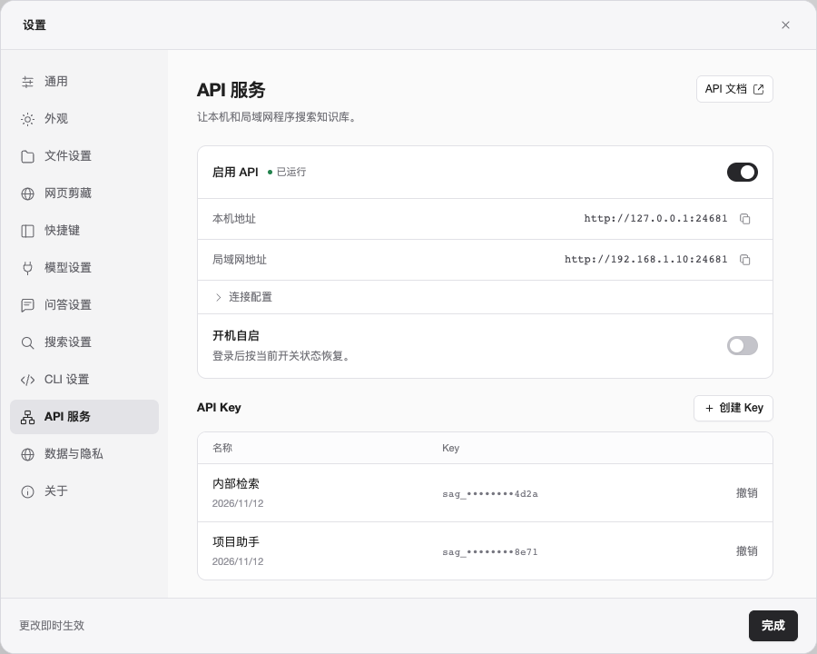
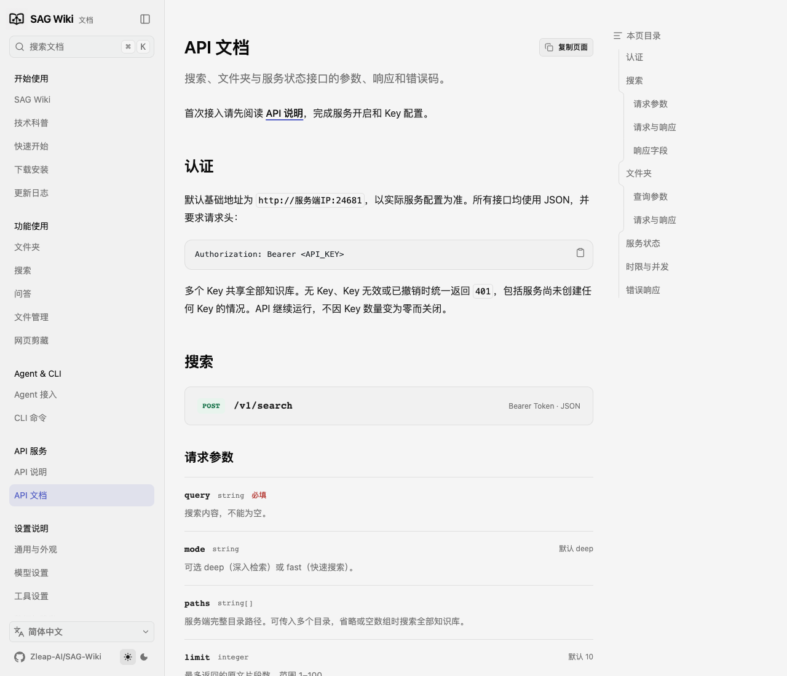
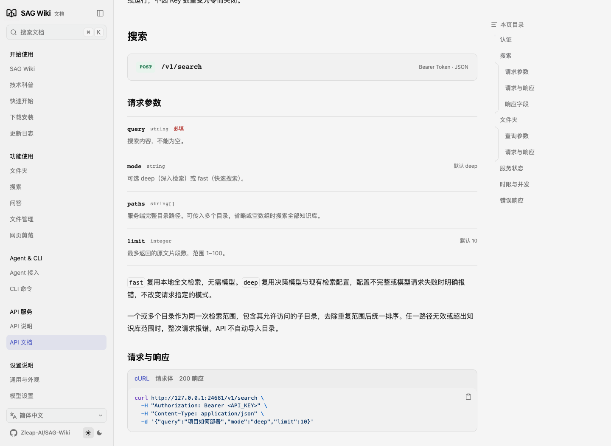
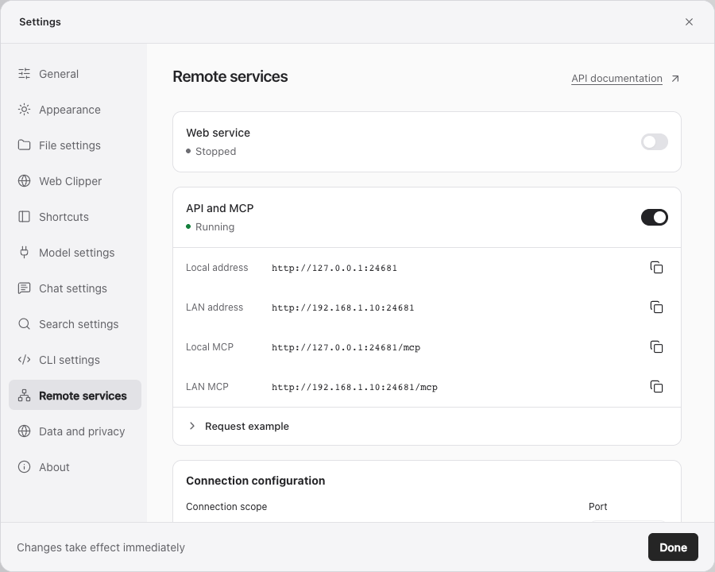

# SAG CLI and HTTP API design

[简体中文](../zh-CN/CLI与HTTP_API设计.md) · [Documentation index](README.md)

Date: 2026-11-12

Status: the API service, CLI management and desktop settings are implemented as described here. This document keeps the design conventions; implementation and verification results are in section 17.

## 1. Goals and scope

With only the standalone CLI installed, users can turn on an HTTP API on a local computer or server so other programs on the same computer or local network can search the knowledge base. The desktop app is an optional front end that shares the service, knowledge base, model settings and API settings with the CLI.

The first version includes:

- Fast search and deep search, chosen by a request parameter. Deep search is the default.
- Results returned as source passages; requests wait synchronously for the search to finish.
- Listing all root folders and browsing subfolders level by level.
- Choosing search folders by full server-side path, with multiple folders per request.
- Multiple API keys that all share the same knowledge base, without per-folder permissions.
- CLI management of API start/stop, keys and launch at startup.
- Desktop settings for the API switch, listen address, port, keys and launch at startup.
- Standalone CLI/API support for Linux ARM64 and x86_64, verified on Ubuntu/Debian and installed primarily through npm.

This round does not add question answering, answer-model settings, file upload, a separate full-text read endpoint, remote knowledge-base management, folder aliases, a public MCP service, Docker images, search pagination or asynchronous task endpoints.

Existing CLI natural-language search, folder selection, regex and fixed-string matching stay unchanged. CLI natural-language search still defaults to deep search; this round adds no CLI options for fast search or multi-folder search. New CLI capabilities are limited to API management, launch at startup and the Linux changes this requires.

## 2. Existing implementation and reuse principles

The desktop app and CLI share the SAG background service. The service owns the database, file monitoring, indexing, model requests and retrieval. The built-in MCP tools reuse these capabilities inside the service.

CLI natural-language search currently returns passage records, each with a path, heading, start and end lines and source text. One file can return several non-contiguous passages, and overlapping passages are merged. The desktop app additionally groups passages by file.

`sag config` configures the decision model. On first use the default endpoint is `https://api.zleap.com/v1` and the model is `Zev-1`; an existing configuration is reused. Fast search needs no decision model; deep search needs a working decision-model configuration.

Proposed runtime relationship:

```text
Desktop app ──┐
Existing CLI ─┼── SAG service ── shared knowledge base, index and retrieval
HTTP API ─────┘
```

The HTTP API calls existing service operations directly. It does not spawn a CLI subprocess per HTTP request or duplicate the retrieval algorithm.

Add a separate HTTP listener inside the existing service process, reusing the same service instance and task scheduling. The existing local RPC keeps its protocol and authentication; the external HTTP entry point uses separate API keys and exposes only the business endpoints defined here.

When reusing, verify that:

- HTTP, desktop and CLI long-running tasks share one concurrency limit rather than creating three separate pools of 20 tasks.
- Fast search reuses the existing local full-text search; deep search reuses the existing SAG2 and decision-model retrieval.
- Deep search only retrieves results. It does not trigger search summaries or answer generation and does not require an answer model.
- HTTP multi-folder search is not implemented by changing the existing CLI search command.
- Existing ranking, expansion rounds, model providers, indexing rules and stored source text are not changed along the way.

## 3. Network entry point and defaults

| Item | Convention |
| --- | --- |
| API state after first install | Off by default; turn on through the CLI or desktop settings |
| Access scope when on | Local computer and local network together |
| Default listen address | `0.0.0.0`, all IPv4 interfaces |
| Default port | `24681`, configurable |
| Transport | HTTP in the first version; no built-in certificate management |
| Authentication | `Authorization: Bearer <API_KEY>` |
| API path prefix | `/v1` |
| Data format | UTF-8 JSON |
| Default search mode | `deep` |
| Default result count | 10 passages, at most 100 |
| Browser cross-origin access | Off by default |

Listening on `0.0.0.0` does not filter by private address range; actual reachability depends on the host network and firewall. The program does not change the system firewall. Settings show copyable local and LAN addresses and never present `0.0.0.0` as a call address.

The first version keeps cross-origin access off and sends no CORS allow headers by default. Ordinary local and LAN programs are unaffected; web pages can call through their own backend. Allowed origins for direct browser calls can be added once there is a clear need. CORS settings do not replace API key authentication.

## 4. API start/stop and persisted state

Distinguish these states:

- **Enabled state**: whether the user wants the API on, saved in the current SAG data directory.
- **Running state**: whether the HTTP port is actually listening.
- **Launch-at-startup state**: whether the platform's autostart mechanism is registered.

| Action or event | Behavior |
| --- | --- |
| `sag api start` | Starts or connects to the SAG service, starts the HTTP listener and saves the enabled state on success |
| `sag api stop` | Saves the disabled state, stops accepting API requests, cancels API searches and closes the HTTP listener |
| Closing the terminal that ran the start command | The API and service keep running |
| Opening the desktop app | Starts or connects to the service; listens on HTTP according to the saved enabled state |
| Opening the desktop app after manually turning the API off | The API stays off |
| Closing or quitting the desktop app | The running service and API keep running |
| No valid API key | The HTTP listener keeps running; business requests return `401 Unauthorized` |
| Revoking the last API key | Cancels that key's searches; the listener and enabled state stay unchanged |
| Port in use or listening fails | Reports the error clearly without silently switching ports |
| Enabled state saved but automatic restore fails | Shows "enabled, not running" with the reason, without claiming it is running |
| `start` while already running on the same address and port | Returns the current state without creating a second listener |

Turning the API off affects only API requests; it does not stop background indexing, the desktop app or ordinary CLI tasks. `sag service stop` still stops the whole shared service, which also stops the HTTP listener; help text must make the difference from `sag api stop` clear.

Turn the API off before changing the listen address or port, then start it with the new settings, so in-flight requests are never interrupted without notice. The enabled state, listen settings and key records exist only once, and changes from the CLI and desktop settings sync immediately.

## 5. API keys

### 5.1 Permissions and authentication

- Multiple keys can be created, named and revoked individually.
- All keys have the same permissions: they can search everything added to the knowledge base and browse the corresponding folders.
- Keys stay valid until revoked; this round adds no expiry or renewal.
- Search, folder listing and the HTTP status endpoint all require a valid key.
- Keys are never accepted as URL query parameters.
- A missing, invalid or revoked key always returns `401` with error code `unauthorized`.
- With no valid keys, the API can start and keep listening, and every business request returns unauthorized.
- The connection token of SAG's local internal RPC is managed separately from HTTP API keys.

### 5.2 Creating, showing and revoking

- Creation returns the full key; afterwards the list shows only the key ID, name, partial identifier and creation time.
- The full key is shown once, at creation; users store it themselves.
- Keys are sufficiently random; the server stores a verification digest, never the full key in plain text.
- Key records and API settings use private file permissions for the current user, following the project's existing per-platform handling.
- Logs, error responses and configuration output never contain the full key.
- Revocation blocks new requests immediately and cancels that key's running or queued API searches.
- Revoking a key does not affect other keys, the desktop app or ordinary CLI tasks.
- Responses already completed and sent are not recalled; cancelled searches no longer return normal results.
- Revoking the last key does not turn the API off and does not change launch at startup or the enabled state.

The local CLI and desktop settings manage keys through the existing local communication channel and operating-system account permissions, without first holding an HTTP API key. HTTP offers no endpoints for creating, revoking or otherwise managing keys.

## 6. HTTP endpoints

The field names, command spellings and error codes below are the proposed specification; the confirmed rules for modes, scope, timeouts, permissions and lifecycle must be followed.

Naming: parameters, JSON fields, settings and error codes related to the decision model use `decision`, called "decision model" in prose, for example `decision_configured`, `decision_not_configured` and `decision_request_failed`. Provider model IDs such as `Zev-1` are kept as is.

### 6.1 `POST /v1/search`

Example request:

```json
{
  "query": "How is the project deployed",
  "mode": "deep",
  "paths": [
    "/data/projects",
    "/data/tech-docs/deployment"
  ],
  "limit": 10
}
```

| Field | Type | Rules |
| --- | --- | --- |
| `query` | string | Required; must not be empty after trimming whitespace |
| `mode` | string | Optional, `fast` or `deep`, default `deep` |
| `paths` | string array | Optional full folder paths on the server; omitted or empty means the whole knowledge base |
| `limit` | integer | Optional, default 10, range 1–100, maximum number of passages returned |

The first version has no request parameter to extend the server's 30/60-second limits. Callers can set a shorter HTTP timeout of their own; when they disconnect, the server cancels the search.

Search rules:

1. `fast` uses the existing local full-text search and needs no model.
2. `deep` uses the existing decision model and retrieval parameters. If the model is not configured or the call fails, it returns a clear error and keeps the mode the caller chose.
3. A single folder includes its accessible subfolders; multiple folders form one search scope with one combined ranking.
4. Multiple folders are merged into one scope with duplicate scopes and passages removed; results must not be `limit` per folder concatenated together.
5. One file can return several non-contiguous passages; overlapping source ranges are merged under the existing rules.
6. No match is a successful request with an empty `results` array.
7. While a folder is being indexed, existing indexed content can be returned; search responses add no "indexing in progress", partial-index warning or similar marker.
8. This round has no pagination, task IDs, summaries or answers, and requires no answer model.

Example response:

```json
{
  "request_id": "example-request",
  "mode": "deep",
  "elapsed_ms": 1820,
  "results": [
    {
      "path": "/data/tech-docs/deployment/release-process.md",
      "heading": "Deployment steps",
      "start_line": 12,
      "end_line": 18,
      "content": "Check the configuration before running the release command."
    }
  ],
  "truncated": false
}
```

Responses are in units of source passages with full server-side paths. Source locations follow the existing index and CLI semantics. For converted documents such as PDF and Office files, line numbers refer to the converted searchable text and must not be described as original PDF page numbers.

`elapsed_ms` includes queueing and server execution time. Selecting the top results by `limit` is not truncation. If an existing protocol response-size limit reduces the number of results, `truncated` is set explicitly; the size limit is never reported as no match, and a single passage's text is never silently clipped.

### 6.2 `GET /v1/folders`

Without `path`, it lists every root folder added to the knowledge base:

```json
{
  "folders": [
    {"name": "projects", "path": "/data/projects"},
    {"name": "tech-docs", "path": "/data/tech-docs"}
  ]
}
```

With `path`, it lists only that folder's direct subfolders, for example:

```text
GET /v1/folders?path=<URL-encoded full server path>
```

Conventions:

- Root folders are listed all at once; subfolders are read one level at a time, never as a whole tree.
- Only folders are returned; this endpoint carries no file contents or downloads.
- Each item has a display name and a full path usable directly in later requests.
- Folders with the same name are distinguished by full path, without aliases or root IDs.
- No root folders or no direct subfolders returns an empty array.
- Browsing follows the existing authorization, visibility, ignore and exclusion rules and does not bypass removed-folder restrictions.
- Query parameters must be URL-encoded, including Chinese text, spaces and Windows paths.

### 6.3 `GET /v1/status`

Lets authorized callers check whether the service is available. It returns the actual program version, API running state, whether a decision model is configured and the indexing status of root folders.

```json
{
  "version": "<actual program version>",
  "api": {"enabled": true, "running": true},
  "decision_configured": true,
  "roots": [
    {"path": "/data/projects", "status": "ready", "indexed_files": 128}
  ]
}
```

The status endpoint still requires an API key and never returns model keys, API key digests, internal connection tokens or the whole configuration file. Search responses carry no indexing marker, but callers can check actual indexing status through this endpoint.

When the API is off, the HTTP status endpoint is unavailable too; use the local `sag api status` or desktop settings instead.

## 7. Paths and data scope

- All paths belong to the computer running the SAG service, never to the caller's computer.
- Paths are full paths. `root/subfolder` aliases are not supported, and paths are not resolved against the API process's working directory.
- Added root folders or accessible subfolders inside them can be specified.
- Path format, existence, folder type and authorization scope are validated at the HTTP input boundary.
- If any of several paths is invalid, the whole request returns a clear error rather than silently dropping it and widening or narrowing the scope.
- When a parent folder is already in the requested list, duplicate subfolder scopes are removed to avoid searching twice.
- Path normalization and symbolic-link authorization reuse the existing core implementation; `..` and symbolic links cannot escape the knowledge base.
- API requests never import new folders or change folder indexing settings.
- No search scope means the whole existing knowledge base; an empty knowledge base returns empty results.

## 8. Concurrency, waiting, timeouts and cancellation

### 8.1 Concurrency

The service's existing limit of 20 long-running tasks is shared by the API, desktop app and ordinary CLI. When it is full, requests wait for a slot. There is no separate "at most 4 API requests" limit, and queueing alone never returns `429`.

This limit covers search, question answering and some existing Explore tasks. Lightweight operations such as folder listing and status do not use search slots. The existing RPC limits of 64 connections and 32 request tasks per connection are protocol boundaries, distinct from the 20 search tasks, and adding HTTP must not raise the overall search limit.

The limit does not scale with CPU cores. Verification observes CPU, memory, disk and decision-model requests for fast search, deep search and search alongside indexing; the first version adds no automatic tuning.

### 8.2 Whole-request time limits

| Mode | Limit |
| --- | ---: |
| `fast` | 30 seconds |
| `deep` | 60 seconds |

One deadline covers server processing, queueing and retrieval; the clock does not restart after a slot is acquired. Queueing can use up the limit, in which case the request is cancelled before search begins.

The limits cover server-side request processing; callers still set their own HTTP timeouts for network transfer. Examples set the client timeout slightly above the server limit.

These limits apply only to the new HTTP API and do not change timeouts for the existing CLI, desktop app or other service features.

### 8.3 Cancellation ownership

- Each API search has its own request ID, owning key and cancellation signal.
- A request is cancelled on timeout, caller disconnect, revocation of its key or API shutdown.
- Stopping the API cancels all API searches, running and queued.
- Cancellation releases the request's concurrency slot without cancelling background indexing, desktop requests, ordinary CLI tasks or other keys' requests.
- Cancelled work exits at existing cancellation points and aborts local network waits where possible; stopping a local wait does not mean the external model service has stopped computing.

## 9. Errors

Unified error structure:

```json
{
  "request_id": "example-request",
  "error": {"code": "unauthorized", "message": "Unauthorized"}
}
```

| HTTP status | Error code | Situation |
| --- | --- | --- |
| 400 | `invalid_request` | Invalid JSON, missing required parameters, wrong types or out-of-range values |
| 400 | `invalid_path` | Not a full folder path or wrong path type |
| 401 | `unauthorized` | Missing, invalid or revoked key, including when no valid key exists |
| 403 | `path_not_allowed` | Path outside the accessible knowledge base |
| 404 | `directory_not_found` | Folder does not exist or was removed |
| 404 | `not_found` | Endpoint does not exist |
| 405 | `method_not_allowed` | HTTP method not supported |
| 409 | `decision_not_configured` | Deep search needs a decision model that is not configured |
| 413 | `request_too_large` | Request exceeds the input size limit compatible with the existing protocol |
| 502 | `decision_request_failed` | Decision-model call failed, with the reason where it can be shown |
| 503 | `api_stopped` | Request cancelled because the API was turned off, when the connection can still respond |
| 504 | `search_timeout` | Whole search request timed out, including waiting for a slot |
| 500 | `internal_error` | Other internal errors, never replaced by empty results |

No match returns `200` with an empty array. Failed deep searches stay failed and never fall back to fast search. Upstream model authentication errors must not be reported as the caller's API key being unauthorized.

Requests cancelled because their key was revoked return unauthorized when the connection can still respond; if the caller has disconnected, no result is delivered. Error messages and logs never expose keys or full authentication headers.

## 10. CLI management commands

The spellings below were proposed at design time; see section 17 for what is implemented.

| Command | Purpose |
| --- | --- |
| `sag api start` | Turns the API on with saved settings, serving the local computer and LAN by default |
| `sag api start --host HOST --port PORT` | Turns the API on with the given listen address and port and saves them on success |
| `sag api stop` | Turns the API off, saves the off state, cancels API requests and keeps the service |
| `sag api status` | Shows enabled and running state, address, port, key count and launch-at-startup state |
| `sag api status --json` | Prints status as JSON for automation |
| `sag api key create --name NAME` | Creates a named key and shows it in full once |
| `sag api key list` | Lists key metadata and partial identifiers |
| `sag api key list --json` | Prints key metadata as JSON |
| `sag api key revoke KEY_ID` | Revokes a key and cancels its API searches while the API keeps listening |
| `sag api autostart enable` | Registers and turns on the platform autostart mechanism without changing the API enabled state |
| `sag api autostart disable` | Turns off autostart without interrupting the running API |
| `sag api autostart status` | Shows the actual autostart registration |

Additional conventions:

- Querying API status never starts the service or turns the API on.
- Passing different listen settings while running asks the user to stop and start again, rather than ignoring the options or interrupting requests.
- The API can start without keys; the CLI prints the address and states that requests need a valid key.
- Creating and revoking keys takes effect immediately without restarting the API.
- Full keys are never written to command arguments or autostart registration files.
- Existing `sag config`, `sag add`, `sag list`, `sag check`, `sag remove` and `sag service` keep their current behavior.

Intended first-run flow:

```bash
npm install -g @zleap-ai/sag

sag config
sag add "/data/docs"
sag api key create --name "Business app A"
sag api start

# Run explicitly when launch at startup is needed
sag api autostart enable
```

## 11. Desktop settings

**Option A, vertical groups on a single page,** was chosen. "API service" is added below CLI settings in the Settings sidebar and reuses the existing settings window width, sidebar, gray-and-white palette, fonts and control styles.

The page is organized top to bottom:

| Area | Layout and content |
| --- | --- |
| Header | Title "API service" and a one-line description on the left; a fixed "API docs" link at the top right |
| Service group | First row: "Enable API", actual running state and a switch; then local and LAN addresses, each with a copy button |
| Connection settings | Collapsed by default inside the service group; expands to listen address and port fields, read-only while the API runs and editable when it is off |
| Launch at startup | At the bottom of the service group, with its own switch, explaining login or boot startup per platform |
| API keys | Separate group with "Create key" beside the title; the table shows name, creation time, partial key identifier and "Revoke" |
| Request example | Collapsed by default; expands to a minimal search request with a copy button, without a real key |
| Window footer | "Changes take effect immediately" on the left and "Done" on the right; the API page does not use the shared "Save settings" action |



The prototype above uses demo data to show the chosen layout and does not indicate implemented behavior. It shows the running state to display the full interface; in the product the API is still off after first install.

Interface state and interaction requirements:

- An API enable switch showing the actual running state and failure reasons.
- Listen address and port, plus copyable local and LAN call addresses.
- Key creation, a list of names and partial identifiers, and per-key revocation; the full key is shown once at creation.
- A launch-at-startup switch explaining when it takes effect on each platform.
- A copyable minimal request example that never includes a full key automatically.
- Every API switch applies to local and LAN access together; there are no separate switches for each.
- The "API docs" link works when the API is off, has no valid key or failed to listen.

API docs link conventions:

- Use the text "API docs" with an external-link icon at the top right of the page, not hidden in the request example or key management.
- The docs-site sidebar adds a top-level "API service" category after "Agent & CLI" and before "Settings", containing only "API overview" and "API reference".
- The product opens the docs-site "API reference" in the system default browser, choosing `/zh/docs/api` or `/en/docs/api` by interface language.
- "API overview" covers installation and onboarding, the difference between the decision model and API keys, start/stop, key management, background running and launch at startup, with a first request example.
- "API reference" covers authentication, search modes, folder browsing, multi-folder requests, response fields, timeouts and error codes.
- Endpoints use method tags and path headings, list parameters with type, required flag and default on separate rows, and switch between cURL, request body and success response through tabs, with copyable examples.
- The docs belong to the separate docs site, do not depend on the local API service running and require no API key; links never carry keys, knowledge-base paths or other private settings.
- Both pages exist in Chinese and English and link to each other; the text is written as finished user documentation without "feature status" or "not yet implemented" notes.
- Before launch, verify both pages, the sidebar category, cross-page links and search results, and confirm the settings link actually works.
- The interactive prototype opens the local docs-site "API reference" in a new tab, using the same category structure as the real docs site, and keeps the settings page as it was.

| Docs page | Chinese path | English path |
| --- | --- | --- |
| API 说明 / API overview | `/zh/docs/api-guide` | `/en/docs/api-guide` |
| API 文档 / API reference | `/zh/docs/api` | `/en/docs/api` |





Creating a key uses a centered dialog: enter a name first, then show the full key once with a copy button and a note that it cannot be viewed again after closing, with "I've saved it" at the bottom. After the dialog closes the list keeps only the partial identifier. Revoking uses a confirmation dialog that explains the key's searches will be cancelled.

With no valid key, a short "Requests will return unauthorized (401)" note appears near the key group. The service status keeps showing the actual state, and an empty key list does not turn the API off. Copying an address or key gives brief feedback without changing service settings.

Start/stop, key management and autostart registration are independent immediate actions, not tied to the shared save button at the bottom of ordinary settings pages. After CLI changes, desktop settings refresh to the actual state; after desktop changes, the CLI sees the same state.

Changing the address and port while running requires turning the API off first. Failures show the real reason, and the switch always matches the actual state. With no valid key, an authentication note is shown and the API switch can stay on; the key count never changes the switch implicitly.

The interface stays simple, without statistics panels, call rankings or unnecessary secondary tabs.

## 12. Launch at startup

| Platform | Confirmed behavior |
| --- | --- |
| Linux | After the user turns it on explicitly, it runs after a server reboot without anyone logging in |
| macOS | After the user turns it on explicitly, it starts when the user logs in |
| Windows | After the user turns it on explicitly, it starts when the user logs in |

Autostart is not registered by default. Linux uses the system service manager; macOS and Windows use their per-user login mechanisms. Registering a Linux service that runs without login may need administrator rights, but the SAG process itself runs as the ordinary user chosen during setup, with that user's data directory.

The startup record is pinned to the correct user, SAG program location and data directory so model settings, API keys, root folders and the existing knowledge base stay the same. Registering through an administrator command must not switch to a separate administrator knowledge base.

Autostart is independent of the API enabled state:

- Turning on autostart does not turn on an API that is off.
- `sag api stop` keeps the autostart registration but saves the off state; the next automatic service start leaves the API off.
- Turning off autostart does not stop the running service or API.
- Having no keys does not prevent the HTTP listener from starting automatically; business requests keep returning unauthorized.

## 13. Linux CLI and npm delivery

- Target architectures are Linux ARM64 and x86_64; 32-bit architectures are out of scope.
- Linux ships only the CLI and service/API, without the desktop app or a graphical environment.
- `npm install -g @zleap-ai/sag` is the main installation path.
- Servers need Node.js/npm; release packages contain native binaries for each architecture, so installation needs no Rust compilation.
- npm install, upgrade and uninstall follow the existing CLI ownership rules without creating conflicting CLI copies.
- The release process adds builds, real service tests and npm package installation checks for both Linux architectures.
- Startup, reconnection, keys, requests, cancellation and autostart are verified through the actual npm-installed entry point, not only the compiled binaries.
- Tested Ubuntu/Debian versions and minimum runtime library requirements are recorded during the Linux build work; cross-compilation alone does not count as verified runtime support.
- No Docker images or container management commands this round.

The design does not tie the feature to a release version. Documentation may claim npm support for Linux only after Linux builds and runtime checks pass and the binaries actually ship in release packages.

## 14. Request examples

The intended request forms once the design is implemented. Keys are environment-variable placeholders, never real credentials.

```bash
export SAG_API_URL='http://192.168.1.10:24681'
export SAG_API_KEY='<API key saved at creation>'

# List all root folders
curl --fail-with-body \
  -H "Authorization: Bearer $SAG_API_KEY" \
  "$SAG_API_URL/v1/folders"

# Browse direct subfolders; curl encodes non-ASCII text and spaces
curl --fail-with-body --get \
  -H "Authorization: Bearer $SAG_API_KEY" \
  --data-urlencode 'path=/data/projects' \
  "$SAG_API_URL/v1/folders"

# Synchronous deep search; the server allows at most 60 seconds per request
curl --fail-with-body --max-time 65 \
  -H "Authorization: Bearer $SAG_API_KEY" \
  -H 'Content-Type: application/json' \
  -d '{"query":"How is the project deployed","mode":"deep","paths":["/data/projects","/data/tech-docs/deployment"],"limit":10}' \
  "$SAG_API_URL/v1/search"

# Switch to fast search, which needs no decision model
curl --fail-with-body --max-time 35 \
  -H "Authorization: Bearer $SAG_API_KEY" \
  -H 'Content-Type: application/json' \
  -d '{"query":"deployment","mode":"fast","limit":10}' \
  "$SAG_API_URL/v1/search"
```

## 15. Implementation and verification order

1. Pin regression checks for the existing CLI, desktop search, folder authorization and service lifecycle.
2. Add persisted API settings, key management, a separate HTTP listener and the authentication entry point.
3. Connect existing retrieval, reuse the shared concurrency limit, and implement scope merging, result conversion and the whole-request deadline.
4. Implement cancellation by request, key and API entry point while keeping non-API tasks independent.
5. Add CLI management commands and desktop settings and verify they share state.
6. Add platform autostart; verify the same user and data directory, continued running after the terminal closes and recovery after restart.
7. Complete builds for both Linux architectures, the npm package and Ubuntu/Debian runtime checks.
8. After implementation, sync the Chinese and English user documentation, API reference, Linux installation notes and screenshots, and run the docs-site build, page, link and search checks.

The HTTP parsing library, transport size limits and Linux distribution baseline are engineering details to confirm before implementation. Prefer standard HTTP components and the project's existing protocol constraints; do not hand-write a full HTTP parser or introduce a second retrieval implementation.

## 16. Acceptance criteria

| Item | Required result |
| --- | --- |
| Running without the desktop app | With only the CLI installed, users can add folders, configure the decision model, turn on the API and search |
| Network access | One listener is reachable from the local computer and another computer on the LAN |
| API off by default | After first install the API is not exposed until explicitly enabled |
| No keys | The API can be turned on and keeps running; all three business endpoints return 401 |
| Multiple keys | Each key can make calls; the list never shows full keys |
| Revoking a key | New requests are unauthorized and its running and queued searches are cancelled; other keys are unaffected |
| Revoking the last key | The API keeps listening, the enabled state is unchanged and later requests are unauthorized |
| Mode selection | Deep by default; fast needs no model; deep reuses the decision model and reports failures clearly |
| Multiple folders | Root folders, subfolders and multiple folders can be searched; results share one ranking and overlapping ranges are not repeated |
| Path errors | Invalid or unauthorized paths return clear errors and never silently skip a folder |
| Folder listing | Root folders are listed at once; subfolders return one level; full paths work in searches |
| Result unit | Results are source passages with matching heading, text and location; one file can have several records |
| Result count | Default 10, at most 100; no match returns a successful empty array; size truncation is marked explicitly |
| Indexing in progress | Existing content can be searched; search responses carry no indexing marker |
| Total concurrency | API, desktop and CLI long-running tasks together respect the existing limit of 20; the rest wait |
| Whole-request timeout | Queueing plus execution is limited to 30 seconds for fast and 60 for deep; the clock does not restart after a slot is acquired |
| Caller disconnect | The corresponding API search is cancelled; other calls continue |
| Stopping the API | API requests are cancelled and the port closes; background indexing and non-API tasks continue |
| Persisted state | After manually turning the API off, reopening the desktop app keeps it off; when enabled, opening the desktop app restores it |
| Closing the terminal | The API keeps serving after the terminal closes |
| Desktop settings | Start/stop, address and port, keys and autostart match the CLI, and failures are shown clearly |
| Chosen layout | Option A vertical groups, reusing existing settings styles, with connection settings and the request example collapsed by default |
| API docs link | Visible at the top right; works when the API is off or has no key; opens the docs-site API reference by language without private data |
| Docs-site API service category | After Agent & CLI and before Settings, containing API overview and API reference; Chinese and English navigation, pages, links and search agree |
| Launch at startup | Off by default; Linux runs without login; macOS/Windows run after login; the same user data is used |
| Linux architectures | ARM64 and x86_64 both verified through real npm installation and running, not only compilation |
| Compatibility | Existing CLI search, single-folder selection, match modes, the desktop app and built-in MCP keep their existing behavior |
| Documentation | After implementation, Chinese and English pages, API examples, supported platforms and screenshots match verified behavior |

These are the acceptance criteria; the checks performed and the items still needing verification on real machines are in the next section.

## 17. Implementation and verification

Date: 2026-11-12.

- The HTTP entry point is `core/src/http_api.rs`, which uses the shared service, full-text index and SAG2 retrieval directly. The API, CLI and desktop app share the 20 long-running task slots.
- API settings and key verification digests are stored in `http-api.json` in the current data directory with private permissions for the current user. Full keys are returned only at creation.
- The CLI provides `sag api start/stop/status`, key create/list/revoke and `autostart enable/disable/status`. Querying status does not start the service.
- The desktop sidebar adds "API service" after CLI settings; start/stop, connection settings, keys and autostart take effect immediately. The page reads the actual state every 3 seconds, and the docs link opens the docs site in the interface language.
- "Clear all data" also turns the API off, revokes keys and restores the default API settings.
- Linux CLI native binaries are built against glibc 2.36. Both ARM64 and x86_64 passed local npm package installation and full API calls in temporary Debian 12 and Ubuntu 24.04 Linux environments without Rust or the desktop app installed.
- API off by default, no keys, revoking the last key, stop and restart, persisted settings, root folders and subfolders, multi-folder search, fast and deep search, and model failures are verified.
- Calls to the host HTTP API from a separate Linux network environment are verified.
- The JSON request body is limited to 32 KiB with a 30-second receive limit, search JSON responses to 512 KiB, and search queries to 2,000 characters. A file changing during search returns `500 internal_error`, and model request failures return `502 decision_request_failed`; both are verified with real requests.
- Whole-request timeouts are verified by actually waiting: queueing counts toward the 30-second fast and 60-second deep limits. Cancellation and slot release on key revocation, caller disconnect and API stop are verified.
- 476 core tests pass with 8 existing tests skipped; existing CLI tests and decision-model integration tests pass; 737 frontend tests pass, and desktop/Rust builds pass.
- The Chinese and English API overview, API reference, CLI, settings and installation pages, and the API settings screenshots are updated.
- Autostart uses a macOS LaunchAgent, a Windows per-user Run registry entry and Linux systemd, each bound to the current program location and data directory. Personal autostart settings on this computer were not changed; automatic start after a system restart and running on real Windows machines still need verification.
- Linux builds, npm installation and API checks are added in `.github/workflows/cli-linux.yml`; the existing macOS/Windows CI adds HTTP API call checks. Writing CI locally does not mean the remote workflows have run.


