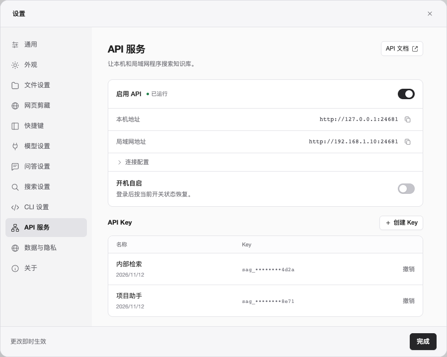
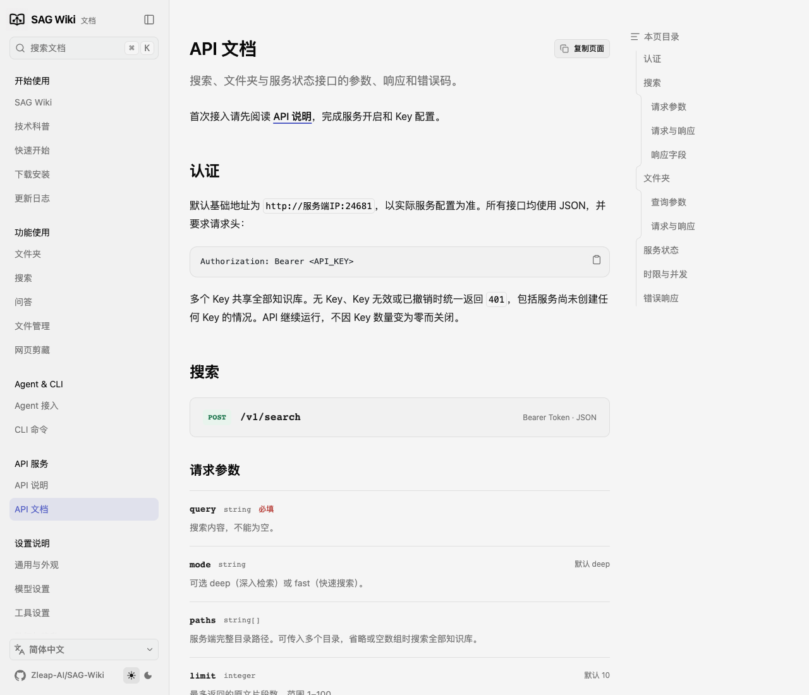
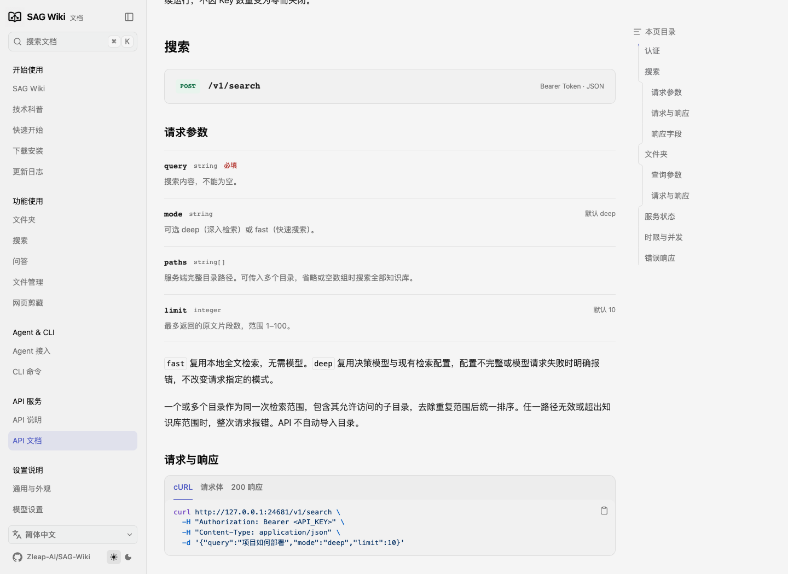
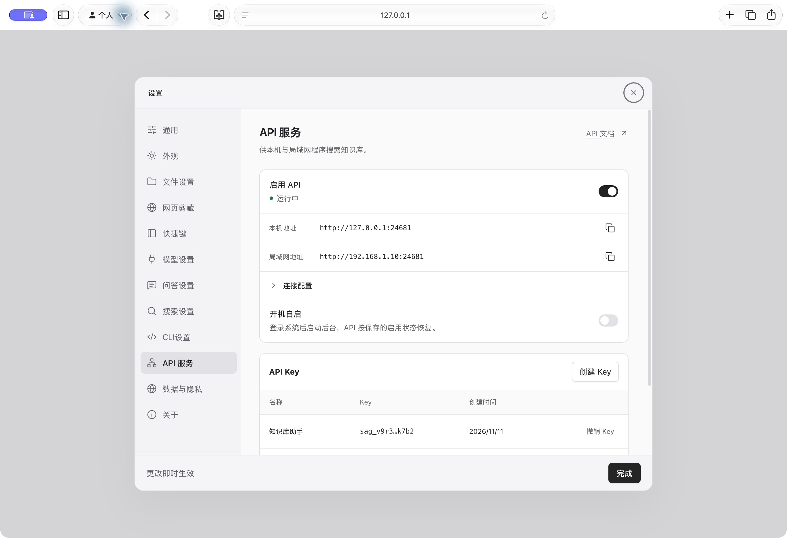

# SAG CLI 与 HTTP API 设计

日期：2026-11-12

状态：已按本文实现 API 服务、CLI 管理和桌面设置。本文保留设计约定，具体实现与验证结果见第 17 节。

## 1. 目标与范围

用户仅安装独立 CLI，就能在本机或服务器上开启 HTTP API，供本机和局域网中的其他程序搜索知识库。桌面端作为可选操作入口，与 CLI 共用服务、知识库、模型配置和 API 设置。

第一版包含：

- 快速搜索、深入检索，通过请求参数选择，默认深入检索。
- 按原文片段返回结果，同步等待搜索完成。
- 查询全部根文件夹，按层级浏览子文件夹。
- 使用服务端完整路径选择搜索目录，一次请求支持多个目录。
- 多个 API Key，全部共享同一知识库，不区分目录权限。
- CLI 管理 API 启停、Key 和开机自启。
- 桌面设置管理 API 开关、监听地址、端口、Key 和开机自启。
- Linux ARM64、x86_64 的独立 CLI/API 支持，以 Ubuntu/Debian 验证，优先通过 npm 安装。

本轮不增加问答、回答模型配置、文件上传、独立全文读取接口、远程知识库管理、目录别名、公开 MCP 服务、Docker 镜像、搜索分页或异步任务接口。

现有 CLI 的自然语言检索、目录选择、正则及固定文字匹配行为保持不变。CLI 自然语言检索仍默认深入检索；本轮不为 CLI 新增快速搜索或多目录搜索参数。新增的 CLI 能力限于 API 管理、开机自启和必要的 Linux 适配。

## 2. 现有实现与复用原则

当前桌面端和 CLI 共用 SAG 后台服务。后台负责数据库、文件监听、索引、模型请求及检索。内置 MCP 工具也在后台内复用这些能力。

目前 CLI 的自然语言检索返回片段记录，每条包含路径、标题、起止行号和原文。同一文件可以返回多条不连续片段，重叠片段会合并。桌面端另外将片段按文件归组展示。

当前 CLI 的 `sag config` 配置决策模型，首次默认地址为 `https://api.zleap.com/v1`，模型为 `Zev-1`；已有配置继续复用。快速搜索无需决策模型，深入检索需要可用的决策模型配置。

建议的运行关系：

```text
桌面端 ───────┐
现有 CLI ─────┼── SAG 后台 ── 共用知识库、索引和检索实现
HTTP API ─────┘
```

HTTP API 直接调用现有后台操作，不为每个 HTTP 请求启动 CLI 子进程，也不复制检索算法。

建议在现有后台进程中增加独立的 HTTP 监听入口，复用同一个服务实例和任务调度。原有本机 RPC 保持现有协议与认证；对外 HTTP 入口使用独立的 API Key，只开放本文规定的业务接口。

复用时必须核对：

- HTTP、桌面端和 CLI 的耗时任务使用同一个并发控制，不分别创建三个“20 个任务”的额度。
- 快速搜索复用现有本地全文检索；深入检索复用现有 SAG2 与决策模型检索。
- 深入检索只获取检索结果，不触发搜索总结或问答生成，不要求配置回答模型。
- 不通过修改现有 CLI 的搜索命令来实现 HTTP 多目录检索。
- 不顺带调整现有排序、扩展轮数、模型供应商、索引规则或数据库中的原文。

## 3. 网络入口与默认配置

| 项目 | 约定 |
| --- | --- |
| 首次安装后的 API 状态 | 默认关闭，需通过 CLI 或桌面设置开启 |
| 开启后的访问范围 | 本机和局域网一起开放 |
| 默认监听地址 | 建议 `0.0.0.0`，监听所有 IPv4 网卡 |
| 默认端口 | 建议 `24681`，可修改 |
| 传输方式 | 第一版使用 HTTP；不内置证书管理 |
| 认证 | `Authorization: Bearer <API_KEY>` |
| API 路径前缀 | `/v1` |
| 数据格式 | UTF-8 JSON |
| 默认搜索模式 | `deep` |
| 默认返回数量 | 10 个片段，上限 100 |
| 浏览器跨域访问 | 默认关闭 |

监听 `0.0.0.0` 不按私有网段过滤地址；具体可达范围由主机网络和防火墙决定。程序不自动修改系统防火墙。设置中显示可供复制的本机地址和局域网地址，不把 `0.0.0.0` 当作调用地址。

第一版保持跨域关闭，不默认返回允许跨域访问的响应头。普通本机、局域网程序调用不受影响；网页可以通过自己的业务后端调用。浏览器直接跨域调用的允许来源配置，可在明确需求后补充。跨域设置不替代 API Key 认证。

## 4. API 启停与持久状态

区分以下状态：

- **启用状态**：用户是否希望提供 API，保存到当前 SAG 数据目录。
- **运行状态**：HTTP 端口是否已经实际启动监听。
- **开机自启状态**：是否已注册平台对应的自动启动机制。

| 操作或事件 | 行为 |
| --- | --- |
| `sag api start` | 启动或连接 SAG 后台，启动 HTTP 监听，成功后保存启用状态 |
| `sag api stop` | 保存关闭状态，停止接收 API 请求，取消 API 搜索，关闭 HTTP 监听 |
| 关闭启动命令所在终端 | API 和后台继续运行 |
| 打开桌面端 | 启动或连接后台；根据已保存的 API 启用状态决定是否监听 HTTP |
| 手动关闭 API 后再次打开桌面端 | API 保持关闭 |
| 关闭或退出桌面端 | 已运行的后台和 API 继续运行 |
| 没有有效 API Key | HTTP 监听继续运行，业务请求返回 `401 未授权` |
| 撤销最后一个 API Key | 取消该 Key 的搜索；API 监听和启用状态保持不变 |
| 端口被占用或监听失败 | 明确报告错误，不静默改用其他端口 |
| 已保存启用状态，但自动恢复监听失败 | 显示“已启用、未运行”及错误原因，不假报运行成功 |
| API 已在相同地址和端口运行时再次 start | 返回当前状态，不创建第二个监听实例 |

API 关闭只影响 API 请求，不停止后台索引、桌面端或普通 CLI 的任务。`sag service stop` 仍表示停止整个共享后台，届时 HTTP 监听也会停止；该操作与 `sag api stop` 的含义需要在帮助中分清。

修改监听地址或端口前先关闭 API，再按新配置开启，避免无提示地中断正在执行的请求。启用状态、监听配置及 Key 记录必须只有一份，CLI 与桌面设置的修改即时同步。

## 5. API Key

### 5.1 权限与认证

- 可以创建多个 Key，分别命名和撤销。
- 所有 Key 权限相同，可以搜索全部已加入知识库的资料，并浏览相应目录。
- 默认长期有效，直到手动撤销；本轮不增加到期续期机制。
- 搜索、文件夹列表、HTTP 状态接口均要求有效 Key。
- 不接受通过 URL 查询参数传递 Key。
- 无 Key、Key 无效或已撤销，统一返回 `401` 和错误码 `unauthorized`。
- 没有任何有效 Key 时，API 可以启动并继续监听，任何业务请求都返回未授权。
- SAG 本机内部 RPC 的连接令牌与 HTTP API Key 分开管理。

### 5.2 创建、展示和撤销

- 创建时返回完整 Key，之后列表只展示 Key ID、名称、部分标识和创建时间。
- 完整 Key 只在创建时显示一次，使用者自行保存。
- 建议使用足够随机的 Key，服务端保存校验摘要，避免明文存储完整 Key。
- Key 记录和 API 配置使用当前用户私有文件权限，沿用项目现有的平台权限处理。
- 运行日志、错误响应和配置输出不包含完整 Key。
- 撤销立即阻止新请求，并取消该 Key 仍在执行或等待的 API 搜索。
- 撤销某个 Key 不影响其他 Key、桌面端或普通 CLI 的任务。
- 已经完成并发出的响应不回收；尚未完成的搜索取消后不再正常返回检索结果。
- 撤销最后一个 Key 不自动关闭 API，也不改变开机自启或启用状态。

本机 CLI 和桌面设置通过现有本机通信与操作系统账户权限管理 Key，无需用户先持有 HTTP API Key。HTTP 不提供 Key 创建、撤销或其他管理接口。

## 6. HTTP 接口

以下字段名、命令拼写和错误码为建议规范；已确认的模式、范围、超时、权限及生命周期规则必须保持一致。

命名约定：决策模型相关的参数、JSON 字段、配置项和错误码统一使用 `decision`，中文称为“决策模型”。例如 `decision_configured`、`decision_not_configured`、`decision_request_failed`。供应商实际模型 ID（如 `Zev-1`）保持原值。

### 6.1 `POST /v1/search`

请求示例：

```json
{
  "query": "项目如何部署",
  "mode": "deep",
  "paths": [
    "/data/项目资料",
    "/data/技术文档/部署指南"
  ],
  "limit": 10
}
```

| 字段 | 类型 | 规则 |
| --- | --- | --- |
| `query` | 字符串 | 必填，去除首尾空白后不能为空 |
| `mode` | 字符串 | 可选，`fast` 或 `deep`，默认 `deep` |
| `paths` | 字符串数组 | 可选，服务端的完整目录路径；省略或空数组表示全部知识库 |
| `limit` | 整数 | 可选，默认 10，范围 1–100，表示最多返回的原文片段数 |

第一版不提供延长服务端 30/60 秒时限的请求参数。调用方可以设置更短的自身 HTTP 超时，断开后服务端取消相应搜索。

搜索规则：

1. `fast` 使用已有本地全文检索，无需配置模型。
2. `deep` 使用已有决策模型和检索参数；模型未配置或调用失败时返回明确错误，保持调用方选择的模式。
3. 单目录搜索包含其允许访问的子目录；多个目录作为同一次检索的范围，统一排序返回。
4. 多目录合并范围后去除重复范围和重复片段，不能对每个目录分别取 `limit` 后简单拼接。
5. 同一个文件可返回多个不连续片段，重叠原文范围按原有规则合并。
6. 无匹配是成功请求，返回空的 `results` 数组。
7. 文件夹正在索引时，可以返回现有索引中的内容；搜索响应不增加“索引进行中”、部分索引警告或相似标记。
8. 本轮不分页，不返回任务编号，不生成总结或回答，不要求问答模型。

响应示例：

```json
{
  "request_id": "example-request",
  "mode": "deep",
  "elapsed_ms": 1820,
  "results": [
    {
      "path": "/data/技术文档/部署指南/发布流程.md",
      "heading": "部署步骤",
      "start_line": 12,
      "end_line": 18,
      "content": "部署前先检查配置，再执行发布命令。"
    }
  ],
  "truncated": false
}
```

响应以原文片段为单位，路径使用服务端完整路径。原文位置应沿用现有索引与 CLI 的定位语义；PDF、Office 等转换文档必须说明行号对应转换后的可检索正文，不能把正文行号解释为原始 PDF 页码。

`elapsed_ms` 包含排队和服务端执行时间。正常按 `limit` 选取前若干结果不等于发生正文截断。若已有协议的响应大小边界导致减少返回结果，应明确设置 `truncated`，不把大小限制解释为没有匹配；不静默裁切单个片段的原文。

### 6.2 `GET /v1/folders`

不传 `path` 时，列出全部已加入知识库的根文件夹：

```json
{
  "folders": [
    {"name": "项目资料", "path": "/data/项目资料"},
    {"name": "技术文档", "path": "/data/技术文档"}
  ]
}
```

传入 `path` 时，只列出该目录的直接子文件夹，例如：

```text
GET /v1/folders?path=<经过URL编码的服务端完整路径>
```

约定：

- 根文件夹一次列全；子文件夹按层级读取，不一次返回整棵目录树。
- 仅返回文件夹，不在该接口夹带文件正文或文件下载能力。
- 每项包含显示名称和可直接用于后续请求的完整路径。
- 同名文件夹通过完整路径区分，不增加别名或根目录 ID。
- 没有根文件夹或没有直接子文件夹时，返回空数组。
- 目录浏览沿用现有授权、可见性、忽略及排除规则，不绕过已移除目录限制。
- 查询参数必须 URL 编码，包含中文、空格和 Windows 路径时也适用。

### 6.3 `GET /v1/status`

用于已授权的调用程序检查服务是否可用，建议返回实际程序版本、API 运行状态、决策模型是否配置及根文件夹的索引状态。

```json
{
  "version": "<实际程序版本>",
  "api": {"enabled": true, "running": true},
  "decision_configured": true,
  "roots": [
    {"path": "/data/项目资料", "status": "ready", "indexed_files": 128}
  ]
}
```

状态接口仍要求 API Key，不返回模型密钥、API Key 摘要、内部连接令牌或整个配置文件。搜索响应不显示索引进行标记，不影响调用方主动通过状态接口查看实际索引状态。

API 关闭时，HTTP 状态接口也不可用；此时使用本机 `sag api status` 或桌面设置查看状态。

## 7. 路径与数据范围

- 路径全部属于运行 SAG 服务的电脑，不解释为调用方电脑上的路径。
- 使用完整路径，不支持 `根文件夹/子文件夹` 形式的别名路径，也不相对于 API 进程工作目录解释。
- 可指定已加入的根目录，也可指定其中允许访问的子目录。
- 路径格式、存在性、目录类型、授权范围在 HTTP 输入边界校验。
- 多个路径中任意一项无效时，整次请求返回明确错误，不静默忽略该项后扩大或缩小搜索范围。
- 请求目录列表中已有父目录时，消除重复子目录范围，避免重复搜索。
- 路径规范化和符号链接授权沿用现有核心实现，不允许通过 `..` 或符号链接越过知识库范围。
- API 请求不自动导入新目录，也不修改文件夹索引设置。
- 不传搜索范围表示全部现有知识库；知识库为空时返回空结果。

## 8. 并发、等待、超时与取消

### 8.1 并发

沿用后台现有的 20 个耗时任务并发额度，供 API、桌面端和普通 CLI 共同使用。达到上限后等待空位，不另加“API 最多 4 个”的限制，不因为排队就立即返回 `429`。

该额度用于搜索、问答及现有部分探索任务。目录、状态等轻量操作不占用搜索额度。现有 RPC 的 64 个连接和单连接 32 个请求任务属于协议层边界，不能混同于 20 个搜索任务，也不能因新增 HTTP 而扩大原有搜索总额度。

上限不会按 CPU 核数自动变化。验证时分别观察快速、深入检索以及与索引同时运行时的 CPU、内存、磁盘和决策模型请求情况；第一版不增加自动调节算法。

### 8.2 整次请求时限

| 模式 | 时限 |
| --- | ---: |
| `fast` | 30 秒 |
| `deep` | 60 秒 |

同一个截止时间覆盖该次请求在服务端的处理、排队和检索，不在取得并发额度后重新计时。排队阶段也可能耗尽时限，届时直接取消，不再开始搜索。

时限针对服务端完成请求处理；调用方仍需为网络传输设置自身 HTTP 超时。示例调用可将客户端总超时略高于服务端时限。

这些时限只作用于新增 HTTP API，不修改现有 CLI、桌面端和后台其他功能的超时配置。

### 8.3 取消归属

- 每个 API 搜索都有独立请求 ID、Key 归属和取消信号。
- 超时、调用方断开连接、所属 Key 被撤销或 API 被关闭时，取消该请求。
- 停止 API 取消全部 API 搜索，包括正在执行和排队等待的请求。
- 取消释放其占用的并发资源，不取消后台索引、桌面请求、普通 CLI 或其他 Key 的独立请求。
- 取消后在现有任务可取消的位置退出，并终止可终止的本地网络等待；不把停止本地等待等同于外部模型服务已经停止计算。

## 9. 错误规范

建议统一错误结构：

```json
{
  "request_id": "example-request",
  "error": {"code": "unauthorized", "message": "未授权"}
}
```

| HTTP 状态 | 建议错误码 | 情况 |
| --- | --- | --- |
| 400 | `invalid_request` | JSON、必填参数、类型或数值范围不正确 |
| 400 | `invalid_path` | 不是完整目录路径或路径类型不正确 |
| 401 | `unauthorized` | 缺少 Key、Key 无效或已撤销，包括没有任何有效 Key |
| 403 | `path_not_allowed` | 路径不在允许访问的知识库范围内 |
| 404 | `directory_not_found` | 指定目录不存在或已移除 |
| 404 | `not_found` | 接口不存在 |
| 405 | `method_not_allowed` | HTTP 方法不受支持 |
| 409 | `decision_not_configured` | 深入检索所需的决策模型未配置 |
| 413 | `request_too_large` | HTTP 请求超过与现有协议相容的输入大小边界 |
| 502 | `decision_request_failed` | 决策模型调用失败，保留可公开的原因 |
| 503 | `api_stopped` | API 关闭导致仍未完成的请求取消，连接可回应时使用 |
| 504 | `search_timeout` | 整次搜索请求超时，包括等待并发额度阶段 |
| 500 | `internal_error` | 其他内部错误，不以空结果代替失败 |

没有匹配返回 `200` 和空数组。深入检索失败保持失败，不自动改为快速搜索。上游模型的认证错误不能误报成调用程序的 API Key 未授权。

撤销 Key 导致取消的请求在连接仍可回应时返回未授权；调用方已经断开连接时不再尝试交付结果。错误信息和日志不得暴露密钥或完整认证请求头。

## 10. CLI 管理命令

以下是新增命令的建议拼写，现阶段尚不可作为已经实现的使用说明。

| 命令 | 作用 |
| --- | --- |
| `sag api start` | 按已保存配置开启 API，默认同时提供本机和局域网访问 |
| `sag api start --host HOST --port PORT` | 使用指定监听地址和端口开启，并在成功后保存配置 |
| `sag api stop` | 关闭 API，保存关闭状态，取消 API 请求，保留后台 |
| `sag api status` | 查看启用、实际运行、地址、端口、Key 数量和自启状态 |
| `sag api status --json` | 以 JSON 输出状态，便于自动化检查 |
| `sag api key create --name NAME` | 创建并命名 Key，完整显示一次 |
| `sag api key list` | 列出 Key 元数据及部分标识 |
| `sag api key list --json` | 以 JSON 输出 Key 元数据 |
| `sag api key revoke KEY_ID` | 撤销指定 Key，取消其 API 搜索，保持 API 监听 |
| `sag api autostart enable` | 注册并开启平台自启机制，不改变 API 启用状态 |
| `sag api autostart disable` | 关闭自启机制，不中断当前正在运行的 API |
| `sag api autostart status` | 查询实际自启注册状态 |

补充约定：

- API 状态查询不会为了查看状态而自动启动后台或开启 API。
- 已运行时指定不同监听配置，提示先停止再开启，不静默忽略参数或自动中断请求。
- API 允许无 Key 启动；CLI 输出运行地址，并明确提示请求需要有效 Key。
- Key 创建、撤销即时生效，不要求重启 API。
- 不在命令参数、自动启动注册文件中写入完整 Key。
- 原有 `sag config`、`sag add`、`sag list`、`sag check`、`sag remove`、`sag service` 继续沿用现有行为。

目标首次使用流程：

```bash
npm install -g @zleap-ai/sag

sag config
sag add "/data/资料"
sag api key create --name "业务程序A"
sag api start

# 需要开机自启时再显式执行
sag api autostart enable
```

## 11. 桌面设置

已选定 **A 方案：纵向分组、单页设置**。在设置侧栏的 CLI 设置下方增加“API 服务”，复用现有设置窗口的宽度、侧栏、灰白配色、字体和控件样式。

页面从上到下组织为：

| 区域 | 布局与内容 |
| --- | --- |
| 页头 | 左侧标题“API 服务”和一行用途说明；右上角固定“API 文档”入口 |
| 服务分组 | 首行为“启用 API”、实际运行状态和开关；随后为本机地址、局域网地址，各带复制按钮 |
| 连接配置 | 在服务分组内默认折叠；展开后显示监听地址与端口输入框，API 运行时只读，关闭后可修改 |
| 开机自启 | 放在服务分组底部，使用独立开关，根据系统显示登录启动或开机启动的含义 |
| API Key | 独立分组，标题右侧“创建 Key”；表格展示名称、创建时间、部分 Key 标识和“撤销”操作 |
| 调用示例 | 默认折叠，展开后提供最小搜索请求和复制按钮，不带入真实 Key |
| 窗口底部 | 左侧“更改即时生效”，右侧“完成”；API 页面不使用统一“保存设置”操作 |



上图使用演示数据，表示选定布局，不表示功能已经实现。原型默认展示已运行状态，便于查看完整界面；正式产品首次安装时 API 仍默认关闭。

界面状态和交互要求：

- API 启用开关，并显示实际运行状态和失败原因。
- 监听地址、端口，以及可复制的本机和局域网调用地址。
- Key 创建、名称与部分标识列表、单独撤销；创建时展示完整 Key 一次。
- 开机自启开关，按平台实际能力说明生效时机。
- 可复制的最小调用示例，示例不自动包含完整 Key。
- 所有 API 开关操作同时作用于本机与局域网，不新增两个分别控制的开关。
- “API 文档”入口在 API 关闭、无有效 Key、监听失败时仍可使用。

API 文档入口约定：

- 使用“API 文档”文字和外部链接图标，放在页面右上角，不藏在调用示例或 Key 管理中。
- 文档站侧栏在“Agent & CLI”之后、“设置说明”之前增加独立大类“API 服务”，其中只放“API 说明”和“API 文档”两个选项。
- 正式界面通过系统默认浏览器打开文档站的“API 文档”，按界面语言选择 `/zh/docs/api` 或 `/en/docs/api`。
- “API 说明”介绍安装与接入流程、决策模型和调用 Key 的区别、启停、Key 管理、后台运行和自启，提供首次调用示例。
- “API 文档”覆盖认证、搜索模式、目录浏览、多目录请求、返回字段、超时与错误码，作为接口参考。
- 接口使用独立的方法标签与路径标题，参数分行标注类型、必填项和默认值；cURL、请求体与成功响应通过标签切换，示例支持复制。
- 文档属于独立文档站，不依赖本机 API 服务运行，不要求 API Key；链接中不携带 Key、知识库路径或其他私有配置。
- 两页均提供中英文版本，并相互链接；正文按正式使用说明编写，不加入“功能状态”“尚待实现”等提示。
- 上线前验证两页、侧栏分类、跨页链接和搜索结果，确保设置页入口实际可达。
- 当前交互原型在新标签页打开本地文档站的“API 文档”，使用与正式文档站相同的分类结构，原设置页保留当前状态。

| 文档页面 | 中文路径 | 英文路径 |
| --- | --- | --- |
| API 说明 / API overview | `/zh/docs/api-guide` | `/en/docs/api-guide` |
| API 文档 / API reference | `/zh/docs/api` | `/en/docs/api` |





Key 创建使用居中弹窗：先填写名称，成功后展示一次完整 Key 与复制按钮，提示关闭后不可再次查看，底部使用“我已保存”。关闭弹窗后列表只保留部分标识。撤销使用确认弹窗，并说明会取消该 Key 的搜索。

无有效 Key 时，在 Key 分组附近显示简短的“请求将返回未授权（401）”提示。服务运行状态继续显示实际状态，Key 为空不自动关闭 API。地址、Key 复制后给出短暂反馈，不改变服务配置。

启停、Key 管理和自启注册作为独立即时操作，不依赖普通设置页底部的统一保存按钮。CLI 修改之后，桌面设置刷新为实际状态；桌面修改之后，CLI 看到相同状态。

运行时修改地址和端口需先关闭 API。操作失败时显示真实原因，开关和实际状态保持一致。没有有效 Key 时显示认证状态说明，API 开关仍可保持开启；不以 Key 数量隐式修改开关。

界面保持简洁，不增加统计面板、调用排行或无必要的次级标签。

## 12. 开机自启

| 平台 | 已确认行为 |
| --- | --- |
| Linux | 用户显式开启后，服务器重启无需登录即可运行 |
| macOS | 用户显式开启后，用户登录时启动 |
| Windows | 用户显式开启后，用户登录时启动 |

默认不注册自动启动。Linux 建议使用系统服务管理器，macOS、Windows 使用对应的用户登录启动机制。Linux 注册无人登录运行的服务可能需要管理员权限，但实际 SAG 进程使用配置时选定的普通用户及其数据目录。

启动记录必须固定到正确的用户、SAG 程序位置和数据目录，保持模型配置、API Key、根文件夹和现有知识库一致。不能因通过管理员命令注册而切换到另一份管理员知识库。

自启与 API 启用状态独立：

- 开启自启不会自动把已关闭的 API 打开。
- `sag api stop` 不卸载自启注册，但保存 API 关闭状态；下次自动启动后台时，API 仍关闭。
- 关闭自启不停止当前正在运行的后台或 API。
- 无 Key 不阻止自动启动 HTTP 监听；业务请求持续返回未授权。

## 13. Linux CLI 与 npm 交付

- 目标架构为 Linux ARM64、x86_64；本轮不包含 32 位架构。
- Linux 只提供 CLI 和后台/API，不要求安装桌面端或图形环境。
- 以 `npm install -g @zleap-ai/sag` 作为主要安装入口。
- 服务器需有 Node.js/npm；发布包提供对应架构的原生程序，用户安装时无需 Rust 编译。
- 保持 npm 安装、升级、卸载与现有 CLI 归属规则一致，不额外创建相互冲突的 CLI 副本。
- 发布流程补齐两个 Linux 架构的构建、真实服务测试及 npm 包装入检查。
- 使用 npm 安装后的实际入口验证启动、重连、Key、请求、取消和自启，不只验证编译产物。
- Ubuntu/Debian 的具体测试版本和最低运行库要求在 Linux 构建实施时明确记录，不把“可交叉编译”当作已验证运行支持。
- 不在本轮制作 Docker 镜像或容器管理命令。

当前设计不指定功能发布版本。只有 Linux 构建与运行验证通过、对应程序实际进入发布包后，文档才能宣称 npm 安装已经支持该平台。

## 14. 调用示例

以下为设计完成后的目标调用形式。示例 Key 使用环境变量占位，不包含真实凭据。

```bash
export SAG_API_URL='http://192.168.1.10:24681'
export SAG_API_KEY='<替换为创建时保存的API Key>'

# 列出全部根文件夹
curl --fail-with-body \
  -H "Authorization: Bearer $SAG_API_KEY" \
  "$SAG_API_URL/v1/folders"

# 浏览直接子文件夹；中文、空格等由curl编码
curl --fail-with-body --get \
  -H "Authorization: Bearer $SAG_API_KEY" \
  --data-urlencode 'path=/data/项目资料' \
  "$SAG_API_URL/v1/folders"

# 同步深入检索；服务端整次请求最多60秒
curl --fail-with-body --max-time 65 \
  -H "Authorization: Bearer $SAG_API_KEY" \
  -H 'Content-Type: application/json' \
  -d '{"query":"项目如何部署","mode":"deep","paths":["/data/项目资料","/data/技术文档/部署指南"],"limit":10}' \
  "$SAG_API_URL/v1/search"

# 切换为快速搜索，无需决策模型
curl --fail-with-body --max-time 35 \
  -H "Authorization: Bearer $SAG_API_KEY" \
  -H 'Content-Type: application/json' \
  -d '{"query":"部署","mode":"fast","limit":10}' \
  "$SAG_API_URL/v1/search"
```

## 15. 实施与验证顺序

1. 固定现有 CLI、桌面搜索、目录授权和服务生命周期的回归检查。
2. 增加 API 持久配置、Key 管理、独立 HTTP 监听和认证入口。
3. 接入现有检索，复用统一并发额度，完成范围合并、结果转换及整次请求截止时间。
4. 实现按请求、Key 和 API 入口区分的取消；保持非 API 任务独立。
5. 增加 CLI 管理命令及桌面设置，验证两者共用状态。
6. 增加平台自启；验证同一用户和数据目录、终端关闭后持续运行及重启恢复。
7. 补齐 Linux 两个架构的构建、npm 包及 Ubuntu/Debian 运行验证。
8. 在实际实现完成后同步中英文使用文档、API 参考、Linux 安装说明和相关截图，并运行文档站构建、页面、链接和搜索检查。

HTTP 解析库、传输层大小边界和 Linux 发行版基线属于实现前需要核对的工程细节，应优先使用标准 HTTP 组件与项目已有协议约束，不临时手写完整 HTTP 协议解析或引入第二套检索实现。

## 16. 验收标准

| 项目 | 必须验证的结果 |
| --- | --- |
| 无桌面运行 | 仅安装 CLI 可导入目录、配置决策模型、开启 API 并完成搜索 |
| 网络访问 | 同一监听同时可由本机与另一台局域网电脑访问 |
| API 默认关闭 | 首次安装后未经显式启用，不开放 API |
| 无 Key | API 可开启且保持运行，三个业务接口均返回401 |
| 多 Key | 多个 Key 各自可调用，列表不显示完整 Key |
| 撤销 Key | 新请求未授权，其正在执行和排队的搜索取消，其他 Key 不受影响 |
| 撤销最后一个 Key | API 仍监听，启用状态不变，后续请求均未授权 |
| 模式选择 | 默认深入；快速无需模型；深入复用决策模型，失败时明确报错 |
| 多目录 | 根目录、子目录和多目录均可搜索；结果统一排序，重叠范围不重复返回 |
| 路径错误 | 无效或越权路径明确报错，不能静默遗漏某个目录后继续 |
| 目录列表 | 根目录一次列全；子文件夹仅返回一层；完整路径可用于搜索 |
| 结果单位 | 按原文片段返回，标题、正文和位置对应，同文件可有多条记录 |
| 返回数量 | 默认10、最多100；无匹配返回成功空数组；响应大小截断明确标记 |
| 索引进行中 | 可查询已有内容，搜索响应没有额外索引进行标记 |
| 总并发 | API与桌面、CLI的耗时任务合计遵守现有20个额度，其余等待 |
| 整次超时 | 排队与执行合计快速30秒、深入60秒，取得执行额度后不重置计时 |
| 调用方断开 | 取消对应API搜索，其他调用继续 |
| 停止API | API请求取消、端口关闭，后台索引及非API任务继续 |
| 状态持久化 | 手动关闭API后重新打开桌面仍关闭；已启用时打开桌面自动恢复API |
| 终端关闭 | 关闭终端后API继续提供服务 |
| 桌面设置 | 启停、地址端口、Key与自启操作和CLI一致，失败明确显示 |
| 选定布局 | 使用 A 方案纵向分组，复用现有设置样式，连接配置与调用示例默认折叠 |
| API文档入口 | 页头右侧可见；API关闭或无Key仍可打开；按语言跳转文档站API文档，不携带私有信息 |
| 文档站API服务分类 | 位于Agent & CLI之后、设置说明之前，包含API说明和API文档；中英文导航、页面、链接和搜索一致 |
| 开机自启 | 默认关闭；Linux无需登录运行；macOS/Windows登录后运行；使用同一用户数据 |
| Linux架构 | ARM64、x86_64均验证npm实际安装和运行，不仅通过编译 |
| 兼容性 | 现有CLI检索、单目录选择、匹配模式、桌面和内置MCP行为保持原有约定 |
| 文档 | 实现后中英文页面、API示例、支持平台和截图与已验证行为一致 |

以上为验收标准，已执行的检查与尚需实机验证的项目见下节。


## 17. 实现与验证

日期：2026-11-12。

- HTTP 入口位于 `core/src/http_api.rs`，直接使用共享后台、全文索引及 SAG2 检索。API、CLI 和桌面共用 20 个耗时任务额度。
- API 配置与 Key 校验摘要保存在当前数据目录的 `http-api.json`，使用当前用户私有权限。完整 Key 只在创建时返回。
- CLI 提供 `sag api start/stop/status`、Key 创建/列表/撤销和 `autostart enable/disable/status`。状态查询不启动后台。
- 桌面侧栏在 CLI 设置后增加“API 服务”，启停、连接配置、Key 和自启操作即时生效。界面每 3 秒读取实际状态，文档入口按界面语言打开文档站。
- “清除所有数据”同时关闭 API、撤销 Key 并恢复 API 默认配置。
- Linux CLI 原生程序已按 glibc 2.36 构建，ARM64、x86_64 都已在 Debian 12、Ubuntu 24.04 的临时 Linux 环境中完成 npm 本地包安装与完整 API 调用验证；运行环境未安装 Rust，也未安装桌面端。
- 默认 API 关闭；无 Key、撤销最后一个 Key、停止与重启、配置持久化、根目录与子目录、多目录检索、快速和深入检索、模型失败均已验证。
- 已通过从独立 Linux 网络环境调用主机 HTTP API 的检查。
- JSON 请求体上限 32 KiB、接收时限 30 秒，搜索 JSON 响应上限 512 KiB；搜索问题最多 2000 个字符。文件在检索期间变化返回 `500 internal_error`，模型请求失败返回 `502 decision_request_failed`，均已通过真实请求验证。
- 整次请求超时已实际等待验证：排队包含在快速 30 秒、深入 60 秒内。Key 撤销、调用方断开与 API 停止的取消和并发资源释放已验证。
- 核心测试 476 项通过、8 项原有测试跳过；CLI 原有测试与决策模型接入测试通过；前端测试 737 项通过，桌面/Rust 构建通过。
- 中英文 API 说明、API 文档、CLI、设置与安装页面，以及 API 设置截图已同步。
- 自启使用 macOS LaunchAgent、Windows 用户 Run 注册项、Linux systemd，均绑定当前程序位置和数据目录。未修改本机个人开机自启设置；系统重启后的自动启动以及 Windows 实机运行仍需验证。
- Linux 构建、npm 安装与 API 检查已加入 `.github/workflows/cli-linux.yml`；现有 macOS/Windows CI 增加 HTTP API 调用检查。本地编写 CI 不表示远端工作流已经执行。


