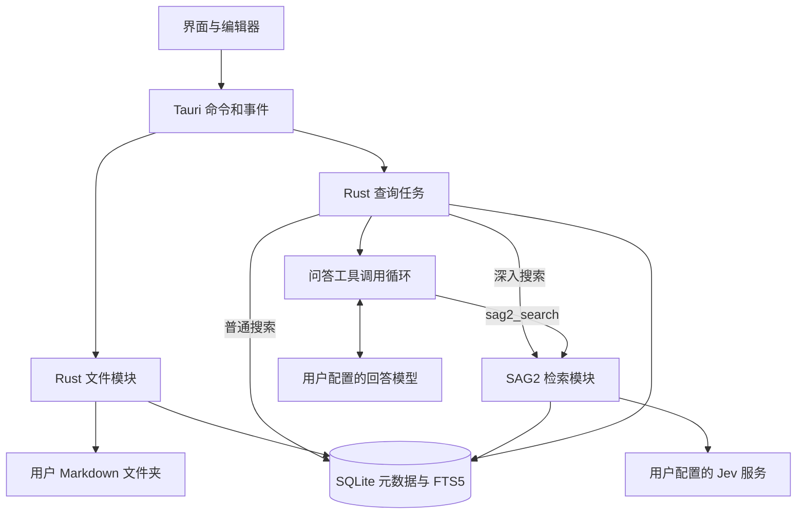

# 客户端实施方案

2026-10-15 搜索更新：搜索框发送按钮前提供“深入／快速”切换，默认深入。快速模式使用本地 BM25，不限制结果总数；每页 20 个文件，按需读取当前页正文，并显示总数与翻页控件；深入模式每轮最多召回 100 个新候选，保留前轮命中参与当前轮排序，按最终相关性展示最多 100 个文件，每页 20 个；翻页复用当前完整排序结果，不重新调用模型。同一文件的多个命中合并展示，不执行问答用的 top-10 截断。问答检索仍使用原有候选数与返回片段设置。切换模式会重新执行已有查询并立即清空旧列表与预览；搜索时在下方显示当前阶段与加载动画，停止或失败分别显示对应状态。

2026-10-15 更新：内置 SAG 改为进程内 MCP，提供 `search`、`list`、`read`、`grep`；按模型独立选择工具。参数与配合说明见《SAG内置MCP工具》，历史实施记录见《更新记录》。

当前实现更新（2026-10-14）：问答先交给回答模型，由模型按需调用 `sag2_search`；SAG2 的 BM25、Jev 与多跳逻辑保留在工具内部。普通搜索使用本地 BM25，点击“深入搜索”才调用 SAG2。查询范围由客户端固定，模型不能扩大。每次回答最多调用三次检索工具，工具结果及最终回答共同使用稳定引用编号。
2026-10-14 更新：用户要求去掉反复出现的系统密码授权。当前实现已改用当前用户目录内的本地密钥文件（macOS 0600），不自动读取或迁移钥匙串。下文原定系统凭据方案已被替代。长段落/代码切分及回答总预算亦以《长文与代码检索验证》为准。

SAG 桌面客户端采用 Tauri 2 + Rust + SQLite FTS5，面向 macOS 和 Windows。前端使用 Svelte + TypeScript，延续本地原型 A 版；保留已有样式和编辑器，把真实文件、索引、检索和模型请求交给 Rust。

产品定位是直接使用已有 Markdown 文件夹。接入阶段只有本地读取、切分和索引，不调用模型、不建立向量索引。查询阶段的普通搜索使用本地 BM25、深入搜索使用 SAG2；问答由回答模型按需调用 SAG2 工具。

## 设计目标与范围

优先级依次为：源文件安全、原型还原、SAG2 一致性、响应速度、安装包与内存。

第一版覆盖真实目录接入、文件树、Markdown 创建和编辑、范围选择、SAG2 搜索、带引用问答、历史管理、模型与检索设置。只交付当前确认的 A 版，不同时维护 B、C 两套页面。

第一版不加入云同步、账户体系、协同编辑、插件系统、向量库、知识图谱、内置大模型、PDF/OCR、后台常驻或手机界面。所有数据默认在本地；配置远程模型后，提问会把问题及所需候选原文发往该服务。

## 技术选择

| 层次 | 选择 | 用途 |
| --- | --- | --- |
| 桌面容器 | Tauri 2 | 系统窗口、目录选择、应用数据目录、打包 |
| 界面 | Svelte + TypeScript + Vite | 按原型拆分页面与状态，构建静态资源 |
| 样式 | 现有 tokens.css 与原型 CSS | 保留黑白配色、字号、圆角和布局，不引入完整 UI 库 |
| 编辑器 | 当前 Tiptap 扩展集合 | 所见即所得编辑，进入编辑页时再加载 |
| 本地逻辑 | Rust | 文件操作、任务调度、索引、SAG2、模型请求 |
| 数据库 | rusqlite + 内置 SQLite，启用 FTS5 | 保证两个系统使用同一 SQLite 版本和全文能力 |
| 文件变化 | notify | 原生监听，合并重复事件，处理外部编辑 |
| 分词 | 与 Demo 对齐的 Jieba Rust 实现及词典 | 文档和查询使用同一分词流程 |
| 模型连接 | reqwest + serde，复用异步执行环境 | Jev 结构化请求，回答模型流式输出与取消 |
| 密钥 | Rust 系统凭据适配 | macOS 钥匙串与 Windows 凭据管理器，选定库后锁版本 |

Svelte 将界面编译成代码，适合以现有 HTML/CSS 为基础拆分局部更新；不采用 SvelteKit 服务端运行时。Vite 和 Node 仅用于开发与打包，成品不依赖用户安装它们。[Svelte 官方说明](https://svelte.dev/docs/svelte/overview)

Tauri 使用系统 WebView，macOS 为 WKWebView、Windows 为 WebView2。主程序不捆绑整套浏览器，成品不运行原型的 Python HTTP 服务，也不开放本地 HTTP 端口。实际进程数量包含系统 WebView，不能把它宣传为绝对单进程。[Tauri 进程模型](https://v2.tauri.app/concept/process-model/)

依赖在技术验证结束后锁定版本，保存 Cargo.lock 与前端锁文件。仅开启必要特性，发布包不含调试符号、源码映射和开发工具。

## 本地模块与数据流

Rust 使用一个核心程序管理任务，不分拆常驻服务。模块先按职责划分，不为每个模块建立单独进程或独立 crate。

| 模块 | 负责 | 不负责 |
| --- | --- | --- |
| 文件 | 目录权限、路径身份、枚举、监听、读取、保存、冲突、系统定位 | 模型请求、界面状态 |
| 索引 | 解析、分词、批量入库、增量更新、重建 | 回答生成 |
| 检索 | 范围过滤、BM25、扩展、Jev 分批与排序 | 文档写入 |
| 对话 | 模型工具调用、回答流、引用、历史 | 直接操作全文表 |
| 配置 | 配置校验、系统凭据、版本迁移 | 保存密钥到界面本地存储 |

界面调用少量明确操作，例如列出子目录、读取文档、保存草稿、启动检索、取消任务、保存配置。命令返回结构化数据；长任务通过带 task_id 的事件报告阶段、数量、答案增量或错误。界面丢弃已取消或已被新任务替代的事件。

每次查询固定配置版本、范围和索引版本。检索过程使用不可变的候选原文快照；网络等待时不持有长数据库事务。后续轮次发现索引版本变化时取消并提示重试，避免混用多个文件版本或阻碍数据库回收。文件浏览不依赖模型连接。

## 数据存储

源 .md 保留原目录。SQLite 位于 Tauri 提供的系统应用数据目录，不放进用户笔记目录或软件安装目录。

| 数据 | 建议结构 | 保留原则 |
| --- | --- | --- |
| 接入目录 | roots | 规范路径、显示路径、状态、排除规则 |
| 目录结构 | folders | 父子关系和稳定 ID；按需分页加载到前端 |
| 文档 | documents | 稳定 ID、路径、大小、修改时间、内容哈希、索引状态 |
| 当前内容 | document_versions | 当前索引对应的原文、版本和换行信息；旧版本仅在任务需要时短暂保留 |
| 检索片段 | chunks | 文档版本、顺序、章节、原文范围，避免重复存放整篇原文 |
| 全文索引 | chunk_fts | 标题、章节、正文分词文本，权重 2 / 2 / 1 |
| 对话 | conversations、messages | 标题、消息、范围、模型、时间、状态 |
| 引用 | evidence_snapshots | 只保存实际引用的片段和定位信息，不为每次问答复制整个知识库 |
| 草稿 | drafts | 未提交内容与基准版本；不进入 FTS5 |
| 配置 | settings | 非敏感配置和结构版本；密钥仅保存系统凭据引用 |

SQLite 采用 WAL、单写入队列和少量读连接。按批次提交导入事务，不每个词提交，也不为一次全库导入锁住数据库。文档、片段与全文表在同一事务更新。数据库迁移、分词版本、切分版本分别记录；改变切分参数只重建受影响的索引，不改变源 Markdown。

第一版直接使用参数化 SQL，不引入 ORM、向量扩展或第二套数据库。索引可重建，历史和草稿不可因“重建索引”被删除。元数据校验及数据库迁移失败时明确报错，不自动清空全部应用数据。

## 文件接入与快速索引

目录选择返回后，立即保存接入记录并显示根目录；后台分批枚举。文件树按展开分支加载子项，不把全部文件名和全文一次传给前端。扫描线程与索引队列有容量限制，磁盘读取不阻塞窗口操作。

导入流程为：目录登记 → 枚举文件 → 读取变更文件 → Markdown 分段 → Jieba 分词 → FTS5 批量写入。无需模型 API、Embedding、实体抽取或独立搜索服务。

“文件与编辑”提供导入文件类型勾选项：Markdown、纯文本、代码、配置文件，默认全部启用。取消某类后移除该类已有索引，并忽略后续同类文件变化；重新开启时补建该类索引。其他类型的已有索引保持不变。选择仅影响检索，原文件和文件树浏览保留。

已接入目录中，以 `.` 开头的隐藏子目录默认不参与索引，也不会因文件变化重新加入索引；下次目录校验时清理这些目录已有的索引及失败记录，保留原文件。此规则独立于“显示隐藏文件夹”的浏览开关。用户直接选作知识库根目录的路径按明确选择处理，规则从该根目录的子目录开始应用。

同页提供“重新索引”按钮，按已保存的设置重新校验全部已接入目录的文件内容，只更新发生变化的索引。文件类型、排除目录或切分设置尚未保存时，先提示保存。索引任务进行中禁止重复启动；页面显示当前目录进度、已索引文件总数和可展开的失败原因。重新索引不清空可用索引，不修改原文件或问答记录。

目录扫描未结束时只显示已发现数量；发现总量后才显示有分母的进度。每批成功提交即可检索已索引文件，界面注明索引未完成；不把局部结果标为全库完整结果。完成后显示真实文档数及总耗时。

后续启动先显示本地已知目录和索引，再校验变化。先用修改时间和大小筛选，读取变更候选后比较哈希；不能据此承诺发现所有保留原时间与大小的外部修改。手动重新读取对所选目录重新校验内容。

监听通过 notify 接收系统文件事件（macOS 使用 FSEvents），处理新增、修改、重命名和删除。普通文件事件只读取对应文件；目录新增、移动或删除只处理对应子树，不重新遍历整个根目录。重复路径在 300 ms 内合并，持续写入时每批最长等待 1.5 秒。文件变化通知会重新读取内容并比较哈希，不依赖修改时间和大小；内容未变时不重写片段。删除只清理本地索引，不操作原文件。

单个文件编码不支持或读取失败时，记录文件路径与原因并继续索引其他文件。侧栏显示“SAG · 部分失败”，点击可查看各文件夹的失败路径与原因；问题记录在应用重启后仍保留，文件修复、删除或排除后自动更新。不可用的文件会撤出旧索引，避免返回过期内容。数据库故障、根目录不可用等整体错误仍中止任务并报告，不视为普通文件问题。应用不会为修复编码而改写原文件。

索引时先列出本次需要处理的文件，按已处理数 / 总数显示进度，不另做一遍目录扫描。增量任务只统计变化路径及其中的文件。状态合并为一行，例如“SAG 正在索引（27% 部分失败）”；结束后只保留失败提示，全部成功则隐藏。右侧“×”允许随时隐藏整条状态，包括部分失败；后台任务继续运行，下一轮任务开始时重新显示。超长单行使用稀疏字符位置记录计算引用列号，避免对每个片段重复扫描行首。

文件读取优先使用 BOM 或文件内的编码声明，再识别无声明的旧编码。支持 UTF-8、带 BOM 的 UTF-16LE/BE，以及 GBK/GB18030、Big5、Shift-JIS、Windows-1252 等编码。旧编码自动识别存在歧义，不能保证任意短文本都能正确判断；明确声明的编码无法解码时会报告错误。索引、原文预览和引用使用同一解码结果，引用行列与片段位置保持一致。主动编辑保存时保留原编码、BOM 和换行形式；新字符无法用原编码表示时停止保存，保留原文件。

macOS 客户端通过系统 NSAttributedString 读取 RTF 正文，归入“文本与 RTF”文件类型，不增加常驻进程或转换文件。格式控制码、字体表和文档属性不进入检索正文；索引、SAG 工具、搜索预览和引用共用同一正文。长段落继续按片段长度切分，引用的字节范围、行列基于提取后的 UTF-8 正文，界面明确标注“RTF 正文”。原始 RTF 只读，以原文件哈希检测变化，修改、重命名、删除沿用路径增量更新。RTF 内嵌图片暂不做 OCR，Windows RTF 读取适配尚未实现，读取时明确报错。

启动、重新开启监听、手动重新读取，以及系统明确报告事件丢失时进行目录校验；空闲时阻塞等待事件，不定时扫描全库。根目录不可用时保留已有索引并报告错误。网络挂载目录可能不产生监听事件，仍可手动重新读取。[notify 说明](https://docs.rs/notify/latest/notify/)

目录移除只移除接入关系；不调用磁盘删除。取消仍在进行的扫描或索引，撤销时恢复接入并重新校验。文件路径使用目录组件判断包含关系，不能把 `/notes2` 当成 `/notes` 的子目录；处理 Windows 盘符、大小写和 UNC 路径。符号链接不跨出已选择范围。

## 文档保存

每次打开文档记录磁盘版本、原始字节、换行风格和 BOM。未改动就保存时不重写文件。编辑后保留这些格式，并将改动内容写回原位置。

新文档保存使用排他创建，禁止覆盖同名文件；现有文件保存前复核外部版本，再写同目录临时文件并调用对应平台的替换操作。Windows 文件被占用、只读、无权限和磁盘空间不足需要明确报错。不能先截断源文件再写入。

文件系统和 SQLite 无法共享一次事务：先成功落盘，随后提交索引任务。索引失败时显示“文件已保存，索引更新失败”并允许重试，不能显示“保存失败”诱导用户覆盖或丢弃已写内容。恢复启动时能重新发现尚未索引的已保存文件。

继续使用 Tiptap，但其 Markdown 扩展仍标为早期版本，不能将普通导入导出视为无损保存保证。技术验证必须覆盖 frontmatter、原始 HTML、代码围栏、图片、表格、任务列表和自定义块。未支持的块保存原始内容并提供局部编辑；不能静默删除、改写成空块或执行其中的脚本。[Tiptap Markdown 文档](https://tiptap.dev/docs/editor/markdown)

若当前编辑器无法满足这些保存要求，先完成编辑器适配验证，不在真实文件写入已开放的情况下继续交付。全文阅读模式切换不作为解决办法。

## SAG2 迁移

以 SAG-SQLite-Demo 的 `src/lexical-search.js`、`markdown.js`、`expansion-terms.js`、`name-phrases.js` 和 `ai.js` 为直接参考；用 SAG-Benchmark 的固定样本、原始 Node 结果和 oracle 检查 Rust 实现。

只迁移 bm25-jev-v9 的原文检索路径。Demo 中实体、事项、评测后台和其他策略不纳入运行时。原算法的候选 ID 可以映射到片段 ID，必须保留确定性排序和参考 ID 映射。

### 固定步骤

1. Markdown 按章节和完整句子分段，代码保留完整行；目标默认 512 字符，长句可超过目标，相邻片段保留完整句子重叠；记录原文范围。分词按原实现进行 NFKC、转小写、Jieba 搜索分词和停用词过滤。
2. 原问题词 OR 查询，按 FTS5 BM25 召回，问答默认每轮新候选最多 50，深入搜索固定为 100，列权重为标题 2、章节 2、正文 1。
3. Jev Noul 判断候选对原问题是否提供有效证据，保留全部评分结果，不设置过滤阈值。
4. 选择最多 10 个未扩展片段，从完整原文选词和名称短语，保留原版词频、稀有程度、句内关联和 Jev 权重算法。
5. 扩展时按各扩展项匹配候选，排序表达式为“全部扩展项 OR 原问题词”，按各项名次交替合并并去重。不能替换为单条普通 OR 查询。
6. 把首轮 BM25 前 5 个片段、累计已使用起点和本轮新候选联合评分。公共证据按原版规则组成，直接使用本轮分数。
7. 默认扩展 1 轮，共 2 轮评分；最终保留 10 个片段。没有起点、扩展词或新候选时按原版规则停止。搜索展示文件结果；问答将证据交给回答模型。

当前客户端默认参数是 50 / 10 / 20 / 1 / 10 / 512，依次为候选、起点、扩展词、扩展轮数、返回片段数、切分预算。Demo 函数缺省扩展轮数为 1、扩展词为 80，不能混作同一配置。对齐测试必须显式传参并记录配置。

当前 Jev 请求恢复原版的分批处理：使用 o200k_base 估算及 1024、64 的附加预算，单批累计超过 32000 时先提交已有候选，再开始下一批。该值从原版的 64000 降低，以适配实际服务的请求限制；它不限制整次搜索的累计输入。每批使用完全相同的共享证据、评分标准和原问题，保留所有候选及原文；全部批次完成后再合并评分并执行原有排序和下一轮扩展。若服务明确返回 HTTP 400 / max_tokens_exceeded，只将被拒绝批次的候选分成两半重试，共享证据完整复制，成功批次不重发。单个候选加共享证据超过 32000，或单个候选仍被服务拒绝时，保留明确错误，不裁剪证据。这不是 Jev 官方精确计数器。批次并发上限 20；同一检索轮可包含多次 HTTP 请求，不能将检索轮数当成请求次数。首版前台同时只运行一个用户查询，数据库和界面仍可操作。

这组上下文预算用于所移植版本的请求构造；连接测试也检查所配置服务是否兼容，不能仅凭模型名称认定可用。原文超出预算时报错并说明调整切分或起点数量，不静默截断。临时网络错误按原实现分类与 1、2、4 秒间隔重试，取消时停止等待和后续请求；身份验证、参数错误不重复请求。

FTS5 的 BM25 数值越低匹配越好，与 Jev 分数方向不同，必须分别排序。[SQLite FTS5](https://www.sqlite.org/fts5.html#the_bm25_function)

Rust 与 JavaScript 对字符串长度、排序、正则和浮点累加的行为不同。切分预算保留 UTF-16 计数语义，不能直接用 UTF-8 字节数；名称短语、同分排序、词典和累加顺序通过参考数据锁定。先证明对齐，再优化，不以“使用了 BM25 和 Jev”代替算法一致性。

### 范围与引用

先规范化范围为文档 ID 集合，候选查询在 LIMIT 之前过滤；首轮、扩展轮、起点、公共证据与最终引用均受约束。@ 引用文件按交互规范作为显式并集，额外标记来源，不扩大其他目录候选。

方案决定：首版共用一个 FTS5 索引及全库统计，范围限制候选和证据。这样切换目录不会复制或重建索引。它与“把所选子集单独建库”所得 BM25 统计可能不同，不能声称两者分数相同。原版一致性验收使用相同语料全集；范围验收单独覆盖过滤和数据不泄漏。若以后要求范围内独立统计，应另列需求和性能验证，不能未经验证替换算法。

显式引用文件进入证据候选，超长引用按已索引片段在文件内选取相关段落，不能把整个文件无上限塞进上下文。最终片段数与上下文预算照常生效；引用标签不表示模型已经阅读全篇。

### 模型与错误

Jev 与回答模型分别配置地址、模型、密钥。Jev 走原版结构化评分协议，不假定与 chat/completions 通用；回答模型首版支持 OpenAI 兼容 Chat Completions 和流式响应。提供商原生协议需要另做明确适配。

读取配置后由 Rust 请求模型，界面只接收状态、回答和错误；连接测试使用短测试内容，不发送用户文档。测试分别验证 Jev 结构和回答模型流式能力。密钥输入保存后从界面状态清除，通过系统凭据读取，不回传明文用于回填。

Jev 失败时明确显示检索失败，保留问题供重试，不把关键词命中冒充 SAG2 结果。回答失败可保留已完成的检索证据并重试回答。取消的对话保留为已停止状态，迟到数据不能覆盖新消息。

## 轻量化实施

- 成品只包含一个应用核心、静态界面、编辑器所需扩展、SQLite 和分词所需资源。无 Python、Node、Docker、服务进程或自动模型下载。
- 编辑器及复杂渲染按页面加载；仅渲染可见树行和当前文档，不预加载所有正文与图片。大列表达到性能阈值后使用可见行渲染。
- 候选查询、文件枚举和结果传输分页／分批执行；复用分词器、数据库连接和 HTTP 连接。
- 优先 SQLite 查询完成筛选，不将全库导入 Rust 集合或前端状态再过滤。
- 查询使用有限并发和有界任务队列；配置重建时取消旧任务，避免多份索引同时常驻内存。
- 日志只记录必要状态、时长和数量，采用轮转；默认不保存完整模型请求、原文或密钥。详细算法轨迹用于测试和手动诊断，不为所有历史持久保存全部候选。
- 不使用无限期答案缓存。已有 FTS5 持久化复用；额外缓存必须包含文档版本、范围、模型和参数，不允许旧答案掩盖文件变化。

资源数字均为首轮工程预算，尚未实测。每架构压缩安装包目标不超过 30 MiB（不计 Windows 系统 WebView2），空闲整组应用进程内存目标 macOS 150 MiB、Windows 220 MiB。完整测量条件见《验证与验收》。超预算先定位依赖、重复文本和后台任务，再决定调整预算。

## 权限与文件内容

Tauri capability 只开放实际需要的窗口和系统功能；自定义 Rust 命令仍校验路径与接入目录。不能把插件权限配置当作自定义命令自动受控的保证。[Tauri capabilities](https://v2.tauri.app/security/capabilities/)

文档内容不执行脚本、不打开任意本地协议，不允许原始 HTML 触发系统命令。模型请求只发往用户配置的服务，返回内容视为外部数据。引用与文件定位使用内部文档 ID，不执行模型生成的磁盘路径。

首次保存远程模型配置时明确展示会发送问题及候选片段。后续同一配置正常使用不重复确认。未配置模型时仍可添加、浏览、编辑与索引；问答和 SAG2 搜索提示完成模型配置。

## 跨平台交付

macOS 首发 Apple Silicon，Intel 单独构建并验证后列入支持；Windows 首发 x64。Windows ARM 和移动端不纳入第一版。

macOS 打包 .app/.dmg，发行版签名及公证；Windows 首版采用 NSIS 安装器并签名。测试包与正式签名包分开标识。

Windows 优先使用系统 Evergreen WebView2，缺失时由安装器引导安装；安装包体积统计必须把系统运行时单独列出。完全离线安装需要附带运行时，会增加体积，不能同时承诺极小下载和任何干净系统均可离线安装。[Windows 安装说明](https://v2.tauri.app/distribute/windows-installer/)

正式版首发不增加自动更新后台任务。升级时保留数据目录，数据库迁移先备份历史与配置。目录权限、中文输入、系统缩放、休眠恢复、路径重命名与文件占用从早期就分别在两种系统测试。

## 实施阶段

| 阶段 | 实际产出 | 完成条件 |
| --- | --- | --- |
| 0 技术验证 | 最小 Tauri 双平台窗口，FTS5/Jieba 验证，编辑器保真样本，固定 Jev 响应的 Rust 检索样例 | 真实 WebView 布局可行，Markdown 不丢内容，算法差异有明确结论 |
| 1 桌面界面 | 移植 A 版样式与页面，接入真实窗口、目录选择与状态管理 | 用户已确认交互全部可操作；局部更新不丢焦点 |
| 2 文件与索引 | 真实读取、保存、目录去重、后台索引、监听、移除与撤销 | 在临时目录验证全部文件行为，任何失败不损坏源文件 |
| 3 SAG2 检索 | 分词、BM25、词项扩展、Jev、范围、取消与真实搜索 | 逐轮对齐通过，范围无非授权内容，失败不静默降级 |
| 4 问答与设置 | 模型选择、@ 引用、流式回答、历史、配置及系统凭据 | 重启可恢复配置和历史，引用可定位，追问与中止可用 |
| 5 验收与发布 | 两平台安装包、性能记录、已知限制、迁移和发布说明 | 功能与资源验收通过，签名及安装卸载测试完成 |

按完成条件推进，不给未经双平台实测支持的固定交付日期。阶段 0 是短验证，验证代码直接进入后续实现或删除，不形成第二套长期原型。每个阶段都提供可运行客户端供确认；真实索引或模型尚未接入的阶段明确标注。

## 优先确认的技术风险

| 项目 | 当前判断 | 处理方式 |
| --- | --- | --- |
| Markdown 往返保存 | Tiptap 存在不支持语法的风险 | 阶段 0 建保真样本，补原始块保留，验证前不开正式文件写入 |
| SAG2 Rust 对齐 | 不能由算法名称推定结果一致 | 逐轮固定响应测试，锁分词、排序、提示词和预算 |
| 索引接入速度 | 不受模型网络影响，但仍受磁盘、文件数和分词成本影响 | 两种语料规模实测，目录先显示，队列分批处理 |
| 系统 WebView 差异 | 两系统字体、输入法和窗口行为不同 | 使用相同内容分别截图、键盘操作和缩放测试 |
| 网络目录和休眠 | 文件事件可能不完整 | 明确支持范围，启动与恢复检查、重新读取 |

## 参考实现

本机源码与哈希见《参考源码清单》。核心文件：

- `/Users/jomymac/Desktop/SAG/sites/sag-desktop-prototype/app.js`、`interactions.js`、`settings.js`、`style.css`、`tokens.css`、`editor-entry.js`。
- `/Users/jomymac/Desktop/SAG-SQLite-Demo/src/lexical-search.js`、`markdown.js`、`expansion-terms.js`、`name-phrases.js`、`ai.js`、`db.js`。
- `/Users/jomymac/Desktop/SAG/SAG-Benchmark/tests/scripts/sag2_v9_oracle.json`、`test_sag2.py`。

这些源码用于参考和对照，不把 Demo 的 Node 服务、数据库全部表结构或 Benchmark 的 Python 环境打包进客户端。
